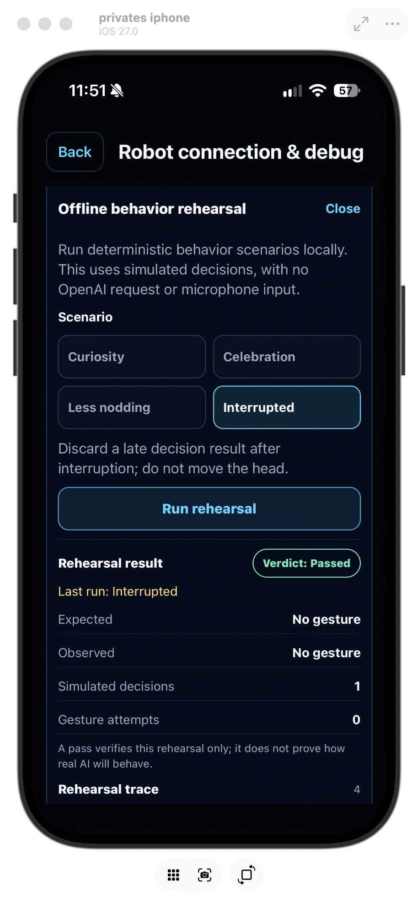

# Behavior-Rehearsal: Brief und Abnahme

Stand: 26. Oktober 2026.

## Brief

Adaptive Entscheidungen sollen ohne physischen Roboter, Mikrofoneingabe oder echte API-Anfrage nachvollziehbar geprüft werden können. Die Rehearsal führt festgelegte Texteingaben durch dieselbe Behavior-Engine und leitet zulässige Kopfgesten ausschließlich an die vorhandene Mock-Verbindung weiter. Sie verändert weder Produktionsmodus und Budget noch gespeicherte Präferenzen. Fahrbefehle, BLE-Zugriff und Netzwerk sind ausgeschlossen.

Abnahmekriterien: Vier Szenarien zeigen das erwartete Verhalten; der Mock-Trace belegt erfolgreiche Kopftelegramme; Unterbrechung, STOP, Quellenwechsel oder ungeeigneter Mock dürfen keine alte Geste fortsetzen oder als bestanden erscheinen; keine Radbewegung und keine API-/BLE-Anfrage. Die endgültige iPhone-Oberfläche muss die Rehearsal auffindbar machen, ohne die vorhandenen Debug- und STOP-Bedienelemente zu verdrängen.

## Ausgangslage und Methode

Als Ausgangsmaterial dienten `src/ui/RobotDebugPanel.tsx` und `src/device-tools/mock-looi-transport.ts`: Der manuelle Roboter-Debugpfad kann bereits Verbindung, Sensorzustände und geschützte Mock-Steuerung nachvollziehbar machen. Das vorherige Geräteprotokoll bestätigt diesen manuellen Mock-Pfad ([iPhone-Mock-Abnahme](iphone-mock-acceptance-2026-10-26.md)). Der Behavior-Pfad hatte dagegen keine manuelle Turn-Eingabe: `BehaviorSettings` bot Modus und Nutzungswerte, während die Laufzeit den Decisions-Client direkt verwendete. Ein spontanes Gespräch oder eine echte Anfrage hätte das Verhalten sichtbar gemacht, aber nicht reproduzierbar oder offline geprüft.

Der wichtigste Engpass war daher die fehlende reproduzierbare Verbindung von Behavior-Engine, sichtbarem Ergebnis und Mock-Aktor. Die Prüfung vergleicht Engine-Ergebnis und Mock-Trace und unterbricht gezielt asynchrone Pfade. Die bestehende injizierbare `decide`-Schnittstelle ermöglicht deterministische Antworten, während die Integration über den echten SDK-/Controllerpfad zeigt, ob Gesten wirklich bis zum Mock-Telegramm gelangen.

## Abgewogene Optionen

| Option | Nutzen und Beleg | Kosten/Risiko | Entscheidung |
|---|---|---|---|
| Weitere manuelle Roboterkontrollen | Mehr Sensor- und Transportabdeckung; der vorhandene Mock-Debugpfad belegt diese Stärke. Erzeugt aber keine Behavior-Entscheidung oder sichtbare Turn-Reaktion. | Geringe Umsetzungskosten, löst die fehlende Ende-zu-Ende-Prüfung nicht. | Nicht gewählt. |
| Live-API-Smoke-Test | Prüft den echten Netzwerkvertrag und Anbieterzugriff. Der vorhandene simulierte HTTP-Test deckt bereits Engine → Client → Antwortvertrag ohne echte API ab. | Benötigt Schlüssel und Netz, kann Kosten verursachen; Ergebnis, Latenz und Verfügbarkeit sind nicht deterministisch. | Separater späterer Integrationscheck, kein Standard-Rehearsal. |
| Isolierte deterministische Rehearsal | Wiederholt reale lokale Behavior-Regeln mit festgelegten Antworten und dem echten Controller-/SDK-/Mock-Ausführungspfad. | Zusätzliche Debugoberfläche und strikte Grenzen gegen Produktionszustand und reale Hardware nötig. | Gewählt, auf Kopfgesten und vier benannte Szenarien beschränkt. |

## Szenarien und Grenzen

- **Curiosity:** gewöhnliche Frage → neugierige Kopfbewegung.
- **Celebration:** positives Ergebnis → sanftes `happy_bob`.
- **Less nodding:** ausdrückliche Stilpräferenz → Policy unterdrückt ein modellseitig vorgeschlagenes Nicken und hält still.
- **Interrupted:** Antwort nach einer Unterbrechung → veraltetes Ergebnis wird verworfen, keine Kopfbewegung.

Die Rehearsal erzeugt einen privaten Engine-Lauf mit simulierten Antworten, ohne Produktionspräferenzen, persistenten Behavior-Zustand oder Produktionsbudget zu ändern. Der Mock-Zugriff prüft Quelle, Verbindung, Laufgeneration und Gültigkeit jeder Geste. Er verwendet nur den bestehenden Kopfbewegungspfad; die Räder bleiben gestoppt. Sensor- und Cliff-Sperren bleiben Aufgabe des Robot-Debug-Mocks und des vorhandenen Safety-Controllers, nicht der semantischen Rehearsal. Das Ergebnis ist kein Beleg für echte API-Qualität, Mikrofon-/Kamerapipeline oder physische Kalibrierung.

Die Debugroute pausiert Mikrofon und Kamera vor dem Anzeigen ihrer Kontrollen. Das verhindert konkurrierende Aufnahme während der Offline-Prüfung und gibt die Geräte für die native iPhone-Bildschirmfreigabe frei. Die Pause gehört nur zum aktuellen Routenfokus; beim Verlassen gelten weiterhin die bestehenden Vordergrund- und Schlafbedingungen für die Wiederaufnahme. Sie ändert keine Berechtigungen oder gespeicherten Einstellungen.

## Evidenz und Abnahme

- `pnpm run ios:check` — PASS.
- `pnpm run ble:lifecycle-test` — PASS.
- Medien-Lifecycle: 18 Tests PASS, einschließlich synchroner Sperre vor Cold-Start, abgebrochenem Erwerb, schlafender Debugpause, Freigabe im Schlaf und Aufwecken während der Pause. Die bisherigen Foreground-/Abort-Prüfungen und die Schlafsperre anderer Roboter-Apps bleiben erhalten.
- `scripts/behavior-rehearsal-mock.test.mjs` integriert die echte Behavior-Engine, den echten Robot-Controller, SDK und Mock-Transport: alle vier Szenarien PASS; erwartete Kopftelegramme (`00 87`, `00 ff 00 87`), keine Radbewegung, kein `fetch`, kein BLE-Import. STOP verhindert verbleibende Kopftelegramme; Quellenwechsel kann keinen PASS liefern. Ergebnis: PASS.
- Finaler nativer iOS-Release-Build einschließlich eingeklapptem Runner und Medienpause: `BUILD SUCCEEDED`; tiefe Signaturprüfung PASS. Update auf dem verbundenen iPhone 16 installiert. Nach Entsperren durch den Nutzer erfolgreich auf der Debugroute gestartet.
- Native Geräteabnahme im Hochformat: alle vier Szenarien zeigen **Passed**. Curiosity: erwarteter und beobachteter `Curious look`, ein Gestenversuch. Celebration: `Happy bob`, ein Gestenversuch. Less nodding: `Hold still`, null Gestenversuche. Interrupted: `No gesture`, null Gestenversuche. Jeweils eine simulierte Entscheidung.
- Medienpause beseitigt den zuvor beobachteten Konflikt mit der nativen Bildschirmfreigabe. Runner startet eingeklappt; Öffnen, Szenariowahl und Start sind bedienbar, Ergebniszeilen passen in die Breite. Nach Ein- und Ausklappen bleibt das letzte Ergebnis erhalten. Eingeklappt sind die manuellen Kontrollen einschließlich STOP sichtbar. STOP zeigt **STOP completed**; der Mock-Trace belegt das Stopptelegramm und die vorherigen Kopftelegramme. Abschließend nur Mock verbunden, keine laufende Probe; Bildschirmfreigabe beendet. Querformat, vergrößerte Systemschrift und VoiceOver wurden in dieser Geräteabnahme nicht erneut geprüft.

Der Erfolg ist durch Software-Integration und die native Bedienprüfung der vier Szenarien belegt. Echte Decisions-Antworten und physische Roboterbewegung bleiben außerhalb dieser Offline-Abnahme.

