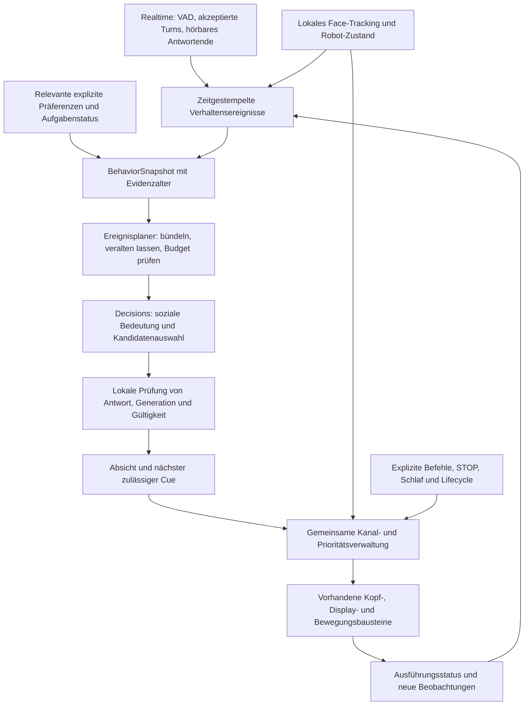

# Decisions als Verhaltensschicht für LOOI

Stand: 25. Oktober 2026. Untersucht wurde der aktuelle Arbeitsbaum auf Commit `09374b5904e5f0efdc89209e8dda0a9a78b35497`, einschließlich bereits vorhandener uncommitteter Änderungen. Dieser Bericht ergänzt die bestehenden Forschungsnotizen. Er ändert keine Produktlogik. Es wurden keine Modellanfragen, Kamerazugriffe oder Roboterbewegungen ausgeführt.

**Frage:** Wo können zusätzliche, günstige KI-Bewertungen LOOIs Bewegung, Verhalten und Entscheidungen glaubwürdiger machen, und wie lässt sich der Nutzen gegenüber der bestehenden Logik nachweisen?

**Empfehlung:** Eine ereignisgesteuerte semantische Verhaltensschicht zwischen Gesprächskontext und vorhandenen Aktionsbausteinen aufbauen. Sie entscheidet über soziale Absicht, passende Reaktion und deren Fortführung. Lokale Zustände, Ressourcenverwaltung und Bewegungsausführung übersetzen diese Absicht in zeitlich zusammenhängendes Verhalten. Der größte kurzfristige Hebel ist die Bedeutung einer Geste im Verlauf einer Interaktion. Ein höherer Takt allein erzeugt diese Bedeutung nicht.

**Drei erste Versuche:** situationsgerechte Gesprächshaltung mit echter Option „kein zusätzlicher Akzent“; Absichten über Unterbrechungen erhalten; Gesicht und Kopf als zusammengehörige Reaktion komponieren. Anschließend bieten gezielte Beobachtung bei Unsicherheit und die Bewertung mehrerer möglicher nächster Handlungen interessante Forschungspfade.

Im Folgenden sind **Bestand** und **dokumentierte API-Fakten** belegt. **Vorschläge**, **Startwerte** und **Erfolgskriterien** sind eigene Entwürfe. Die Natürlichkeit der vorgeschlagenen Verhaltensweisen ist noch nicht gemessen.

## 1. Was das System tatsächlich schon kann

| Bereich | Verifizierter Bestand | Bedeutung für Decisions |
|---|---|---|
| Produktiver Ablauf | Bootstrap registriert Voice als allgemeinen Perceiver und startet Ambient Motion sowie Social Attention separat. `realtime_pcm` ist der Standard. [Bootstrap](/Users/U751725/LOOI/my-looi-ios/src/core/app-bootstrap.ts:59), [Präferenzen](/Users/U751725/LOOI/my-looi-ios/src/store/user.ts:246), [Routing](/Users/U751725/LOOI/my-looi-ios/src/voice/realtime-conversation.ts:1874) | Eine neue Schicht muss an diese produktiven Ereignisse anschließen. |
| Bestehender Decision-Name | `DecisionEngine` ist ein Interface mit `respond/store/remind/ignore`. Die Suche in `src`, `app`, `modules` und `packages` findet keine Implementierung, keinen `.decide()`-Aufruf und keine Decisions-API-Integration. [Interface](/Users/U751725/LOOI/my-looi-ios/src/core/decision-engine.ts:1) | Der Name ist kein vorhandener KI-Verhaltensloop. Ein eigener kleiner Behavior-Bereich ist verständlicher als die Wiederbelebung des alten Gesamtentwurfs. |
| Gespräch | Realtime erzeugt Sprache und verwendet lokale Memory-/Sprachpräferenz-Tools. Server-VAD startet Antworten automatisch mit `create_response: true`; akzeptierte Transkripte kommen separat an. [Konfiguration](/Users/U751725/LOOI/my-looi-ios/src/voice/realtime-config.ts:65), [Turn-Erkennung](/Users/U751725/LOOI/my-looi-ios/src/voice/realtime-config.ts:150), [Transkripte](/Users/U751725/LOOI/my-looi-ios/src/voice/realtime-pcm-conversation.ts:832) | Ein nachgeschalteter Decisions-Call kann den bereits beginnenden Antwortturn nicht zuverlässig vorab freigeben. Zunächst parallele Verhaltenssignale statt eines neuen Gates vor jeder Antwort. |
| Explizite Befehle | Akzeptierte Transkripte durchlaufen lokale physische und visuelle Parser. Physische Treffer unterbrechen gegebenenfalls die Modellantwort. [PCM](/Users/U751725/LOOI/my-looi-ios/src/voice/realtime-pcm-conversation.ts:847), [Absichtsfilter](/Users/U751725/LOOI/my-looi-ios/src/voice/explicit-robot-command.ts:132) | Decisions kann soziale Zweckmäßigkeit bewerten; explizite Steuerung bleibt über den vorhandenen Pfad erreichbar. |
| Ambient Motion | Der Kontext ist `idle/processing/speaking`. Gesten und Richtungen werden teilweise zufällig gewählt. Normaler Idle-Abstand: 5–9 s; „lively“: 2,5–5,5 s. User-Sprache, aktive Driving-Control-Session, Mood, laufende Roboterbewegung und weitere Zustände blockieren neue Ambient-Aktionen. Explizite Kopfaktionen teilen noch keinen allgemeinen Head-Lease. [Intervalle](/Users/U751725/LOOI/my-looi-ios/src/core/ambient-motion.ts:17), [Auswahl](/Users/U751725/LOOI/my-looi-ios/src/core/ambient-motion.ts:153), [Sperren](/Users/U751725/LOOI/my-looi-ios/src/core/ambient-motion.ts:120) | Hier fehlt semantischer Zusammenhang und Aktionshistorie. Der lokale Taktgeber und seine Sperren sind bereits vorhanden. |
| Soziale Aufmerksamkeit | Gesichtspunkt wird geglättet; Kopf und Körper haben stabile-Frame-Schwellen, Totzonen, Hysterese und Cooldowns. Verlorene Gesichter lösen eine begrenzte Suche aus. [Konstanten](/Users/U751725/LOOI/my-looi-ios/src/core/social-attention.ts:19), [Korrekturen](/Users/U751725/LOOI/my-looi-ios/src/core/social-attention.ts:406), [Suche](/Users/U751725/LOOI/my-looi-ios/src/core/social-attention.ts:544) | Feine Nachführung benötigt keine Cloudentscheidung pro Frame. Interessant ist, ob und weshalb LOOI die Aufmerksamkeit halten, lösen oder eine Suche beenden soll. |
| Lokales Sehen | iOS Vision analysiert höchstens etwa alle 120 ms. Das Event enthält Zahl der Gesichter und das Rechteck des größten Gesichts. [Swift](/Users/U751725/LOOI/my-looi-ios/modules/local-face-attention/ios/LocalFaceAttentionModule.swift:150), [Datentyp](/Users/U751725/LOOI/my-looi-ios/modules/local-face-attention/index.ts:4) | Vorhanden sind weder menschliche Blickrichtung noch Ausdruck, Identität, Sprecherzuordnung, Objektpose oder Raumkarte. Ein Detektor-Nichtfund bedeutet nicht, dass der Mensch gegangen ist. |
| Bilder | Explizit angeforderte Einzelbilder werden im Speicher erfasst. Der Pfad hält Bewegung zurück und wartet vor der Aufnahme. [Aufnahme](/Users/U751725/LOOI/my-looi-ios/src/vision/look-here.ts:18) | Ein geeigneter Einstieg für visuelle Qualitätsentscheidungen. Ein fortlaufender semantischer Bildstrom wäre eine zusätzliche Funktion mit geändertem Datenfluss. |
| Ausdruck | Es gibt fünf kurzlebige Character-Moods, Bildschirmblick und lokale Animationen. Kopfgesten umfassen `nod`, `curious`, `happy_bob`, `sleepy`, `thinking`, `speaking_soft`. [Mood](/Users/U751725/LOOI/my-looi-ios/src/character/character-reaction.ts:4), [Gesten](/Users/U751725/LOOI/my-looi-ios/src/device-tools/looi-robot.ts:900) | Ein nutzbarer Wortschatz ist vorhanden. Ausdruck und Bewegungsakzent brauchen einen gemeinsamen Anlass und Lebenszyklus. |
| Physische Charakterreaktionen | `performLooiCharacterReaction` ist vorhanden und wird bereits im Tap-Ablauf für `annoyed/angry` benutzt. [Aufruf](/Users/U751725/LOOI/my-looi-ios/app/(tabs)/index.tsx:170), [Reaktionen](/Users/U751725/LOOI/my-looi-ios/src/device-tools/looi-robot.ts:977) | Es geht um kontextbezogene Auswahl und Koordination vorhandener Makros, nicht um einen bisher völlig unbenutzten Katalog. |
| Gedächtnis | Lokale SQLite-Fakten, Herkunft und begrenzter Gesprächskontext; bei größeren Beständen lokale FTS-Suche. [Retrieval](/Users/U751725/LOOI/my-looi-ios/src/memory/memory-service.ts:48) | Explizite Stilpräferenzen sind nutzbar. Ein wiederaufnehmbarer Aufgabenstatus und verlässliche Zuordnung zu einer gerade sichtbaren Person sind damit noch nicht gegeben. |
| Aktuation | Diskrete Kopfpositionen, Licht und zeitbasierte Fahrt-/Drehbefehle. Kein Positions-/Encoder-Readback im Transportvertrag; `_speed` wird in `moveLooi` nicht verwendet. [SDK](/Users/U751725/LOOI/my-looi-ios/packages/looi-sdk/src/index.ts:25), [Transport](/Users/U751725/LOOI/my-looi-ios/packages/looi-sdk/src/index.ts:98), [Bewegung](/Users/U751725/LOOI/my-looi-ios/src/device-tools/looi-robot.ts:696) | Neue semantische Auswahl ist realistisch; genaue Winkel, kontinuierlich modulierte Geschwindigkeit und gemessene Rückkehr zur Ausgangspose sind dadurch nicht verfügbar. |

Zusätzlich bleibt `FED9 0E` im Decoder ausdrücklich provisorisch. Darauf sollten wir keine neue, scheinbar genaue Distanzwahrnehmung gründen. [Decoder](/Users/U751725/LOOI/my-looi-ios/src/device-tools/fed9-sensors.ts:1) Die native iPhone-/Roboterwirkung wurde für diesen Bericht nicht geprüft.

## 2. Was OpenAI Decisions hierfür tatsächlich liefert

**Dokumentierte Fakten, am 25.10.2026 geprüft:** Der Endpoint liefert mit `gpt-6-luna` typisierte `predicate`, `choice` und `score`-Antworten und akzeptiert Text, JSON und Bilder. Der Create-Vertrag erlaubt 1–400 Fragen. [Create-Referenz](https://developers.openai.com/api/reference/resources/decisions/methods/create) Unabhängige Fragen können gemeinsamen Kontext nutzen; abhängige Schritte benötigen getrennte Requests. Schwellen sind mit gelabelten Anwendungsbeispielen zu bestimmen. Der Guide nennt ungefähr zehnfache Geschwindigkeit gegenüber Responses, aber keine garantierte LOOI-Reaktionszeit. Wahrscheinlichkeiten und `confidence` belegen keine physische Wahrheit. [Offizieller Guide](https://developers.openai.com/api/docs/guides/decisions)

**Schnittstellenfolge:** Audio, Video und File-IDs sind keine unterstützten direkten Decisions-Eingaben. Für den heutigen LOOI-Sprachpfad verwenden wir Transkript und lokale Zustandsereignisse. Die Antwort wählt beziehungsweise bewertet Optionen; Anwendung und Aktoren führen sie aus. Ein frei erzeugter Aktionsplan gehört in einen anderen Vertrag. [Create-Referenz](https://developers.openai.com/api/reference/resources/decisions/methods/create)

**Voice-Integration:** Die native Voice-Anbindung der Dokumentation bezieht sich auf GPT-Live. Unsere Realtime-PCM-Anwendung kann einen separaten Decisions-Client aus eigenen Ereignissen aufrufen. Eine GPT-Live-Migration ist für diesen Vorschlag keine Voraussetzung. [Voice-Guide](https://developers.openai.com/api/docs/guides/decisions-voice), [heutiger Realtime-Vertrag](/Users/U751725/LOOI/my-looi-ios/src/voice/realtime-config.ts:120)

**Preisgrundlage:** Decisions kostet derzeit $0,10 je Million uncacheter Eingabetokens, Output wird nicht berechnet. Cachepreise folgen Standard-Luna: Lesen $0,01/M, 30-Minuten-Schreiben $0,125/M. Regionale/Long-Context-Zuschläge können hinzukommen. [Endpoint-Preise](https://developers.openai.com/api/docs/guides/decisions#pricing-and-availability), [Preistabelle](https://developers.openai.com/api/docs/pricing) Der Decisions-Create-Vertrag unterstützt aktuell nur die Cache-TTL `30m`; längere TTLs anderer Endpoints werden hier nicht vorausgesetzt. [Create-Vertrag](https://developers.openai.com/api/reference/resources/decisions/methods/create)

Für Caching zählt ein exakt gleicher Shared-Input-Prefix mit mindestens 1.024 Tokens; Frageinhalt liegt außerhalb dieses Prefix. Usage enthält Cache-Read/-Write-Tokens bereits in `input_tokens`. Nicht noch einmal addieren. Die Abrechnung des gemeinsamen Kontexts über viele Fragen darf ohne echte Usage-Antwort nicht als kostenlose Vervielfachung vorausgesetzt werden. Unsere Rechnung unten verwendet deshalb gesamte abrechenbare Tokens je Request als explizite Annahme. [Caching und Usage im Guide](https://developers.openai.com/api/docs/guides/decisions#reuse-shared-input-with-prompt-caching)

Projekt-/Organisationslimits und tatsächlicher Kontozugriff sind ungeprüft. Ein niedriger Tokenpreis garantiert weder genug Durchsatz noch niedrige Tail-Latenz. Auf `429`, Ausfälle und langsame Antworten muss die lokale Policy reagieren können. [Limits](https://developers.openai.com/api/docs/guides/rate-limits)

**Jev separat eingeordnet:** Die Typesafe-Dokumentation beschreibt ein eigenes System-One-Angebot mit paralleler Auswertung; die Modellseite nennt $42/Milliarde Inputtokens und kostenlose Outputs. Das sind keine OpenAI-Preise. [Typesafe Einführung](https://docs.typesafe.ai/introduction), [Modelle](https://docs.typesafe.ai/models) Typesafe beschreibt seine Bildfunktion als experimentell; daraus folgt kein robuster visueller LOOI-Regelkreis. [Bilder](https://docs.typesafe.ai/images) Die AutoTrust-Karte zu JEV-9B bezeichnet das Modell als unabhängige Distillation und dokumentiert einen begrenzten Simulationsversuch. Sie belegt keinen Typesafe-Hardwarebetrieb mit LOOI oder PiPER. [Modellkarte](https://huggingface.co/autotrust/JEV-9B/blob/main/README.md) Die konkreten PiPER-/Drohnen- und Geschwindigkeitsversprechen der mitgelieferten Übersicht wurden für unser Gerät nicht bestätigt. Unsere Empfehlung hängt nicht von ihnen ab.

## 3. Welche Art von Lebendigkeit wir erreichen wollen

**Arbeitshypothese:** Menschen sollten über eine Sequenz erkennen können, worauf LOOI gerade achtet, was er als Nächstes vorhat und weshalb er seine Handlung ändert. Einzelne hübsche Gesten sind dafür unzureichend. Ein Roboter kann mit weniger Bewegung aufmerksamer erscheinen, wenn die verbleibenden Bewegungen verständliche Anlässe haben.

Zwei Primärarbeiten helfen bei der Aufgabenstellung: Dragan, Lee und Srinivasa unterscheiden Vorhersagbarkeit einer Bewegung von der Lesbarkeit ihrer Absicht. Daraus übernehmen wir die Forschungsfrage, ob Beobachter das Ziel einer kleinen LOOI-Sequenz erkennen können. Das ist eine Übertragung auf andere Hardware, kein publizierter Nachweis für LOOI. [HRI 2013](https://publications.ri.cmu.edu/legibility-and-predictability-of-robot-motion)

SayCan verbindet semantische Auswahl mit tatsächlich ausführbaren Fähigkeiten. Für LOOI ist die relevante Idee eine lokal erzeugte Kandidatenmenge: Was verfügbar ist, muss die Anwendung wissen. Die Forschungsergebnisse eines mobilen Manipulators übertragen sich nicht automatisch auf unseren Roboter. [Paper](https://arxiv.org/abs/2204.01691), [Autorenprojekt](https://say-can.github.io/)

**Konkrete Zielgrößen:** situationsgerechte statt unmotivierter Gesten; weniger Wechsel zwischen widersprüchlichen Haltungen; passende Wiederaufnahme nach einer Unterbrechung; erkennbare Unsicherheit; angemessene Zurückhaltung; wiedererkennbare Vorlieben ohne monotone Wiederholung. „Menschlicher“ ist kein ausreichendes einzelnes Kriterium: LOOI darf einen eigenen, verständlichen Robotercharakter behalten.

## 4. Zehn Ansatzpunkte mit unterschiedlichen Voraussetzungen

Die Prioritäten sind Designurteile aus dem Codebestand. Noch kein Eintrag ist ein gemessener Produktgewinn.

| Priorität / Mechanismus | Konkrete Szene und gewünschte Wirkung | Decisions-Aufgabe und Anlass | Voraussetzung |
|---|---|---|---|
| **P1 Gesprächshaltung** | Nach einer ernsthaften Erklärung bleibt LOOI zugewandt; nach einem spielerischen Satz passt ein kleiner Akzent. In einer Denkphase gibt es höchstens einen passenden Kopfimpuls. | Eine `choice` über `attend/reflect/yield/settle` beziehungsweise einen zulässigen Cue; am akzeptierten Turn oder hörbaren Antwortende. | Vorhandene Ereignisse und Gesten; neue Policy plus Historie. |
| **P1 Absicht über Unterbrechungen** | „Lass uns gleich weitermachen.“ Nach einer Pause und „Wo waren wir?“ findet LOOI zur offenen Aufgabe zurück, statt einen neuen, unverbundenen Ablauf zu beginnen. | `continue/wait/offer_resume/drop`; bei neuer Äußerung oder Rückkehr in die aktive Interaktion. | Neuer expliziter Aufgabenstatus; Verknüpfung mit Realtime für gesprochene Wiederaufnahme. |
| **P1 Zusammengehöriger Ausdruck** | „Ich habe es geschafft!“ löst eine passende erfreute Gesichtsreaktion und einen einzigen Kopfakzent aus. Beim nächsten sachlichen Satz klingt die Haltung nachvollziehbar ab. | Ereignis bewerten und ein zusammenhängendes Reaktionsmotiv auswählen; nicht jeden Frame eine neue Stimmung. | Gemeinsame Intent-ID, abbrechbare Kopfsequenzen, eindeutiger Präsentationsselektor. |
| **P2 Begründetes Suchen und Loslassen** | Nach „Ich hole kurz etwas“ verfolgt LOOI nicht jede Gesichtslücke mit derselben Suchfolge. Bei ausdrücklich fortbestehender Interaktion kann eine begrenzte Suche sinnvoll bleiben. | `keep_target/brief_search/release` aus Transkript und vorhandener Trackinghistorie. | Kein neues Bild nötig; letzte Sichtungszeit/Seite müssen gezielt exportiert werden. |
| **P2 Beobachtung gezielt verbessern** | Beim gezeigten Zettel erkennt der Ablauf: Der Text ist nicht gut sichtbar. LOOI bittet um eine andere Ansicht, statt auf Basis eines schlechten Bildes weiterzumachen. | Bildqualität/Task-Eignung prüfen; Auswahl `use_view/ask_reposition/wait`. | Expliziter Einzelbildpfad; neue Task-Schleife. Für automatische Folgeaufnahmen wäre ein eigener aktivierter Demonstrationsmodus nötig. |
| **P2 Vertraute, sparsame Rituale** | Nach einer ausdrücklich vereinbarten Begrüßung reagiert LOOI wiedererkennbar, verändert die Geste aber je nach Gesprächskontext und letzter Wiederholung. | Passende Variante einschließlich `none` aus wenigen Motiven auswählen. | Explizite Präferenz, Herkunft, Wiederholungszähler. Keine angenommene Gesichtserkennung. |
| **P2 Sichtbare Selbstkorrektur** | Nach „Nein, ich meinte das andere“ bricht LOOI den alten Aufmerksamkeitsplan ab, zeigt eine kurze Neuorientierung und verwendet den korrigierten Bezug. | `repair_reference/clarify/continue` nach expliziter Korrektur. | Versionierter Referent-/Aufgabenstatus. Für reale Objektorte ist zusätzliche Wahrnehmung erforderlich. |
| **P3 Gegenüberstellen möglicher nächster Handlungen** | Vor einer verspielten Reaktion bewertet LOOI „kurzer Akzent“, „auf Antwort warten“ und „ruhig bleiben“ im selben sozialen Kontext. | Wenige unabhängige Kandidaten mit derselben Rubrik bewerten oder eine direkte `choice` treffen. | Lokale Kandidaten und gemeinsame Zieldefinition. Kein Beleg eines physikalischen Weltmodells. |
| **P3 Aufmerksamkeitsbudget für mehrere Menschen** | Jemand läuft kurz nah vorbei; LOOI hält zunächst beim bisherigen Gesprächspartner, statt automatisch das größte Gesicht zu wählen. | `stay/switch/neutral` bei sozial bedeutsamem Wechsel. | Neue lokale Mehrgesichts-Tracks und Kandidaten. Sprecherzuordnung bleibt eine zusätzliche offene Fähigkeit. |
| **P3 Gemeinsames Spiel mit Erwartung** | In einem vereinbarten Ratespiel wartet LOOI auf die Antwort, zeigt bei einer unerwarteten, bestätigten Lösung einen kleinen Überraschungsakzent und erinnert später an diesen Spielmoment. | Spielzustand/Erwartung/Reaktionsmotiv innerhalb einer festen Spielregel bewerten. | Neuer begrenzter Spielzustand; für physische Objekte optional neue Wahrnehmung. Ein guter Test für eigenständigen Charakter über längere Folgen. |

**Weiter reichende Möglichkeit:** Ein aktivierter Tischbegleiter-Modus könnte verfolgen, welche gemeinsame Tätigkeit noch offen ist, welche Beobachtung gerade fehlt und wann ein kurzer Beitrag hilfreich wäre. Der Ablauf wäre `beobachten → Unsicherheit eingrenzen → gezielt nachfragen/ansehen → passende Handlung → Ergebnis prüfen`. Decisions kann diese Übergänge günstig bewerten. Es erzeugt damit noch keine kontinuierliche Raumwahrnehmung, Navigation oder eine physische Erfolgsmessung. Solche Fähigkeiten sind eigene Erweiterungen.

**Aus Korrekturen einen eigenen Umgang entwickeln:** „Nicht jedes Mal nicken“ und „Beim Erzählen darfst du ruhig lebhafter sein“ sollten unterschiedliche, kontextgebundene Verhaltenspräferenzen ergeben. Decisions könnte eine explizite Korrektur auf vorhandene Verhaltenstypen beziehen; lokal ändern sich nachvollziehbare Gewichte, Häufigkeitsgrenzen und Präferenzversionen. Ein solcher persönlicher Stil lässt sich ohne Gewichts-Finetuning erproben. Schweigen des Menschen ist dabei kein verlässliches positives Feedback. Bei mehreren Menschen braucht es zunächst ausdrücklich zugewiesene Profile oder eine gemeinsame Gerätepräferenz.

**Aufmerksamkeit ankündigen und danach bestätigen:** In einem gemeinsam gestarteten Objektspiel könnte LOOI kurz zum Ziel blicken, seine Aufmerksamkeit dorthin verlagern und anschließend zum Menschen zurückkehren, um die gemeinsame Referenz zu bestätigen. Das verbindende Motiv wäre „wir meinen gerade dasselbe“. Decisions bewertet Auswahl und Fortgang; ein lokaler Ablauf hält die drei Phasen zusammen. Für Bildschirmblick ist das technisch näher als für physische Objektausrichtung. Letztere benötigt zunächst lokalisierte Objektkandidaten, eine kalibrierte Kamera-/Robotergeometrie und Rückmeldung, ob das Ziel tatsächlich im Sichtfeld blieb. Der bestehende Einzelbildpfad liefert diese Fähigkeiten noch nicht.

## 5. Die ersten drei Mechanismen genauer

**A. Gesprächshaltung mit passendem Zeitpunkt.**

Heute löst `processing` eine Denkbewegung aus; im Sprechen kommen kleine Gesten nach einem zufälligen Takt. Der neue Ablauf bewahrt pro Turn eine soziale Haltung und die letzte tatsächlich ausgeführte Geste. Nach einem akzeptierten Beitrag kann Decisions einen Kontext wie „ernste Schilderung“, „kurze Bestätigung“ oder „spielerischer Austausch“ in eine zulässige Reaktion übersetzen. Diese Einordnung stützt sich auf Gesprächsevidenz und ist kein Erkennen innerer Gefühle der Person.

Ein Cue wartet kurz auf einen geeigneten Ausführungspunkt. Beginnt ein neuer Turn, verfällt er. Kommt die Antwort zu spät, wird sie ausgelassen. Ein Akzent zum hörbaren Antwortende wird erst an dieser Kante neu angefragt; wir bestellen ihn nicht beim Benutzertranskript und bewahren ihn die gesamte Antwort hindurch auf. So entsteht kein verspätetes Nicken zur bereits nächsten Aussage. Während menschlicher Sprache bleiben zunächst die heutigen physischen Sperren bestehen; ein späteres Experiment mit Zuhör-Nicken wäre eine ausdrückliche Verhaltensänderung.

`hold` heißt in dieser ersten Variante **kein zusätzlicher Bewegungs-/Gesichtsakzent**. Realtime darf weiterhin sprechen. Soll LOOI auch sprachlich auf den Menschen warten, brauchen wir eine gesonderte Turn-Steuerung mit manueller Response-Erzeugung und einen eigenen Latenzvergleich. Eine nachträgliche Decisions-Auswahl liefert ebenso wenig Wort- oder Phonemsynchronisierung; derzeit laufen Audio und Transkript über getrennte Events. [Audio/Transkript](/Users/U751725/LOOI/my-looi-ios/src/voice/realtime-pcm-conversation.ts:763)

Integration: akzeptierter Benutzerturn und `finalizeAssistantTurn` produzieren Ereignisse. Ambient-Auswahl verwendet eine gültige Cue-Policy statt unabhängig noch eine zufällige Geste zu starten. Der hörbare Antwortabschluss wird über Playback-Drain plus Response-Abschluss bestimmt; `response.done` allein ist dafür unzureichend. [Playback-Drain](/Users/U751725/LOOI/my-looi-ios/src/voice/realtime-pcm-conversation.ts:1018)

**B. Eine fortbestehende Absicht.**

Der neue lokale Datensatz enthält Ziel, Quelle, Status, letzten bestätigten Schritt, wartende Bedingung und Verfallsregel. Beispiel: `gemeinsame Geschichte`, `wartet auf Rückkehr`, `zuletzt bestätigte Szene: Waldweg`. Das sind überprüfbare Aufgabenfelder, keine frei fortgeschriebene Fantasie über den Menschen.

Bei „gleich weiter“ wird der Status geparkt. Bei „Wo waren wir?“ bewertet Decisions, ob der neue Turn zur offenen Absicht passt oder erst eine Rückfrage braucht. Ein bloß wieder sichtbares Gesicht löst keine sprachliche Wiederaufnahme aus. Der Status erzeugt einen knappen Kontext für Realtime; allein die symbolische Choice formuliert noch keine Antwort. Explizites Beenden löscht die offene Absicht. STOP beendet Bewegung und ihre Fortsetzungen; ein nichtphysischer Gesprächsauftrag kann separat pausiert bleiben, darf aber keine späteren Motoraktionen wieder scharf schalten.

Dieser Mechanismus kann mehr Natürlichkeit erzeugen als zusätzliche Gesten: LOOI hat im beobachtbaren Verhalten noch etwas vor. Für reine Aufgabenführung könnte lokale Statuslogik genügen; Decisions verdient seinen Platz vor allem bei vielfältigen Formulierungen, Korrekturen und mehrdeutigen Wiederaufnahmen.

**C. Eine Reaktion aus einem Anlass.**

Heute gibt es zeitlich begrenzte Mood-Reaktionen, Kopfmakros und unterschiedliche UI-Prioritäten. Der Vorschlag verbindet Anlass, Gesichtsausdruck, Blickmotiv und höchstens einen physischen Akzent mit derselben Intent-ID. Die Anwendung besitzt eine kleine „Grammatik“ aus Ankündigung, Akzent und Beruhigung. Beispielsweise richten sich zuerst die Bildschirmaugen auf den vorgesehenen Fokus; erst danach beginnt ein zugelassener Kopf-/Körperakzent. Eine neue Interaktion kann die noch ausstehenden Schritte verwerfen.

Decisions wählt Bedeutung und Intensitätsklasse. Lokale Animation bestimmt Übergänge und Timing. Eine langsam veränderliche Roboterhaltung kann Engagement und Aktivierung beschreiben; sie behauptet keinen gemessenen emotionalen Zustand des Menschen. Explizite Vorlieben und nachvollziehbare Ereignisse beeinflussen sie. Langsame Übergänge, Aktionshistorie und Wiederholungsbegrenzung verhindern, dass jeder Modellcall einen anderen Charakter erzeugt.

Wichtig für den tatsächlichen Ausbau: Character-Mood wird derzeit im Realtime-Modus nur beim Zuhören sichtbar; Social Gaze hat Vorrang vor anderen Blickanimationen. Ein Composer muss diese Auswahl bewusst zusammenführen. Nur zwei vorhandene Funktionen gleichzeitig aufzurufen genügt nicht. [Präsentationslogik](/Users/U751725/LOOI/my-looi-ios/src/ui/RobotFace.tsx:188)

## 6. Architektur: Semantik ereignisgesteuert, Ausführung lokal

Die Pfeile beschreiben den Vorschlag. Eine solche gemeinsame Verhaltensschicht ist heute noch nicht implementiert. Die vorhandene lokale Sicherheits- und BLE-Schicht bleibt unmittelbar an der Ausführung beteiligt.

**Snapshot statt bloßer Textfrage.** Benötigt werden `lifecycleGeneration`, `sessionId`, `turnId`, `preferenceVersion`, unveränderlicher `triggerEvent`, Gesprächsphase, neueste relevante Äußerung, aktueller Aufgabenstatus, letzte ausgeführte Cues und verfügbare Aktions-IDs. Sensorinformationen enthalten Wert, Quelle und Beobachtungsalter; fehlende Werte bleiben `unknown`. Es wird nur der benötigte Präferenzkontext beigelegt.

Diese Felder sind zum Teil erst zu ergänzen: Social Attention exportiert heute weder die letzte rohe Bounding Box noch deren Alter, und Conversation-Flags haben keine eigenen Beobachtungszeitmarken. [Attention-Export](/Users/U751725/LOOI/my-looi-ios/src/core/social-attention.ts:639), [Conversation-State](/Users/U751725/LOOI/my-looi-ios/src/store/conversation.ts:15)

**Ein gemeinsamer Zeitbezug.** Swift liefert Face-Zeitpunkte aus `systemUptime`; JS verwendet heute Empfangszeit mit `Date.now()`. Der heutige Handler subtrahiert die unterschiedlichen Domains nicht. Neue Alters-, Latenz- und Lease-Berechnungen brauchen einen gemeinsamen monotonen JS-Empfangstakt oder eine ausdrücklich kalibrierte Clock-Bridge. Wall-Clock und native Uptime dürfen nicht direkt voneinander abgezogen werden. [Native Zeit](/Users/U751725/LOOI/my-looi-ios/modules/local-face-attention/ios/LocalFaceAttentionModule.swift:155), [JS-Empfang](/Users/U751725/LOOI/my-looi-ios/src/core/social-attention.ts:346)

**Wenige sinnvolle Requests.** Ein Request bleibt zunächst gleichzeitig unterwegs. Aktuelle Zustandsfelder werden zusammengefasst; nicht ersetzbare Ereignisse wie Korrektur, neuer Turn oder Abbruch behalten ihre eigene ID und Reihenfolge. Ein Face-Frame darf nicht den Anlass eines Gesprächsereignisses überschreiben. Der Planer wählt nach Abschluss den neuesten noch relevanten Anlass, statt einen Rückstau abzuarbeiten. Er sendet keine Anfrage für einen bereits lokal ausgeschlossenen Cue.

**Fragen sinnvoll bündeln.** Eine direkte Choice über eine kleine Kandidatenmenge ergibt einen kohärenten Hauptentscheid. Unabhängige Evidenzfragen dürfen denselben Snapshot nutzen. Fragen wie „Soll ich reagieren?“ und danach „Welche Reaktion, abhängig von Antwort eins?“ werden zu einer Choice zusammengeführt oder in getrennten Schritten ausgewertet. Zehn Antworten können aus demselben Fehlverständnis stammen; ihre Zahl macht sie nicht zu zehn unabhängigen Bestätigungen.

**Antworten zeitlich begrenzen.** Ein Modellresultat wird vor jedem sichtbaren Effekt gegen Session, Turn, Lifecycle, Präferenzversion, erlaubte Kandidaten, Datenalter und aktuelle lokale Bedingungen geprüft. Benutzer-Sprechbeginn verwirft alte Antwortakzente unmittelbar. Fokusverlust, Schlaf, STOP oder neue explizite Steuerung invalidieren betroffene Fortsetzungen. Abbruch einer HTTP-Anfrage bedeutet nicht rückwirkend null abgerechnete Tokens; Timeout-Requests gehören in die Verbrauchsmessung.

**Startwerte für einen Versuch, keine Produktvorgaben:** höchstens ein zusätzlicher Hauptakzent je Turn; für unmittelbar an der auslösenden Kante gewünschte Akzente zunächst 800 ms Gültigkeit ab Requestbeginn; Haltung bis zur nächsten geeigneten Turn-Kante; maximal eine automatisch ausgeführte Reaktion pro Auslöser. `notBefore` und `expiresAt` werden getrennt geführt. Abschlussakzente erhalten einen neuen Anlass am tatsächlichen Playback-Ende. Diese Werte werden im Replay mit mehreren Fenstern verglichen. Zu spät eingetroffene Resultate dürfen lediglich einen ausdrücklich noch relevanten langfristigen Zustand beeinflussen, niemals einen alten Cue nachholen. Der lokale Grundmodus deckt langsame/fehlende Antworten ab.

## 7. Der notwendige technische Unterbau für glaubwürdige Bewegung

**Gemeinsame Besitzverhältnisse pro Kanal.** Kopf, Körper und Blick/Expression brauchen eindeutige Besitzer, Prioritäten und Gültigkeit. Realtime behält in der ersten Variante die Sprachhoheit; Decisions schreibt keine fingierten `voiceState`-Werte. Eine sichtbare Reaktion und ihre Kopfbewegung teilen eine Intent-ID. Blickziel und Gesichtsausdruck werden getrennt komponiert, dann in einem Selektor zusammengeführt.

Die bestehende Koordination verwendet mehrere Holds und In-flight-Flags. Die Ambient-Kommentare erlauben ausdrücklich, bereits begonnene Gesten fertiglaufen zu lassen. [Holds](/Users/U751725/LOOI/my-looi-ios/src/core/ambient-motion.ts:260) Außerdem prüft `performLooiHeadGesture` zwischen seinen Kopf-Writes und Wartezeiten keinen gemeinsamen Cancel-Token. [Kopfsequenzen](/Users/U751725/LOOI/my-looi-ios/src/device-tools/looi-robot.ts:900) Ein neuer Lease nur am Start würde daher veraltete spätere Writes nicht verhindern.

Für den Ausbau braucht es einen gemeinsamen Kopf-Writer: vor jedem Schritt und nach jedem `await` Gültigkeit prüfen, laufende Writes serialisieren, veraltete wartende Schritte verwerfen und `completed/cancelled/failed` unterscheiden. Ein bereits gesendeter BLE-Wert ist nicht zurückrufbar. Analog müssen Body-Fortsetzungen an den bestehenden Bewegungsabbruch gebunden bleiben. Das verhindert beispielsweise, dass der alte Denk-Cue nach einer neuen expliziten Kopfaktion noch „center“ schreibt.

**Semantische Absicht und Motorparameter unterschiedlich behandeln.** Decisions kann „Aufmerksamkeit bei diesem Gespräch halten“ oder „einmal kurz Freude zeigen“ wählen. Für die Dauer eines Mikropivots ist zunächst ein lokal kalibrierter Regler die sinnvollere Vergleichsbedingung. Gesichtspunkte kommen lokal häufig an; absolute Pose und Motorfeedback fehlen. Ein zusätzlicher Netzwerkcall zwischen Fehlermaß und Korrektur erzeugt noch keine bessere Regelung. Ob ein lokaler Regler gegenüber den heutigen festen 110/150-ms-Schritten hilft, ist ein separates Experiment. [Heutige Pivot-Wahl](/Users/U751725/LOOI/my-looi-ios/src/core/social-attention.ts:469)

**Mögliche Dateigrenzen für eine spätere Umsetzung:**

| Neue/angepasste Stelle | Verantwortung |
|---|---|
| Neu `src/behavior/behavior-state.ts` | Ereignisse, Evidenzalter, offene Absicht, Aktionshistorie, IDs/Versionen; keine Netzwerk- oder BLE-Aufrufe. |
| Neu `src/openai/decisions.ts` | Endpoint-Vertrag, Timeout/Abort, Parsing und Usage; keine Aktorbefehle. |
| Neu `src/behavior/decision-policy.ts` | Auslöser, Kandidaten, Bündelung, Budget, Ablauf und lokale Rückfallentscheidung. |
| Neu `src/behavior/behavior-arbiter.ts` | Besitzer und Konflikte pro Kanal, gültiger nächster Cue, Ergebnisrückmeldung. |
| `realtime-pcm-conversation.ts` | Ereignisse an akzeptierten Turns und tatsächlichen Playback-Kanten; bestehenden Sprachpfad erhalten. |
| `ambient-motion.ts`, `social-attention.ts` | Gültige gemeinsame Policy nutzen; lokale Nachführung und vorhandene Sperren bleiben ausführungsnah. |
| `looi-robot.ts` | Gemeinsamer abbrechbarer Kopf-Writer und eindeutiger Sequenzabschluss. |
| `character-reaction.ts`, `RobotFace.tsx` | Ein zusammenhängender Präsentationszustand statt zusätzlicher konkurrierender Mood-/Blickschreiber. |
| Neue Verbrauchserfassung | Echte Request-Usage und Fehler-/Timeoutversuche zuordnen; Kostenmodell datieren. |

Das sind vorgeschlagene Zuständigkeiten, keine bereits erzeugten Dateien. Ein erster Shadow-Versuch benötigt zunächst nur Ereignisse, Snapshot, Transport und Messung; der größere Arbitrierungsumbau wird erst für echte automatische Ausführung benötigt.

## 8. Was „sehr günstig“ bei häufigem Betrieb bedeutet

Die folgenden Zahlen rechnen ausschließlich Decisions-Input zum uncacheten Listenpreis. `T` ist die **gesamte abrechenbare Eingabetokenzahl pro Request einschließlich Fragen, Kontext und gegebenenfalls Bildtokens**. Sie wurde hier angenommen, nicht tokenisiert oder mit einer API-Usage-Antwort gemessen.

`Kosten je Stunde = Requests je Stunde × T × $0,10 / 1.000.000`

| Lastprofil | Requests/h | Angenommenes T/Request | USD je aktiver Stunde | USD bei 2 h/Tag × 30 Tage |
|---|---:|---:|---:|---:|
| Ereignisgesteuert, etwa ein Call je 30 s | 120 | 1.500 | 0,018 | 1,08 |
| Reichhaltige Interaktion, etwa ein Call je 5 s | 720 | 2.000 | 0,144 | 8,64 |
| Kontinuierlich 1 Hz | 3.600 | 2.500 | 0,90 | 54,00 |
| Kontinuierlich 5 Hz | 18.000 | 4.000 | 7,20 | 432,00 |

Die Frequenzannahmen sind Durchschnittslasten, keine Empfehlung, alle 5 oder 30 Sekunden mechanisch einen Request zu senden. Die steigenden Tokenannahmen sind beispielhafte Profile; die allgemeine Formel erlaubt den fairen Vergleich bei identischem T. Zusätzlich fallen gegebenenfalls Gesprächs-, Transkriptions-, weitere Bild-/Responses- und Betriebskosten an. Die Tabelle ist kein Gesamtkostenangebot und keine zugesicherte obere Grenze. [Preisquelle](https://developers.openai.com/api/docs/guides/decisions#pricing-and-availability)

**Caching-Beispiel:** Bei 720 Calls/h, 1.500 exakt identischen Prefix-Tokens und 500 dynamischen/Frage-Tokens ergeben reine Cache-Hits rechnerisch $0,0468/h. Ein initialer 30-Minuten-Prefix-Write statt eines Reads ergibt $0,0469725/h; zwei Writes statt zweier Reads ergeben $0,047145/h. Ein 30-Minuten-Read verlängert die Abdeckung erneut. Bei fortlaufend unverändertem Traffic ist ein zweiter Write nach einer halben Stunde deshalb nicht automatisch fällig; die Zwei-Write-Zahl ist eine angenommene Miss-/Rewrite-Variante. Tatsächliche Usage, Prefixänderungen und weitere Writes bestimmen den Betrag. Einen künstlich aufgeblähten Prompt nur für die Cache-Schwelle sollten wir nicht vorab als Ersparnis ansehen. [Cachebedingungen](https://developers.openai.com/api/docs/guides/decisions#reuse-shared-input-with-prompt-caching), [Refresh-Verhalten](https://developers.openai.com/api/docs/guides/prompt-caching), [Raten](https://developers.openai.com/api/docs/pricing)

**Wichtiger Durchsatzunterschied:** 5 Hz angefragter Takt ist mit einem Request gleichzeitig nur bei im Mittel höchstens 200 ms Bearbeitungszeit dauerhaft zu bedienen, selbst ohne Zusatzarbeit. Das ist eine reine Kapazitätsrechnung. Ein Planer mit Bündelung reduziert bei längeren Antworten den tatsächlichen Takt und verwirft überholte Anlässe. Er kann die fehlende Latenz nicht wegorganisieren. Unser Netz-/API-Latenzprofil ist unbekannt.

**Wofür viele günstige Fragen besonders interessant sind:** mehrere plausible Kandidaten oder Deutungen auf denselben Anlass beziehen, seltene Situationen zusätzlich bewerten und im Shadow-Modus bessere Rubriken finden. Dafür lohnt sich das Budget eher als für dieselbe unveränderte Szene im hohen Takt.

**Messung fehlt heute noch:** Lokale Session-Summaries setzen `usageEventCount` auf null. Außerdem filtert der Diagnostic-Logger Schlüssel mit `token`; Usage-Felder könnten dadurch verschwinden. Er schreibt bei jedem Event den bis zu 2.000 Einträge großen Ring erneut. Bei fünf Einträgen pro Sekunde umfasst der Ring nur rund 6 min 40 s, noch ohne andere Events. Ein häufiger Decision-Loop braucht deshalb eine separate, begrenzte Usage-/Trace-Erfassung oder Aggregation. [Session-Summaries](/Users/U751725/LOOI/my-looi-ios/src/memory/local-memory-database.ts:651), [Logger](/Users/U751725/LOOI/my-looi-ios/src/diagnostics/diagnostic-log.ts:41), [Schreiben](/Users/U751725/LOOI/my-looi-ios/src/diagnostics/diagnostic-log.ts:87)

## 9. Drei kleine Experimente, die die Empfehlung widerlegen können

**Versuch 1: Gleiche Aufnahmen, bessere Auswahl?**

Zunächst einen gemeinsamen Ereignis-/Videodatensatz mit 12 Szenariofamilien erstellen: Begrüßung, knappe Bestätigung, längere Erklärung, Pause mitten im Gedanken, spielerischer Austausch, ausdrücklich ernste Äußerung, Korrektur, Barge-in, kurz verlorenes Gesicht, angekündigtes Weggehen, Wiederaufnahme, expliziter physischer Befehl. Sprachvarianten in den tatsächlich verwendeten RU/UK/EN-Pfaden einbeziehen. Körper-, Kopf- und Audiobeginn/-ende müssen im Trace wiederzufinden sein.

Für dieselben Szenarien drei Verfahren vergleichen: **A heutige Logik**, **B kleine lokale Regeln mit Historie und demselben Aktionskatalog**, **C derselbe lokale Unterbau plus Decisions**. A/B/C verwenden vergleichbare Intensitätspräferenzen. B und C teilen Arbitrierung und Bewegungsbausteine, damit ein C-Vorteil nicht nur aus einem besseren Writer stammt. Zusätzlich Aktionsanzahl dokumentieren; eine bloß aktivere Variante darf keinen versteckten Vorsprung bekommen.

Vor dem Modelltest markieren mehrere Menschen unabhängig passende/unerwünschte Cues und unklare Fälle. Trennung von Entwicklungsszenen und zurückgehaltenen Varianten. Decisions-Schwellen nach dieser Entwicklungsmenge kalibrieren und danach für den Vergleich einfrieren. Für reine Auswahl-Labels identische Eingaben replayen. Für physische Wirkungen später jede Bedingung neu und kontrolliert aufnehmen: derselbe aufgezeichnete Kamerastrom wäre nach veränderter Roboterbewegung kein gültiger geschlossener Regelkreis.

**Entscheidungskriterium:** C soll gegenüber B weniger eindeutig unpassende Cues erzeugen und in zurückgehaltenen Szenarien einen vorab definierten, praktisch relevanten Vorteil zeigen. Ist B gleich gut, wählen wir B für diesen Mechanismus. Aus kleinen Daten keine allgemeine Zuverlässigkeitszahl ableiten.

**Versuch 2: Bleibt das Verhalten unter Verzögerung zusammenhängend?**

Mit Fake Clock, simulierter API und simuliertem BLE Call-Laufzeiten von 100/300/800/1.500 ms, umgekehrte Antwortreihenfolge, Ausfall, Rate-Limit und laufende alte Requests einspeisen. Diese Werte sind Testbedingungen, keine Leistungsangaben. Neue Sprechturns, STOP, Schlaf, Hintergrund, Fokuswechsel und Präferenzänderungen während des Requests und während einer Kopf-Wartephase auslösen.

Prüfbare Invarianten: kein abgelaufener Cue sichtbar; keine Wiederbelebung einer alten Session/Bewegungsfortsetzung; höchstens ein Kanalbesitzer; keine alten Kopfsequenzschritte nach gültiger Übernahme; `hold` unterdrückt die betreffende Ambient-Auswahl tatsächlich; die normale Realtime-Antwort wartet in der ersten Variante nicht auf Decisions. Bereits gesendete BLE-Writes werden im Ergebnis von erst noch gestarteten Schritten unterschieden.

**Entscheidungskriterium:** alle definierten Invarianten bestehen; andernfalls keine automatische Ausführung. Anschließend p50/p95 von Beobachtung über Request, Auswahl und Aktorbeginn messen sowie Anteil verspätet verworfener Resultate berichten. Ein sehr hoher Verwerfungsanteil kann bedeuten, dass der Mechanismus trotz niedriger Kosten im gewählten Zeitfenster ungeeignet ist.

**Versuch 3: Erleben Menschen einen verständlicheren Roboter?**

Erst nach den Softwareprüfungen A/B/C auf gleicher Hardware in gegenbalancierter Reihenfolge vergleichen. Bewertende kennen die aktive Variante nicht. Verhaltensunterschiede lassen sich naturgemäß nicht vollständig verblinden. Ein Pilot mit beispielsweise zwölf Erwachsenen kann Ablauf, Messinstrument und Effektgrößen abschätzen; eine endgültige Stichprobe und minimale relevante Differenz werden daraus vor der Hauptstudie festgelegt. Ein Pilot ist kein abschließender Wirksamkeitsnachweis.

Primäre Frage: Können Beobachter LOOIs momentanen Fokus beziehungsweise seine nächste soziale Absicht aus kurzen Sequenzen zutreffender erkennen? Separat Natürlichkeit, passende Zurückhaltung und Störwirkung bewerten. Aufgabenbezogen messen: gelungene Wiederaufnahme, notwendige Wiederholungen und falsche Bestätigungs-/Bewegungsakzente. Nach einer Eingewöhnung an einem zweiten Termin wiederholen, um einen bloßen Neuheitseffekt zu prüfen.

Kosten, Requestzahlen, Stale-Verwerfungen, API-Fehler und zusätzliche Audio-/Aktorverzögerung gehören zum Ergebnis. Keine numerischen Natürlichkeitsgewinne erfinden; keine Modellbewertung als Ersatz für diese Menschenbewertung verwenden. Wenn C gegenüber B keinen belastbaren Mehrwert bringt, den zusätzlichen Call für diesen Pfad entfernen.

## 10. Durchgeführte Prüfung und verbleibende Evidenzlücken

**In diesem Auftrag tatsächlich geprüft:**

- Quellcodepfade und Aufrufstellen im aktuellen Arbeitsbaum; Suchabgleich auf Decisions-Endpoint, Client-Aufrufe und `DecisionEngine`-Implementierung.
- Aktuelle OpenAI-Primärdokumentation, getrennte Typesafe-/AutoTrust-Quellen und die oben bezeichneten Forschungsprimärquellen.
- `node scripts/v2.1.133-social-attention-coordination-regression.test.mjs` — PASS. Das ist ein Source-/Konfigurations-Regressionstest, kein laufender visueller Regelkreistest.
- `node scripts/character-layer-behavior.test.mjs` — PASS. Simulierter Transport prüft vorhandene Charakter-/Tanzsequenzen und ihren Abbruch bei STOP/Kantenereignis.
- `node scripts/explicit-robot-command-safety-behavior.test.mjs` — PASS. Bestehender lokaler Parser-/Absichtspfad; kein ASR- oder Hardwaretest.
- Kosten-, Cache- und Ringpufferarithmetik lokal mit Node nachgerechnet.

**Nicht gemessen:** Decisions-Zugriff im Nutzerkonto, reale Usage bei vielen Fragen, Bildtokenverbrauch, Cachehits, Netz-/API-p95, Energie/Temperatur, native iPhone-/BLE-Wirkung, menschliche Präferenz und langfristige Natürlichkeit. Die drei entworfenen Experimente wurden noch nicht durchgeführt. Es gab keine neue Implementierung, keinen Build, keine kostenpflichtige Anfrage und keinen Geräteversuch.

**Konkrete nächste Umsetzung, nach dieser Analyse:** Ein kleiner Shadow-Loop mit Gesprächsereignissen, versioniertem Snapshot, einer Choice einschließlich `hold` und echter Usage-/Latenzmessung. Danach denselben begrenzten Gestenkatalog gegen lokale Regeln vergleichen. Erst wenn diese Auswahl einen Vorteil zeigt und die Abbruch-/Arbitrierungsfälle bestehen, automatische Kopf-/Gesichtsakzente aktivieren. Die größere Vision bleibt eine fortlaufende, nachvollziehbare Absicht mit gezielter Wahrnehmung und gemeinsamem Spiel; der Shadow-Loop schafft dafür die fehlende Evidenzbasis.
