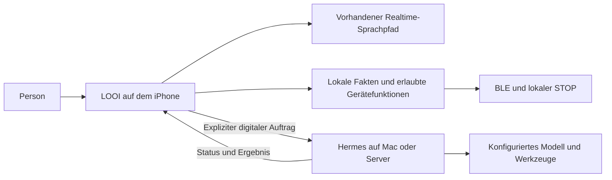

# Hermes Agent als LOOI-Agent und auf dem iPhone 16

Stand: 25. Oktober 2026. Frage: Welchen Nutzen hätte ein Hermes-artiger Agent für My LOOI, und welche Teile können auf dem benannten iPhone 16 laufen? Die ursprüngliche Dokumentations- und Quellprüfung ist unten erhalten. Nach der anschließenden Freigabe für Fly.io wurde der begrenzte Recherchepilot implementiert; der aktuelle Stand folgt hier.

## Umsetzungsstand nach Freigabe für Fly.io

Die App besitzt jetzt eine eigene Aufgabenseite mit HTTPS-/Token-Verbindung, explizitem Textauftrag, Status, Quellen, Abbruch und Löschung. Eine vor dem Senden gespeicherte UUID verhindert Ersatzaufträge nach unklarem Netzwerkfehler. Der Server verwendet Nous Hermes Agent v0.22.5 mit ausschließlich `web_search`, persistenter SQLite-Aufgabenliste und getrennten, zeitlich begrenzten Arbeitsprozessen. Sprachdelegation, Scheduling und Push sind weitere Optionen und wurden in diesem Pilot nicht ergänzt.

Der Dienst läuft inzwischen unter `https://looi-hermes-agent.fly.dev` auf genau einer Fly-Machine mit verschlüsseltem 1-GB-Volume in Frankfurt. `LOOI_AGENT_TOKEN` für den Appzugang und `OPENAI_API_KEY` für Modellaufrufe sind getrennt hinterlegt. Zwei begrenzte öffentliche Rechercheaufträge wurden erfolgreich ausgeführt. Die erste Abnahme deckte einen Quellenparserfehler auf; das anschließende Update und der zweite Auftrag bestätigten fünf korrekt betitelte offizielle Quellen ohne übernommene Fehler-URL. Der abgeschlossene erste Auftrag blieb über das Imageupdate und den Serverneustart unverändert erhalten. Beide Testaufträge wurden danach gelöscht; die Aufgabenliste ist leer, Wiederholungen ihrer IDs werden mit dem Löschbeleg abgewiesen.

Lokale Client-/Server-Verhaltenstests, echte HTTP-Abläufe mit Testarbeitern, der reale Containerstart mit Hermes-Import und Werkzeugprüfung sowie der native ARM64-iOS-Simulatorbuild sind erfolgreich. Das ist noch keine Bedien- oder Hardwareabnahme am iPhone 16. Einrichtung, Grenzen und aktueller Prüfstand stehen in [Hermes-Agent-Anbindung](../hermes-agent.md).

## Ergebnis

**Ein Agent innerhalb der iPhone-App ist machbar.** Aufgabensteuerung und Modellinferenz sind unterschiedliche Teile: Ein begrenzter TypeScript-/Swift-Ablauf kann lokal den nächsten Schritt wählen, ein Cloudmodell aufrufen, erlaubte Werkzeuge ausführen und das Ergebnis prüfen. Die bestehende App besitzt mit Realtime-Function-Calling, lokaler Gedächtnissuche und Sessiongrenzen bereits Teile davon. Zum Zeitpunkt der Recherche fehlte ein fortsetzbarer Aufgabenplaner; der oben beschriebene Pilot ergänzt nun einen Client für persistente Serveraufträge. Codeanker: `src/voice/realtime-config.ts`, `src/voice/realtime-pcm-conversation.ts`, `src/memory/memory-service.ts`, `src/openai/web-research.ts`, `src/agent/agent-service-core.ts`.

**Hermes ist ein plausibler Kandidat für den ergänzenden Serverteil.** Sein unveränderter Runtime-/Gateway-Betrieb wird auf iOS derzeit nicht unterstützt. Ein iOS-Port wäre grundsätzlich denkbar, erforderte aber eine native Einbettung und das Ersetzen oder Entfernen wesentlicher Prozess-, Shell- und Laufzeitfunktionen. Für My LOOI empfehle ich als ersten Versuch kurze Aufgabensteuerung in der App plus Hermes auf einem erreichbaren Mac oder Server für längere digitale Aufträge. Das ist eine Architekturentscheidung aus den folgenden Fakten; ein Mehrwert gegenüber der vorhandenen direkten Websuche ist noch zu messen.

Der im bisherigen Buildprotokoll genannte **Hermes-JavaScript-Compiler** ist die React-Native-JavaScript-Engine. Sein erfolgreicher Export belegt keine Einbettung von Nous Hermes Agent.

## Belegte Fakten

| Bereich | Primärquelle und Befund | Bedeutung für LOOI |
|---|---|---|
| Plattformen | [Hermes Platform Support](https://hermes-agent.nousresearch.com/docs/getting-started/platform-support) führt Tier 1 für macOS Apple Silicon, Windows, Linux/WSL2 und Docker auf; Android/Termux aarch64 ist Tier 2. iOS erscheint nicht als unterstützte Plattform. | iPhone-Hardwarearchitektur allein reicht nicht; es gibt keinen unterstützten iOS-Installer oder iOS-Gateway. |
| Laufzeit | [Installation](https://hermes-agent.nousresearch.com/docs/getting-started/installation) und [offizielles `pyproject.toml`](https://github.com/NousResearch/hermes-agent/blob/main/pyproject.toml) nennen Python 3.14 für aktuelle First-Party-Installationen. Der Source-Installer verwaltet unter anderem Python, Node und optionale Browserwerkzeuge. Das [Terminalwerkzeug](https://hermes-agent.nousresearch.com/docs/user-guide/features/tools#terminal-backends) führt Shellbefehle lokal oder auf anderen Backends aus. | Eine normale Desktopinstallation lässt sich nicht als React-Native-Paket übernehmen. Die [Python-Library-Anbindung](https://hermes-agent.nousresearch.com/docs/guides/python-library) erlaubt zwar eigene Hosts ohne CLI, ist aber kein dokumentierter iOS-Port. Nicht jedes optionale Werkzeug ist für den Agentenkern zwingend. |
| iOS-Python-Grenzen | Die [CPython-iOS-Dokumentation](https://docs.python.org/3.14/using/ios.html) erlaubt Python eingebettet in eine native App. Die [Python-Dokumentation für mobile Plattformen](https://docs.python.org/3.14/library/intro.html#mobile-platforms) schließt die gewöhnlichen Subprozess-/Multiprocessing-/IPC-Funktionen aus; iOS-spezifische Kommunikations-APIs sind davon zu unterscheiden. | Python selbst ist möglich. Hermes’ lokales Terminal und Prozesswerkzeuge funktionieren dadurch noch nicht; native Abhängigkeiten brauchen passende iOS-Builds und Packaging. |
| Agent-Integration | [Hermes Programmatic Integration](https://hermes-agent.nousresearch.com/docs/developer-guide/programmatic-integration) dokumentiert API-Server über HTTP/SSE sowie TUI-Gateway über stdio/WebSocket; alle treiben denselben `AIAgent`-Kern an. Die [API-Server-Doku](https://hermes-agent.nousresearch.com/docs/user-guide/features/api-server/) beschreibt Runs mit Statusabfrage, SSE-Events, Stop und Approval-Endpunkten. | Für einen nativen LOOI-Client bietet sich die Server-API oder ein WebSocket-Client an. Ein API-Key muss geschützt übertragen und verwaltet werden. |
| Mobil-Adapter | Der [Hermes-Katalogeintrag `hermes-mobile`](https://hermes-agent.nousresearch.com/docs/plugins/hermes-mobile) kennzeichnet den Adapter ausdrücklich als Community-Plugin. Er verbindet eine eigene App per WebSocket mit einem laufenden Hermes-Gateway und überträgt Text, Stimme, Bilder, Video, Dateien und Approval-Karten. Remote-Zugriff soll über WSS/TLS, Firewall und Token erfolgen. | Das ist eine Client-Anbindung, kein Hermes-Runtime-Port und laut Protokollbeschreibung keine Geräte- oder BLE-Steuerung. Für Motorbefehle braucht LOOI eine separate, eng begrenzte Bridge. |
| iPhone-Beispiel | Das unabhängige [Hermès-iOS-Projekt](https://github.com/Molliex05/hermes-ios) beschreibt ausdrücklich: Agent läuft auf dem Server, iOS-App verbindet sich damit; das Repository weist darauf hin, dass es keine App-Store-/TestFlight-Veröffentlichung gibt. | Belegt die prinzipielle Client-Architektur, nicht offizielle Nous-Unterstützung oder Produktionsreife. |
| Speicher und Skills | Hermes dokumentiert [Memory](https://hermes-agent.nousresearch.com/docs/user-guide/features/memory) als begrenzte profilbezogene Dateien und [Skills](https://hermes-agent.nousresearch.com/docs/user-guide/features/skills) als bei Bedarf geladene Verfahren. Skilländerungen können zur Prüfung vorgemerkt werden. | Das dokumentierte „Lernen“ betrifft gespeicherte Informationen und Verfahren; daraus folgt keine automatische Verbesserung der Modellgewichte oder nachgewiesene Zuverlässigkeit. Eine zweite persönliche Faktensammlung würde zusätzliche Korrektur-/Löschwege verlangen. |

## Was auf dem iPhone selbst möglich ist

| Variante | Machbarkeit und Grenze | Entscheidung für My LOOI |
|---|---|---|
| Agentenablauf lokal, Modell in der Cloud | Der Appprozess kann Aufgaben und erlaubte Toolaufrufe im Vordergrund verwalten; ein eigener Modellserver auf dem iPhone ist dafür nicht erforderlich. Die vorhandenen Realtime-Werkzeuge zeigen diese Trennung bereits im Code. | Guter erster Ausbau für kurze, nachvollziehbare Aufträge. |
| Agent plus Modell vollständig lokal | Apples [Foundation Models](https://developer.apple.com/documentation/FoundationModels) stellt Swift-Zugriff auf ein On-device-Modell mit strukturierten Ausgaben und eigenen Tools bereit. Das Framework wurde mit [iOS 26](https://www.apple.com/newsroom/2025/09/apples-foundation-models-framework-unlocks-new-intelligent-app-experiences/) eingeführt. | Optionalen nativen Adapter prüfen; Qualität, Laufzeit und gleichzeitiger Audio-/Kamera-/Ladebetrieb wurden hier nicht gemessen. |
| Abgeschlossene Arbeit nach Appwechsel fortsetzen | [Apple WWDC25](https://developer.apple.com/videos/play/wwdc2025/227/) beschreibt `BGContinuedProcessingTask` ab iOS 26: ausdrücklicher Start, erkennbarer Fortschritt, Abbruch durch Person oder System. Normale Hintergrundarbeit wird vom System geplant und kann ausgesetzt werden. | Geeignet für ausgewählte endliche Aufgaben mit gespeichertem Zwischenstand; keine Zusage eines beliebig laufenden Hintergrundagenten. |
| Hermes mit dauerhaften digitalen Aufgaben | Ein erreichbarer unterstützter Host übernimmt den Gateway-/Aufgabenbetrieb. Das iPhone zeigt den Auftrag und holt den Zustand später erneut ab. | Bevorzugter Kandidat, wenn Aufträge bei geschlossener App weiterlaufen müssen. |

Das iPhone 16 ist laut [Apple-Spezifikation](https://support.apple.com/en-kw/121029) für Apple Intelligence geeignet. Die tatsächliche iOS-Version, Aktivierung und Modellverfügbarkeit sind aber noch unbekannt. Ein nativer Adapter muss die OS-Version und `SystemLanguageModel.availability` prüfen. Apples [Sprachleitfaden](https://developer.apple.com/documentation/foundationmodels/supporting-languages-and-locales-with-foundation-models) verlangt zusätzlich `supportsLocale(_:)`; aktuelle Apple-Intelligence-Sprachen enthalten Englisch, aber weder Russisch noch Ukrainisch. Für die bestehenden RU/UK/EN-Dialoge folgt daraus keine vollständige lokale Parität. Ein Cloudpfad bleibt für nicht unterstützte Sprachen erforderlich, sofern dieses Apple-Modell verwendet wird; ein anderes lokales Modell wäre separat zu evaluieren.

Auch bei offener App und angeschlossenem Ladegerät ersetzt die theoretische Machbarkeit keine Messung von Temperatur, Reaktionszeit und Audioqualität. Der bestehende My-LOOI-Vertrag stoppt Mikrofon, Kamera und BLE beim Suspend ausdrücklich (`src/core/app-bootstrap.ts`, [iOS-Dokumentation](../ios.md)). Ein zusätzlicher digitaler Hintergrundauftrag würde diesen Gerätevertrag nicht automatisch ändern.

## Nutzenhypothese und Integrationsentscheidung

Ein passender Auftrag wäre: „Recherchiere diese drei Fragen, vergleiche die Quellen und halte das Ergebnis für unser nächstes Gespräch bereit.“ Ein zweiter, separat einzurichtender Fall wäre ein gewünschtes tägliches Briefing. Hermes dokumentiert [geplante Aufgaben](https://hermes-agent.nousresearch.com/docs/user-guide/features/cron) und einen [Briefing-Workflow](https://hermes-agent.nousresearch.com/docs/guides/daily-briefing-bot). Diese digitalen Aufgaben könnten auf dem Host weiterlaufen, während LOOI lokal ein anderes Gespräch führt oder das iPhone gesperrt ist. Ob das im Alltag besser als die einfache direkte Webrecherche ist, bleibt eine Produktfrage.

Das Diagramm zeigt die Trennung, die der Recherchepilot inzwischen umsetzt; die Live-Abnahme steht noch aus. Dafür ist kein Austausch des akzeptierten PCM-/Barge-in-Pfads nötig. Auch eine für LOOI geschriebene kleine lokale Agentenschleife kann denselben Auftrag im Vordergrund bearbeiten; Hermes lohnt sich vor allem, wenn seine dauerhaften Aufgaben und wiederverwendbaren Verfahren gebraucht werden.

Für den ersten Versuch empfehle ich:

1. **Einen digitalen Auftrag mit sichtbarem Status.** Der Client hält eine Aufgaben-ID und verbindet sich nach einem Verbindungsabbruch wieder. Die Runs-Schnittstelle ist dafür ein Kandidat; Version, Fähigkeiten und tatsächliche Fehlerzustände werden zuerst geprüft. Ein Serverneustart garantiert keine nahtlose Fortsetzung derselben Ausführung.
2. **Ein gesondertes Hermes-Profil mit wenigen Werkzeugen.** Zunächst Recherche und Ergebnisaufbereitung, mit begrenzter Laufzeit, Schritten und Kosten. Werkzeugrechte werden im Host konfiguriert; eine Promptformulierung allein begrenzt keine API-Berechtigung. Die [Werkzeugkonfiguration](https://hermes-agent.nousresearch.com/docs/user-guide/features/tools) unterstützt Auswahl nach Plattform.
3. **Die bestehenden lokalen Zuständigkeiten erhalten.** Audio, Kamera, BLE, STOP und persönliche Fakten bleiben in der App. Der Pilot erhält nur den ausdrücklich übergebenen Aufgabentext. Hermes bekommt für diesen Versuch keine Bewegungswerkzeuge; die Mobilanbindung allein ist ohnehin kein LOOI-Geräteconnector. Quellanker: [Runtimearchitektur](../architecture.md), `src/core/app-bootstrap.ts`.
4. **Eine einzige verbindliche persönliche Faktensammlung.** Erst ein späterer gezielter Adapter könnte freigegebene Fakten mit Version und Löschbehandlung bereitstellen. Vor einer Auslieferung müssen die zusätzliche Serverspeicherung und deren Löschung in Produkt und Datenschutzhinweisen abgebildet werden.

Ein erreichbarer Agent muss nicht ununterbrochen Modellaufrufe machen: Er kann auf einen Auftrag oder Termin warten. Kosten entstehen abhängig von Hostbetrieb, Modell-/Werkzeugaufrufen und Kontext. „Open Source“ macht diese Betriebskosten nicht null; ohne gemessenen Workflow ist keine seriöse Monatspauschale ableitbar.

## Kleiner Machbarkeitsnachweis vor einer Produktintegration

Verglichen werden dieselben fünf mehrstufigen Rechercheaufträge über die vorhandene direkte Suche und einen Hermes-Host. Erst synthetische Inhalte, dann nur ausdrücklich freigegebene echte Fragen. Ein Lauf umfasst: starten → Fortschritt zeigen → App sperren → wieder öffnen → denselben Auftrag abgleichen → Ergebnis mit prüfbaren Quellen anzeigen. Zusätzlich: abbrechen, Netzverlust, doppelte Übermittlung und Hostneustart mit unklarem Ausgang. Eine verlorene Verbindung darf keine zweite Aufgabe starten; ein unklarer Ausgang darf nicht als Erfolg erscheinen.

Erfasst werden belegbare Antwortqualität, Abschlusszeit, tatsächlicher Verbrauch und Bedienaufwand. Der Ansatz wird produktisiert, wenn mehrere Schritte oder Fortsetzung ohne offene App einen erkennbaren Zusatznutzen liefern. Wenn die direkte Suche gleich gut und einfacher ist, bleibt sie der Standard. Scheduling und Push-Zustellung sind ein gesonderter nächster Versuch; eine offene WebSocket-Verbindung allein weckt keine suspendierte iOS-App zuverlässig.

Die Recherche belegt Schnittstellen und Plattformgrenzen. Seit der Recherche wurden der LOOI-Client und Server implementiert; der Server läuft auf Fly.io und hat die begrenzten Live-Aufträge mit gültigem Modellzugriff bestanden. Offen bleiben die iPhone-Bedienabnahme, Ziel-iOS, gemessener Verbrauch, Geräteleistung und der praktische Nutzen im Vergleich zur direkten Suche.
