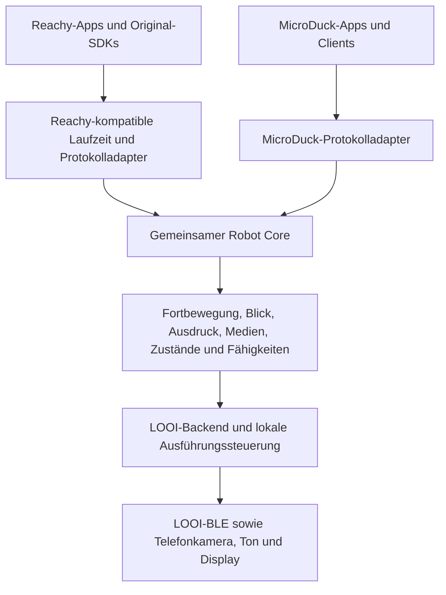

# MicroDuck, Reachy Mini und eine gemeinsame LOOI-Roboterschicht

**Stand:** 25. Oktober 2026. **Frage:** Was liefert MicroDuck für unsere allgemeine App-Kompatibilität, insbesondere für Fortbewegung, und was teilt das Projekt tatsächlich mit Reachy Mini?

**Ergebnis:** MicroDuck ist eine wichtige Ergänzung zur [Reachy-Untersuchung](reachy-mini-kompatibilitaet.md). Beide nutzen bereits denselben zentralen Account-/Discovery-/Signalisierungsdienst. Ihre Roboterbefehle, App-Laufzeiten und Bewegungsmodelle sind jedoch unterschiedlich. Unsere gemeinsame Basis sollte deshalb ein robotenneutraler Kern sein, mit Reachy- und MicroDuck-Kompatibilitätsadaptern darüber und einem LOOI-Ausführungsbackend darunter.

Das ist die Quellenprüfung vor der Implementierung. Anschließend wurden der gemeinsame Kern, beide Protokolladapter, das LOOI-Backend und ein lokaler Companion umgesetzt. Den geprüften Umfang und die verbleibenden Integrationen beschreibt [die Implementierungsdokumentation](../robot-bridge.md). Vollständige MicroDuck-Apps und Bewegung am Gerät wurden weiterhin nicht getestet.

## 1. Geprüfter Stand

MicroDuck: Commit [`942e58e3aa6dbb28e7037203fff11866122c7567`](https://github.com/pollen-robotics/microduck/commit/942e58e3aa6dbb28e7037203fff11866122c7567), Release-/Workspace-Version `0.17.8`. Das typisierte IPC-Protokoll nennt `API_VERSION = 44`; diese Nummer ist nicht die Version des ONNX-Policy-Vertrags. Lokales My LOOI weiterhin Commit `910247a9310b61b10bce36b8275d03ea09fda687`. [Quellen: Workspace][workspace], [IPC-Vertrag][ipc]

Designtexte enthalten teilweise ältere Planungsstände. Wo beispielsweise ein Blickziel noch als geplant beschrieben wird, definiert der aktuelle Quellcode bereits `robot.look`. Für konkrete Schnittstellen hat deshalb der geprüfte Code Vorrang.

## 2. Was tatsächlich gemeinsam ist

MicroDuck registriert sich beim gleichen Dienst wie Reachy Mini: `pollen-robotics-reachy-mini-central.hf.space`. Seine Metadaten kennzeichnen die Familie mit `meta.kind = "microduck"`. Der gemeinsame Dienst kann damit beide Familien unter einem HF-Konto auffindbar machen. Das ist belegte Infrastrukturwiederverwendung, keine bloße Ähnlichkeit zweier Projekte. [Quellen: Remote-Entwurf][remote], [Relay-Implementierung][relay], [Discovery-Client][discovery]

Der gemeinsame Verbindungsweg umfasst Accountzuordnung und Discovery, HTTP/SSE zur Signalisierung und danach WebRTC mit Medien und Datenkanälen. Für MicroDuck vermittelt der Relay zum lokalen GStreamer-Signalisierungsserver. Für langsamere einzelne Aufrufe existiert zusätzlich ein HTTP/SSE-Control-Weg über Central; das ist kein Ersatz für interaktive Teleoperation und Video. [Quellen: Relay][relay], [Control-Client][wire]

**Was daraus nicht folgt:** Reachys `set_target`/Kopf-/Antennenmodell und MicroDucks `robot.move`, `robot.head`, `robot.do` usw. sind verschiedene Befehlsverträge. Eine gemeinsame Verbindung übersetzt sie nicht automatisch. Auch die MicroDuck-Mobile-Dokumentation bezeichnet die Reachy-Mobile-App ausdrücklich als Referenz statt als gemeinsame Basis und beschreibt unterschiedliche BLE-Protokolle. [Quellen: MicroDuck-Methoden][ipc], [Mobile-Architektur][mobile], [Reachy-Protokoll](https://github.com/pollen-robotics/reachy_mini/blob/9fb2bfcbdf4c9800b0649acb8f0c18027673943f/src/reachy_mini/io/protocol.py)

**Folgerung für LOOI:** Central ist ein vorhandener Ansatzpunkt für einen gemeinsamen Verbindungsadapter. Die zweite offiziell integrierte Roboterfamilie zeigt, dass der Dienst nicht ausschließlich auf Reachy-Hardware zugeschnitten ist. Eine dokumentierte Aufnahmegarantie oder ein offiziell unterstützter Registrierungsprozess für LOOI ist damit weiterhin nicht belegt. Wir sollten weder Kompatibilität noch Produktfreigabe allein aus einer gleichen URL ableiten.

## 3. Für Fortbewegung ist MicroDuck die passendere Referenz

MicroDuck hat neben seinem Laufmodus einen **Roller-Modus mit Rädern**. Die Bewegung wird von trainierten Policies und einer lokalen Steuerung umgesetzt. Für LOOI ist besonders die Trennung zwischen Bewegungswunsch und hardwareabhängiger Ausführung nützlich. [Quelle: Projektübersicht](https://github.com/pollen-robotics/microduck/tree/942e58e3aa6dbb28e7037203fff11866122c7567)

Der aktuelle API-Vertrag nimmt `robot.move` mit diesen Werten entgegen:

| Wert | Bedeutung |
| --- | --- |
| `vx` | vorwärts in m/s |
| `vy` | seitwärts nach links in m/s |
| `vyaw` | Drehrate in rad/s, positiv nach links |

Das sind Bewegungswünsche im körperfesten Bezugssystem, keine einzelnen Servobefehle. Kopf und Fortbewegung haben getrennte Slots. `robot.stop` setzt Bewegung auf null; es bedeutet beim Zweibeiner ausdrücklich nicht, die Gelenke stromlos zu machen. [Quellen: Parametertypen][ipc], [Steuerungsmodell][robotd]

MicroDucks Motorzugriff liegt in einer lokalen Steuerung; CLI, Gamepad und Remote-Verbindung liefern Absichten an dieselbe API. Dieses Prinzip passt zu unserer vorhandenen zentralen LOOI-Steuerung. Die konkrete Motor-, Gleichgewichts- und Sensorlogik sollte dagegen beim jeweiligen Roboter bleiben. [Quelle: Dienstarchitektur][architecture]

## 4. Die entscheidende LOOI-Lücke liegt unter der API

Unser SDK sendet bisher feste Werte für vorwärts, zurück, links, rechts und STOP. `moveLooi(..., _speed)` verwendet den Geschwindigkeitsparameter nicht zur Regelung; die größeren Drehungen beruhen auf Zeitannahmen. Wir haben in diesem Pfad keinen verifizierten Vertrag für m/s, rad/s, unabhängige Radgeschwindigkeiten oder gemessene Odometrie. [Lokale Quellen: SDK](../../packages/looi-sdk/src/index.ts), [Bewegungssteuerung](../../src/device-tools/looi-robot.ts)

| MicroDuck-Erwartung | Allgemeine LOOI-Abbildung | Grenze des heutigen Stands |
| --- | --- | --- |
| Vor-/Rückwärtsgeschwindigkeit | Richtung erkennen, begrenzte Fahraktion auslösen | Kein belegtes Einhalten der gewünschten m/s |
| Drehgeschwindigkeit | Begrenzte Drehaktion | Keine gemessene rad/s-Regelung oder absolute Ausrichtung |
| Seitwärtsbewegung | Als fehlende Fähigkeit zurückmelden oder explizit simulieren | Im erschlossenen SDK nicht vorhanden |
| Gleichzeitig vorwärts und drehen | Nur bei nachgewiesener Ansteuerung; sonst nachvollziehbar begrenzen | Keine verifizierte allgemeine Kurvensteuerung im aktuellen High-Level-SDK |
| Geschlossene Bahn-/Navigationsregelung | Benötigt eine tatsächliche Positions-/Bewegungsquelle | Gesendete BLE-Befehle ergeben keine gemessene Position |

**Folgerung:** Der Kern soll SI-Einheiten verstehen, aber die Fähigkeiten des Backends getrennt beschreiben: genaue Regelung, quantisierte Näherung, Simulation oder nicht unterstützt. Eine App kann dann denselben Adapter nutzen, ohne dass eine ungefähre Bewegung als exakte Erfüllung ihrer Vorgabe ausgegeben wird.

MicroDuck liefert dafür ein gutes Vorbild: Zustandsdaten trennen `requested`, `applied` und `limited_by`. Auch dort ist `applied` der angewendete Steuerwert, nicht automatisch die gemessene Bewegung des Roboters. Im gemeinsamen Kern sollten zusätzlich gemessene Zustände und deren Herkunft ausdrücklich getrennt bleiben. [Quelle: Zustandsdefinition][ipc]

Für gestreamte Fahrt müssen Ablaufzeit und Reihenfolge erhalten bleiben. Eine Brücke darf einen alten Joystickwert nicht ständig neu versenden und dadurch den Deadman künstlich am Leben halten. MicroDucks Netzwerk-Gamepad behandelt einen verschwundenen Sender als verlorene Eingabe. [Quelle: Netzwerk-Gamepad][netpad]

## 5. Apps und Bewegungs-Policies sind verschiedene Inhalte

Im Repository liegen mehrere konkrete HF-Space-Projekte. Sie ergeben keinen nachgewiesenen gemeinsamen Reachy-/MicroDuck-App-Installer:

| Projekt | Funktion | Bedeutung für unseren Adapter |
| --- | --- | --- |
| [MicroDuck Console](https://huggingface.co/spaces/pollen-robotics/microduck-console) | Kamera und Roboterbedienung | Guter Test für Discovery, Session, Steuerung und Zustände; [Quellcode][console] |
| [Policy Playground](https://huggingface.co/spaces/pollen-robotics/microduck-policy-playground) | Bewegungs-Policies finden und als Skills ausprobieren | Benutzt MicroDuck-spezifische Policy-/Skill-Operationen; [Quellprojekt][playground] |
| [Vision Demo](https://huggingface.co/spaces/pollen-robotics/microduck-vision-demo) | Kamerastream in einer externen Anwendung verarbeiten | Prüft zusätzliche Medienwege und Verarbeitung außerhalb des Roboters; [Quellprojekt][vision] |

Die Policy-Playground-Web-App verwendet Vite/TypeScript und HF-Hub-Funktionen; ihre Paketdatei bindet kein Reachy-JS-SDK ein. Die Vision-Demo hat ihren früheren `reachy_mini[central-consumer]`-Pfad sogar entfernt und verwendet aktuell vom Roboter ausgehendes WebSocket-Video plus Decoder. Das ist ein konkreter Fallback dieser Demo; die allgemeine MicroDuck-Empfehlung bleibt WebRTC. [Quellen: Playground-Abhängigkeiten][playground-package], [Vision-Abhängigkeiten][vision-requirements], [FAQ][faq]

Der Hub-Bestand `pollen-robotics/microduck-policies` enthält dagegen ONNX-Modelle für die konkrete Roboterhardware. Die aktuelle Beobachtung besteht aus 61 Werten, die Ausgabe aus 14 Aktionen; Gelenkzustände, IMU und bisherige Aktionen gehören zu diesem Vertrag. Das Manifest kann Robotermodell und Ein-/Ausgabegrößen prüfen. Diese Netze sind keine universellen Programme für einen beliebigen fahrenden Roboter. [Quellen: Beobachtungs-/Aktionslayout][obs], [Policy-Manifest][manifest]

**Folgerung:** Ein allgemeiner Aufruf für einen Skill lässt sich auf die Fähigkeiten eines anderen Roboters abbilden. Die Lauf-, Kick- oder Aufsteh-Policy selbst lässt sich nicht durch Umbenennen der Ausgabe in LOOI-Radbefehle portieren. Ein Policy-Installer muss als herstellerspezifische Erweiterung behandelt werden; er darf nicht versehentlich MicroDuck-Gewichte oder Firmware als LOOI-kompatibel installieren.

## 6. Erweiterte Zielarchitektur

Das ist die Weiterentwicklung des vorherigen Entwurfs: Ein angepasster Reachy-Daemon bleibt als Kompatibilitätslaufzeit sinnvoll, wird aber **ein Zugang zum gemeinsamen Kern**. Er soll nicht selbst die gesamte robotenneutrale Abstraktion definieren.

Der Kern sollte folgende Aufgaben haben:

- **Fähigkeiten und Semantik:** Fortbewegung getrennt von Kopfpose; optionale Seitwärtsfahrt, Kurven, Odometrie und Sensorik; genaue Einheiten und Bezugssysteme.
- **Ausführung und Zustände:** angefordert, zugelassen, angewendet und gemessen getrennt; definierte Gründe für Begrenzung und fehlende Funktionen.
- **Session und Zeit:** Besitzer, Generation, Ablaufzeit, STOP und Abbruch. Transportwiederholung darf keine neue menschliche Eingabe vortäuschen.
- **Medien und Ausdruck:** gemeinsam verwaltete Kamera-/Audioquellen sowie Ausdrucksaktionen, die ein Backend passend umsetzt.
- **Kompatibilitätsadapter:** externe Namen, Zustandsformen und Lifecycle-Verträge übersetzen. Roboterspezifische Wartungs-/Policy-Funktionen bleiben eigene Erweiterungen.

Diese Modulaufteilung war der Entwurf und wurde anschließend in `src/robot-bridge/` umgesetzt; siehe [aktueller Vertrag](../robot-bridge.md). `LooiTransport` abstrahiert weiterhin den BLE-Transport. Die Motoren werden über `src/device-tools/looi-robot.ts` ausgeführt; der allgemeine Kern umgeht dessen Schutzlogik nicht. [Lokale Quellen: Transport](../../packages/looi-sdk/src/index.ts), [Runtime](../architecture.md)

## 7. Zusätzliche übernehmbare Ideen

MicroDuck erzeugt nichtsprachliche Laute mit einem kleinen Synthesizer. Ein stabiler Seed bestimmt Klangmerkmale einer Persönlichkeit; Varianten verhindern immer gleiche Wiederholungen. Das wäre eine interessante Ergänzung für LOOIs kurze Reaktionen zwischen Gesprächen. Es ist eine eigene Technik und liefert nicht Reachys gesprochene Stimme oder dessen Gesprächsprofil. [Quelle: Sounds-Modul][sounds]

Die Trennung von zuverlässigen einzelnen Kontrollaufrufen und frischen, nicht nachzuliefernden Teleoperationswerten ist für unsere fahrende Hardware ebenfalls sinnvoll. Dabei muss der letzte lokale Ausführer immer über STOP und Gültigkeit entscheiden. Ein Medienabbruch sollte keine veraltete Fahrt weiterlaufen lassen. [Quelle: WebRTC-Kanalmodell][architecture]

MicroDucks Quellcode deklariert Apache-2.0. Für konkret übernommene Modelle, Sounds, Drittbibliotheken und andere Assets sind deren jeweilige Angaben separat zu prüfen. [Quelle: Workspace][workspace]

## 8. Konsequenz für die nächste Implementierung

Den allgemeinen Vertrag zuerst an **zwei unterschiedlichen Befehlssystemen** prüfen: Reachy-Kopf/Move-Playback und MicroDuck-`robot.move`/STOP. Beide müssen durch denselben Kern und dieselbe LOOI-Ausführung laufen. Einzelne Apps dienen als Kompatibilitätstests, nicht als Ort für eigene Bewegungsübersetzungen.

Zunächst ohne reale Motoren nachweisen: Session-Aufbau, Zustandsschemata, fehlende Fähigkeiten, veraltete Eingaben, STOP während eines asynchronen Starts und sauberes Ende. Anschließend am konkreten Gerät Fahr-/Drehverhalten und Medien prüfen. Präzise Geschwindigkeiten oder Navigation erst zusagen, wenn Ansteuerung und Rückmeldung dafür tatsächlich vorliegen.

Offen bleiben die offizielle Central-Anbindung für LOOI, Umfang und Versionen unterstützter Apps, die physische Kalibrierung sowie die Frage, welche Funktionen simuliert werden sollen. **Der gemeinsame Dienst ist bereits belegt; die gemeinsame App-Kompatibilität ist das zu bauende System.**

[workspace]: https://github.com/pollen-robotics/microduck/blob/942e58e3aa6dbb28e7037203fff11866122c7567/Cargo.toml
[ipc]: https://github.com/pollen-robotics/microduck/blob/942e58e3aa6dbb28e7037203fff11866122c7567/duck-ipc-proto/src/lib.rs
[remote]: https://github.com/pollen-robotics/microduck/blob/942e58e3aa6dbb28e7037203fff11866122c7567/docs/design/remote-access-design.md
[relay]: https://github.com/pollen-robotics/microduck/blob/942e58e3aa6dbb28e7037203fff11866122c7567/mediad/src/relay.rs
[discovery]: https://github.com/pollen-robotics/microduck/blob/942e58e3aa6dbb28e7037203fff11866122c7567/spaces/shared/rendezvous.py
[wire]: https://github.com/pollen-robotics/microduck/blob/942e58e3aa6dbb28e7037203fff11866122c7567/spaces/shared/wire.py
[mobile]: https://github.com/pollen-robotics/microduck/blob/942e58e3aa6dbb28e7037203fff11866122c7567/docs/design/mobile-app.md
[robotd]: https://github.com/pollen-robotics/microduck/blob/942e58e3aa6dbb28e7037203fff11866122c7567/docs/design/robotd-design.md
[architecture]: https://github.com/pollen-robotics/microduck/blob/942e58e3aa6dbb28e7037203fff11866122c7567/docs/design/architecture.md
[netpad]: https://github.com/pollen-robotics/microduck/blob/942e58e3aa6dbb28e7037203fff11866122c7567/netpadd/src/main.rs
[console]: https://github.com/pollen-robotics/microduck/blob/942e58e3aa6dbb28e7037203fff11866122c7567/mediad/webclient/index.html
[playground]: https://github.com/pollen-robotics/microduck/tree/942e58e3aa6dbb28e7037203fff11866122c7567/spaces/policy-playground
[vision]: https://github.com/pollen-robotics/microduck/tree/942e58e3aa6dbb28e7037203fff11866122c7567/spaces/vision-demo
[playground-package]: https://github.com/pollen-robotics/microduck/blob/942e58e3aa6dbb28e7037203fff11866122c7567/spaces/policy-playground/web/package.json
[vision-requirements]: https://github.com/pollen-robotics/microduck/blob/942e58e3aa6dbb28e7037203fff11866122c7567/spaces/vision-demo/requirements.txt
[faq]: https://github.com/pollen-robotics/microduck/blob/942e58e3aa6dbb28e7037203fff11866122c7567/docs/faq.md
[obs]: https://github.com/pollen-robotics/microduck/blob/942e58e3aa6dbb28e7037203fff11866122c7567/duck-control/src/obs.rs
[manifest]: https://github.com/pollen-robotics/microduck/blob/942e58e3aa6dbb28e7037203fff11866122c7567/docs/policy-manifest.md
[sounds]: https://github.com/pollen-robotics/microduck/blob/942e58e3aa6dbb28e7037203fff11866122c7567/sounds/src/lib.rs
