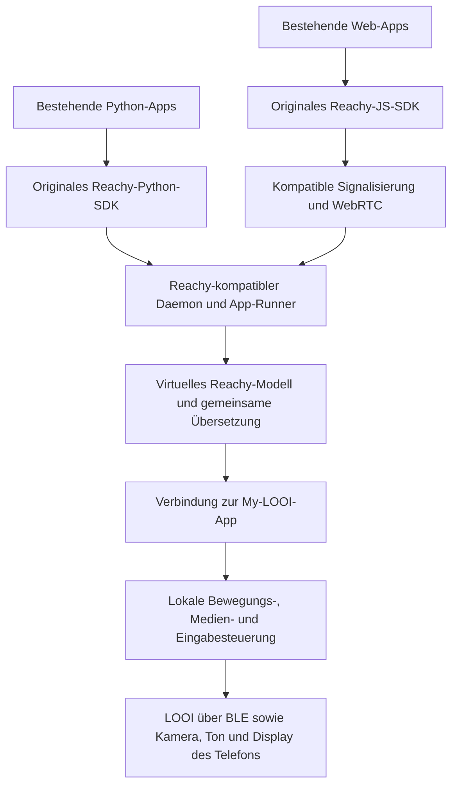

# Reachy Mini als App-Plattform für My LOOI

**Stand:** 25. Oktober 2026. **Frage:** Können wir eine allgemeine Abstraktionsschicht bauen, über die bestehende Reachy-Mini-Apps auf LOOI funktionieren, einschließlich App-Katalog, Tanz und Gespräch?

**Ergebnis:** Eine gemeinsame Reachy-kompatible Laufzeit mit LOOI-Backend ist ein plausibler Weg. Sie sollte unter den vorhandenen Reachy-SDKs ansetzen, damit Apps möglichst unverändert bleiben. „Alle Apps funktionieren vollständig“ ist wegen unterschiedlicher Hardware, direkter Gerätezugriffe und verschiedener Laufzeitabhängigkeiten kein belastbares Versprechen. Eine virtuelle Reachy-Instanz kann zusätzliche Funktionen emulieren; das macht eine App noch nicht physisch gleichwertig.

Dieser Bericht dokumentiert die Quellenprüfung vor der Implementierung. Anschließend wurden ein gemeinsamer Kern, beide Protokolladapter, ein LOOI-Backend und ein lokaler Companion umgesetzt und mit simulierten Geräten geprüft. Den aktuellen Umfang beschreibt [die Implementierungsdokumentation](../robot-bridge.md). Vollständige Reachy-Apps und physische Hardwarekompatibilität wurden weiterhin nicht geprüft.

**Erweiterung um MicroDuck:** Die [anschließende Untersuchung](microduck-gemeinsame-roboterschicht.md) belegt die bereits gemeinsame Central-Infrastruktur und erweitert den Entwurf um Fortbewegung. Die gemeinsame Basis soll ein robotenneutraler Kern sein; die hier beschriebene Reachy-Laufzeit wird ein Kompatibilitätszugang zu diesem Kern.

## 1. Geprüfter Stand und Quellen

Lokales My LOOI: Commit `910247a9310b61b10bce36b8275d03ea09fda687`. Reachy-SDK: Commit [`9fb2bfcbdf4c9800b0649acb8f0c18027673943f`](https://github.com/pollen-robotics/reachy_mini/commit/9fb2bfcbdf4c9800b0649acb8f0c18027673943f), dessen `pyproject.toml` die Entwicklungsversion `1.13.0.dev0` nennt. Conversation-App: Commit [`98633621491c6ecd14079d9dcab2cf7a2c3a0a35`](https://github.com/pollen-robotics/reachy_mini_conversation_app/commit/98633621491c6ecd14079d9dcab2cf7a2c3a0a35). Hugging-Face-Katalog und Spaces sind veränderlich; ihre Prüfung bezieht sich auf das obige Datum.

Die JS-Anleitung fordert mindestens SDK `1.8.0`; das ist keine Zusage für jede Kombination von App, SDK und Daemon. Für eine Implementierung müssen diese Versionen gemeinsam fixiert und geprüft werden. [Quelle: kanonische JS-App-Anleitung][js-guide]

## 2. Was der „App-Store“ tatsächlich bereitstellt

Reachy nutzt Hugging Face Spaces als Quelle für Apps. Es gibt zwei unterschiedliche Ausführungswege:

| Weg | Ausführung | Bedeutung für LOOI |
| --- | --- | --- |
| Python-App | Python-Paket in einer App-Umgebung; vom Daemon verwalteter Prozess | Benötigt einen Python-App-Runner und die erwartete Daemon-/Medienumgebung. |
| JS-/Web-App | Statische Browser-App mit Reachy-JS-SDK und WebRTC | Benötigt Reachys Verbindungs-, Steuerungs- und Medienprotokoll. |

Die Python-Discovery filtert im geprüften Daemon nach `reachy_mini_python_app`; die Installation und der App-Lifecycle liegen unter `/api/apps/...`. Das ist keine Sammlung direkt in React Native ladbarer Plugins. [Quellen: App-Lifecycle][python-apps], [HF-Space-Quelle im Daemon][hf-source]

Ein separates offizielles Katalog-Backend liefert `/api/apps` für Python und JS, `/api/js-apps` für den mobilen Web-App-Katalog und `/api/moves` für Bewegungsdaten. Der mobile JS-Katalog hat eine Moderationsfreigabe; eine öffentliche Space mit passendem Tag erscheint daher nicht automatisch überall. [Quelle: Katalog-Backend][catalog]

**Folgerung:** Wir können denselben öffentlichen App-Bestand als Grundlage verwenden und einen eigenen Kompatibilitätsstatus ergänzen. Katalogzugriff, tatsächliche Ausführung und Registrierung eines Roboters bei Pollen Central sind jedoch getrennte Aufgaben.

Die untersuchten Quellen dokumentieren keinen allgemeinen Aufnahmeprozess für Roboter anderer Hersteller in Pollen Central. Daraus folgt keine technische Sperre; eine offiziell unterstützte LOOI-Registrierung ist damit aber ebenfalls nicht belegt. Auch die Erreichbarkeit und Nutzungsbedingungen des Katalogdienstes müssen für eine Produktintegration noch geprüft werden. [Quellen: JS-SDK][js-sdk], [Central-Relay][central]

## 3. Der richtige Ansatz für eine allgemeine Schicht

**Empfehlung: eine virtuelle Reachy-Mini-Instanz mit LOOI als physischem Backend.** Die App bleibt gegen die Reachy-Schnittstelle entwickelt. Die Übersetzung geschieht zentral darunter, statt pro App neu.

Das ist ein Architekturvorschlag, kein bereits vorhandener Datenweg. Als Ausgangspunkt eignet sich Reachys Daemon besser als eine komplett neue Nachbildung aller SDKs: Es gibt bereits eine gemeinsame Backend-Klasse sowie echte, MuJoCo- und Mockup-Backends. Der gemeinsame Command-Dispatcher verarbeitet Befehle aus mehreren Transporten. Die Auswahl und Statusmodelle sind allerdings auf diese Backends zugeschnitten; ein LOOI-Backend ist kein nachgewiesener, fertig unterstützter Plugin-Einstieg. Es würde eine gezielte Erweiterung beziehungsweise einen gepflegten Fork benötigen. [Quellen: Backend][backend], [Mockup-Backend][mockup], [Daemon][daemon]

### Was die Schicht abdecken muss

| Bereich | Gemeinsamer Vertrag |
| --- | --- |
| Python | Verbindung, initiale Zustände, laufende Telemetrie, Befehle, Task-Fortschritt, Abbruch und App-Lifecycle |
| Web | HF-Authentifizierung beziehungsweise passende eigene Signalisierung, Roboterauswahl, Session, WebRTC-Datenkanäle und Medien |
| Bewegung | `set_target`, `goto_target`, Kopfmatrix, Antennen, Körperwinkel, Interpolation, Aufnahme und Playback |
| Medien | Kameraframes, Mikrofon, Lautsprecher, Lautstärke, Audioformate, Unterbrechen und Zeitbezug |
| Erweiterungen | Gesichtsziel, IMU/DoA soweit verfügbar, JSON-RPC zu laufenden Apps und definierte Antworten bei fehlenden Funktionen |

Das Python-SDK verbindet sich aktuell über `/ws/sdk`; es erwartet bereits beim Verbindungsaufbau Kopf- und Gelenkzustände. Ein Adapter, der nur Bewegungsbefehle entgegennimmt, genügt deshalb nicht. [Quelle: Python-WS-Client][ws-client]

Die konkreten Befehls- und Zustandsmodelle sind in `io/protocol.py` definiert. Sie sollten Vertragsgrundlage und Testorakel sein, anstatt aus Beispiel-Apps eine kleine Ersatz-API abzuleiten. [Quelle: Protokollmodelle][protocol]

### Web-Apps aus dem Katalog starten: Space-URL und mobiler Handoff

Die Hub-Seite (`https://huggingface.co/spaces/{owner}/{space}`) und die laufende Space-App haben verschiedene URLs; Hugging Face bettet die App von ihrem eigenen Host in die Hub-Seite ein. Die offizielle HF-Hub-JS-API liefert `sha` und `subdomain` als optionale erweiterte Space-Felder. Reachy-Kataloganfragen fordern beide an: `sha` pinnt eine Python-Installation, und ein validiertes `subdomain` ergibt nach Hugging Faces dokumentiertem URL-Schema den direkten App-Host `https://<space-subdomain>.hf.space/`. Fehlt das Feld oder ist es ungültig, bleibt der Hub-Link als sichere Auffang-URL erhalten. Wir leiten keinen statischen Hostnamen aus dem SDK-Typ ab. [Quellen: Space-API-Schema][hf-js-space-type], [List-Expansion][hf-js-space-api], [HF Space-URLs und Einbettung][hf-space-embed], [URL-Parameter und Hub-iframe][hf-space-parameters]

Für die **laufende App** beschreibt Reachy den offiziellen Mode A: Bei einer normalen App-URL lädt die Space-eigene `dispatch.ts` den Host-Einstieg `host/auto`; dieser rendert OAuth-Anmeldung und Roboterauswahl. Nach der Auswahl lädt er dieselbe Space in einem gleichursprünglichen iframe mit `?embedded=1#creds=…`. Die App startet dort mit `connectToHost()`, und der Host übergibt typisierte Lifecycle-/Konfigurationsnachrichten. Damit braucht eine Reachy-Web-App, die diesen offiziellen Einstieg verwendet, keinen von LOOI nachgebauten `postMessage`-Host. Das gilt nicht automatisch für beliebige Webseiten mit Reachy-SDK. Die normale Hub-Seite bettet denselben Space-Host zwar ein; ob OAuth und WebRTC in jeder Browser-/WebView-Konstellation aus diesem zusätzlichen iframe zuverlässig funktionieren, ist hier nicht geprüft. [Quellen: Boot-Modi und Host-Ablauf][js-guide], [Host-Einstieg][host-auto], [Embed-Implementierung][embed]

Dieser Startweg liefert aber **keine LOOI-Verbindung**. Mode A authentifiziert den Nutzer bei Hugging Face und sucht verfügbare Roboter über Pollen Central. Das SDK verwendet standardmäßig Central; bei gehosteten Seiten wird ein `?signaling_url=…`-Override ausdrücklich ignoriert, damit eine URL-Query keinen Bearer-Token an ein fremdes Ziel umleitet. Eine produktive alternative Signalisierung muss von der Space vertrauenswürdig konfiguriert werden (z. B. über deren `SIGNALING_URL`) oder über einen unterstützten Central-/Robotereintrag erreichbar sein. Weder unser Katalog-Link noch ein LOOI-Central-Geheimnis wird an die Space übergeben. Die offizielle Registrierung eines LOOI-Companions bei Pollen Central bleibt ungeklärt. [Quellen: Signalisierungs-URL][signaling-url], [Central-Relay][central]

Der **Mode B** (`?embedded=1#creds=…`) ist ein anderer Weg für einen Launcher, der eine eigene WebView besitzt und bereits die explizite Roboterauswahl sowie einen Hugging-Face-OAuth-Token hat. Der Hash enthält laut Anleitung einen kurzlebigen HF-Bearer (15 Minuten), Nutzernamen, Robot-Peer-ID, Signalisierungs-URL und App-Konfiguration; das Embed löscht ihn beim Start. Der Token ist damit für den Code der ausgewählten Space bestimmt und darf niemals durch das serverseitige Central-Token ersetzt oder ungefragt in eine beliebige App injiziert werden. Ein gewöhnlicher Katalog-Link startet nicht Mode B und sollte auch nicht versuchen, selbst eine solche Credential-URL zu konstruieren. [Quelle: dokumentierter Handoff][js-guide]

`connectToHost()` baut also die SDK-Session selbst auf; das Host-Protokoll überträgt Credentials, Konfiguration und Lifecycle, ist aber keine beliebige native Motor-RPC-Schnittstelle. Ein WebView mit einer eigenen `postMessage`-Funktion ersetzt diese Verbindung nicht. [Quellen: Embed-Implementierung][embed], [Host-Vertrag][host-protocol]

Im Original vermittelt Central per HTTP/SSE zum daemonseitigen `CentralSignalingRelay`, der einen lokalen GStreamer-WebSocket anspricht. Erst die ausgehandelte WebRTC-Verbindung trägt Medien und Datenkanäle. Eine eigene kompatible Signalisierung muss diesen Session-Ablauf ebenfalls bedienen. [Quelle: Central-Relay][central]

### Wo die Laufzeit laufen sollte

Für breite Python-Kompatibilität ist zunächst ein **Companion-Dienst auf einem zusätzlichen Rechner** der realistische Ausgangspunkt. Dort laufen der Reachy-Daemon, Python-Abhängigkeiten und App-Prozesse. Das iPhone stellt über eine neue Verbindung LOOI-Steuerung und seine Medien bereit. Dieser Dienst wäre zusätzlich zu unserer App erforderlich.

Unsere Expo-/React-Native-App enthält heute keinen allgemeinen Reachy-Python-Runner oder solchen Bridge-Endpunkt. Eine rein auf dem iPhone laufende Lösung mit denselben nativen Python-/GStreamer-Abhängigkeiten wäre ein eigenes größeres Vorhaben. Der bestehende Hermes-Dienst ist ein Text-Recherchepilot und kein Ersatz dafür. [Lokale Quellen: Architektur](../architecture.md), [Hermes-Grenzen](../hermes-agent.md)

## 4. Was „alle Apps funktionieren“ konkret bedeuten kann

Die Architektur soll alle Apps über denselben Vertrag bedienen. Die Kompatibilitätszusage muss trotzdem drei Ebenen unterscheiden:

1. **Laufzeitkompatibilität:** App installiert/startet, verbindet sich und versteht Antworten.
2. **Funktionale Anpassung:** App erfüllt ihren Zweck mit LOOI-gerechten Bewegungen oder Eingaben.
3. **Physische Gleichwertigkeit:** Bewegung, Sensorik und Bedienung entsprechen Reachy. Diese Ebene ist für bestimmte Funktionen auf LOOI nicht erreichbar.

Reachy hat einen Kopf mit sechs Freiheitsgraden, einen Körperdrehwinkel und zwei motorisierte Antennen. Unser typisiertes LOOI-SDK stellt Räder, drei Kopfpositionen, Licht und Dock-Ereignisse bereit. Das ist der aktuell erschlossene API-Umfang, keine vollständige Aussage über die mechanischen Möglichkeiten jeder LOOI-Firmware. [Quelle: Reachy-Hardwaremodell][reachy-guide], [lokales SDK](../../packages/looi-sdk/README.md)

| Reachy-Annahme | Allgemeine Behandlung im LOOI-Backend | Grenze |
| --- | --- | --- |
| Kontinuierliche Kopfpose | Virtuelle Pose führen; Neigung mit Begrenzung und Hysterese auf vorhandene Kopfsteuerung abbilden | Translation und Rollbewegung sind nicht gleichwertig ausführbar. |
| Absoluter Körperwinkel | Virtuellen Winkel halten; gegebenenfalls begrenzte reale Drehung auslösen | Zeitgesteuerte Raddrehung ist keine gemessene absolute Ausrichtung. |
| Antennenbewegung | Virtuelle Antennen; zusätzlich Ausdruck über Display/Licht möglich | Sichtbarer Ausdruck ist eine Adaption. |
| Antennen als physische Taster oder manuelles Führen | Allgemeine Ersatzbedienung über Touch/Controller | Ohne Ersatzinput kann eine App auf ein Ereignis warten, das nie eintritt. |
| Kamera/Mikrofon/Lautsprecher | Telefonmedien über gemeinsame Medienbrücke | Eine bloße Bild-URL ersetzt keinen Frame-/Audio-Stream. |
| IMU, DoA, Motorstrom oder Rohpakete | Echte passende Quelle, expliziter Simulationsmodus oder „nicht unterstützt“ | Erfundenes physisches Feedback darf keine erfolgreiche Ausführung vortäuschen. |

Apps können das SDK umgehen und USB, OpenCV-Geräte, Sounddevice oder lokale GStreamer-Ressourcen direkt öffnen. Eine Schicht unter dem Reachy-SDK fängt solche Zugriffe nicht automatisch ab. Virtuelle Geräte könnten einzelne Fälle zusätzlich bedienen; beliebige Hardwaretreiber lassen sich damit nicht universell ersetzen. Das SDK unterstützt ausdrücklich auch einen `no_media`-Modus für direkte Medienzugriffe. [Quelle: Python-SDK und Medienoptionen][python-sdk]

Die virtuelle Pose muss gegenüber unserer Steuerung klar von **gemessen**, **geschätzt** und **nur angefordert** getrennt bleiben. Ein unverändertes Reachy-App-Protokoll kann weiterhin simulierte Zustände erhalten, aber dieser Modus darf nicht als gemessene LOOI-Telemetrie ausgewiesen werden.

## 5. Bestehende LOOI-Bausteine

- `packages/looi-sdk/src/index.ts`: transportunabhängiges BLE-SDK, dessen High-Level-Aktionen noch LOOI-spezifisch sind.
- `src/device-tools/looi-robot.ts`: lokale Ausführung, STOP, begrenzte Bewegung, Deadman und Kantenprüfung. Hier sollte der neue Backend-Pfad enden, statt rohe BLE-Writes aus fremden Apps weiterzureichen.
- `src/device-tools/looi-robot.ts`, `performLooiDance`: drei vorhandene Tänze mit Kopfgesten und begrenzten Radbewegungen.
- `src/behavior/behavior-runtime.ts`: vorhandene Koordination von Verhalten, Kopfgesten, Generationen und Verdrängung durch neue Ereignisse.
- `src/voice/realtime-config.ts`: bestehende Realtime-Stimmenwahl und Gesprächsanweisungen.

Die virtuelle Reachy-Zustandsrate und die reale BLE-Schreibrate müssen getrennt sein: Zustände dürfen häufig aktualisiert werden, während reale Ziele zusammengefasst und begrenzt werden. Ein verspätetes Frame einer alten Session darf nach STOP oder App-Wechsel keine Bewegung erneut starten. Medien brauchen ebenso einen gemeinsamen Besitzer; die Reachy-App und unser eigener Dialog dürfen nicht unabhängig dasselbe Mikrofon übernehmen. [Lokale Quellen: Bewegungssteuerung](../../src/device-tools/looi-robot.ts), [Behavior-Runtime](../../src/behavior/behavior-runtime.ts), [Audioarchitektur](../architecture.md)

Die iOS-Dokumentation bestätigt einen Simulator-Build, lässt aber physische Abnahme für iPhone/LOOI-BLE, AEC, Kamera und Lifecycle offen. Neue Bridge-Funktionen könnten darauf noch keine Gerätegarantie aufbauen. [Lokale Quelle: iOS-Status](../ios.md)

## 6. Tanz, Stimme und Wortwahl

**Tanz:** Reachys Conversation-App sampelt Tanzbewegungen zu Kopfpose, Antennen und Körperwinkel und führt sie über einen gemeinsamen Movement-Manager aus. Das lässt sich zentral im Backend übersetzen; wir brauchen dafür nicht für jeden Tanz eine eigene App-Portierung. Ein allgemeiner Retargeter sollte Rhythmus und Verlauf erhalten, die Ausgabe glätten und die reale Bewegung auf das LOOI-Repertoire begrenzen. [Quellen: Dance-Tool][dance-tool], [Movement-Manager][moves]

Für aufgezeichnete Bewegung plus Ton bietet das JS-SDK daemonseitiges Playback auf einer gemeinsamen Uhr. Dieses Prinzip ist für synchrones Tanzen besonders nützlich: Clip einmal übertragen, lokal abspielen und gemeinsam abbrechen, statt jedes Frame mit Netzwerkverzögerung zu fahren. Das ist von Live-Sprachbewegung zu unterscheiden. [Quelle: aufgezeichnetes Playback][js-sdk]

Der offizielle Tanzdatensatz enthält Reachy-Posekurven und deklariert Apache-2.0. Diese Daten müssen auf LOOI umgerechnet werden. Der separate Python-Code der Tanzbibliothek und enthaltenes beziehungsweise zusätzliches Audiomaterial brauchen ihre eigene Lizenzprüfung; die Lizenz eines Datensatzes gilt nicht automatisch für alle anderen Bestandteile. [Quelle: Tanzdatensatz][dance-data], [separate Bibliothek][dance-code]

**Wortwahl:** Das Standardprofil der Conversation-App beschreibt kurze, ruhige, hilfreiche Antworten mit sparsamem, sanftem Humor, meist ein bis zwei Sätzen. Es enthält konkrete Beispiele und vermeidet Sarkasmus. Das ist eine direkt nutzbare Gestaltungsreferenz für unsere eigenen Profile, unabhängig von der Roboterschnittstelle. Unsere bisherigen kurzen, warmen Gesprächsanweisungen passen bereits grundsätzlich dazu. [Quelle: Reachy-Profil][profile], [lokale Anweisungen](../../src/voice/realtime-config.ts)

**Stimme:** Die geprüfte Conversation-Konfiguration nennt Qwen3-TTS-CustomVoice-Sprecher und `Aiden` als Standard. Unser aktueller Pfad nutzt OpenAI Realtime. `Aiden` lässt sich daher nicht einfach als bestehende OpenAI-Stimmen-ID eintragen. Für denselben Klang wäre ein passender zusätzlicher Speech-Backend-Pfad nötig. Welchen Klang der Nutzer konkret gehört hat, bleibt ohne Demo-Link offen. [Quelle: Conversation-Konfiguration][voice-config]

Hugging Face beschreibt auch einen selbst betriebenen Speech-to-Speech-Stack mit `/v1/realtime`; dessen Komponenten sind austauschbar. Das eröffnet einen weiteren Backend-Weg, beweist aber weder lokale Leistungsfähigkeit auf unserem iPhone noch identischen Klang zu einer unbekannten Demo. [Quelle: offizieller Local-Stack-Artikel][local-speech]

## 7. Apps als Prüfbestand für denselben Adapter

Diese Beispiele sind **Testfälle für die gemeinsame Schicht**, keine Empfehlung für separate App-Portierungen. Noch keines ist auf LOOI verifiziert.

| App / Inhalt | Prüft hauptsächlich | Erwartete Anpassung |
| --- | --- | --- |
| [Conversation-App](https://huggingface.co/spaces/pollen-robotics/reachy_mini_conversation_app) | Python-Lifecycle, Mikrofon, Playback, Kamera, Tools, Bewegung | Medienbesitz, lokale Ausführung und Reachy-zu-LOOI-Bewegung |
| [Telepresence](https://huggingface.co/spaces/pollen-robotics/telepresence) | Unveränderte Web-App, Signalisierung, Kamera, Gegensprechen | Roboter-Peer und Medienbrücke; Bewegungssemantik prüfen |
| [Radio](https://huggingface.co/spaces/tfrere/radio) | WebRTC-Audio, kontinuierliche Bewegung, Antennen als Regler | Gemeinsamer Bewegungsretargeter und Ersatzbedienung |
| [Emotions](https://huggingface.co/spaces/pollen-robotics/emotions) | Web-SDK, aufgezeichnete Moves, Audio, Abbruch | Kurvenretargeting und gemeinsamer Playback-Zeitbezug |

Das Conversation-Repository und das SDK deklarieren Apache-2.0. Die übrigen App-Repositories, Abhängigkeiten, Datensätze und Assets müssen jeweils separat bewertet werden; der Katalog gibt ihnen keine gemeinsame Lizenz. [Quellen: Conversation-Repository][conversation], [SDK-Paket](https://github.com/pollen-robotics/reachy_mini/blob/9fb2bfcbdf4c9800b0649acb8f0c18027673943f/ts/package.json)

## 8. Konkreter Umsetzungsweg

1. **Versionierten Referenzbestand festlegen.** SDK-/Daemon-Version, App-Revisionen und alle angesprochenen Protokolloperationen erfassen. Fehlende Operationen müssen sichtbar werden; keine pauschale „kompatibel“-Kennzeichnung.
2. **Virtuellen Daemon mit Backend-Einstieg aufsetzen.** Möglichst Original-SDKs und Original-Protokollmodelle behalten. Zuerst ohne reale Motoren beweisen, dass Python-Apps unverändert starten, Zustände erhalten, Tasks abschließen und abbrechen können.
3. **Gemeinsame Telefonbrücke ergänzen.** Vorschlag: ein neuer Dienst unter `services/reachy-bridge/` und ein typisierter Vertrag mit Session-ID, Generation, Deadline und getrennten angeforderten/ausgeführten Zuständen. Die App führt ausschließlich über ihre vorhandenen lokalen Controller aus.
4. **Medien und WebRTC ergänzen.** Zunächst ein Companion-Host mit kompatibler Signalisierung; offizielles Pollen-Onboarding bleibt eine getrennte offene Frage. Danach dieselbe Backend-Instanz mit unveränderten Web-Apps prüfen.
5. **Retargeting und Ersatzinputs vervollständigen.** Kopfpose, Körperwinkel, Antennen, Kurven, Playback, virtuelle Eingaben und nachvollziehbare Rückmeldungen zentral abbilden. Keine Sonderlogik anhand einzelner App-Namen als reguläres Architekturprinzip.
6. **Katalog anbinden und Abdeckung messen.** Python-, Web- und Medienfälle gegen denselben Adapter prüfen. Pro App unterscheiden: startet, funktional angepasst, simuliert, fehlende Funktion. Den gemeinsamen Adapter bei Lücken erweitern.

Erste belastbare Abnahme: unveränderte Python-Bewegungs-App und Web-Bewegungs-App nutzen denselben Backend-Pfad; anschließend Conversation und Telepresence mit realem Audio/Kamera. STOP, Session-Abbruch, Hintergrundwechsel und Verbindungsverlust müssen alle alten Bewegungen und Audiowiedergaben beenden. Insbesondere muss STOP während eines noch laufenden asynchronen App-/Tanzstarts verhindern, dass danach neue Schritte anlaufen. Die Hardwareprüfung erfolgt erst nach Protokolltests ohne Motoren und separat auf iPhone plus LOOI.

## 9. Offene Entscheidungen und Beweisgrenzen

- Ist für die erste breite Python-Kompatibilität ein zusätzlicher Companion-Rechner akzeptabel? Der Entwurf nimmt das an; eine reine iPhone-Lösung ist damit nicht geliefert.
- Ist Pollen an einer offiziell unterstützten Registrierung fremder Roboter beziehungsweise einer gemeinsamen Backend-Erweiterung interessiert? Es wurde niemand kontaktiert.
- Welche Apps umgehen SDK/Daemon und brauchen virtuelle Betriebssystemgeräte oder eine eigene Hardware? Ein vollständiger Katalogscan fehlt noch; eine Prozentzahl wäre erfunden.
- Wie gut funktionieren Medienbrücke, AEC, Latenz und Bewegungsabbildung auf dem konkreten iPhone/LOOI? Noch nicht gemessen.
- Was soll eine App tun, deren Hauptzweck physisches Antennendrücken oder manuelles Führen des Reachy-Kopfs ist? Ersatzbedienung und Simulation sind Produktentscheidungen, keine physische Gleichwertigkeit.

**Architekturentscheidung:** Den allgemeinen Adapter als Reachy-kompatible Laufzeit mit virtuellem Robotermodell und LOOI-Backend entwerfen. Das erfüllt den Wunsch nach einer gemeinsamen Grundlage für viele unveränderte Apps wesentlich besser als ein eigener LOOI-App-Store mit Einzelportierungen. Vollständige Funktion aller beliebigen Reachy-Apps bleibt ein zu prüfendes Ziel, kein bereits begründbarer Anspruch.

[js-guide]: https://github.com/pollen-robotics/reachy_mini/blob/9fb2bfcbdf4c9800b0649acb8f0c18027673943f/ts/APP_CREATION_GUIDE.md
[python-apps]: https://github.com/pollen-robotics/reachy_mini/blob/9fb2bfcbdf4c9800b0649acb8f0c18027673943f/docs/source/SDK/apps.md
[hf-source]: https://github.com/pollen-robotics/reachy_mini/blob/9fb2bfcbdf4c9800b0649acb8f0c18027673943f/src/reachy_mini/apps/sources/hf_space.py
[catalog]: https://github.com/pollen-robotics/reachy_mini_api/blob/main/README.md
[js-sdk]: https://github.com/pollen-robotics/reachy_mini/blob/9fb2bfcbdf4c9800b0649acb8f0c18027673943f/docs/source/SDK/javascript-sdk.md
[central]: https://github.com/pollen-robotics/reachy_mini/blob/9fb2bfcbdf4c9800b0649acb8f0c18027673943f/src/reachy_mini/media/central_signaling_relay.py
[backend]: https://github.com/pollen-robotics/reachy_mini/blob/9fb2bfcbdf4c9800b0649acb8f0c18027673943f/src/reachy_mini/daemon/backend/abstract.py
[mockup]: https://github.com/pollen-robotics/reachy_mini/blob/9fb2bfcbdf4c9800b0649acb8f0c18027673943f/src/reachy_mini/daemon/backend/mockup_sim/backend.py
[daemon]: https://github.com/pollen-robotics/reachy_mini/blob/9fb2bfcbdf4c9800b0649acb8f0c18027673943f/src/reachy_mini/daemon/daemon.py
[ws-client]: https://github.com/pollen-robotics/reachy_mini/blob/9fb2bfcbdf4c9800b0649acb8f0c18027673943f/src/reachy_mini/io/ws_client.py
[protocol]: https://github.com/pollen-robotics/reachy_mini/blob/9fb2bfcbdf4c9800b0649acb8f0c18027673943f/src/reachy_mini/io/protocol.py
[embed]: https://github.com/pollen-robotics/reachy_mini/blob/9fb2bfcbdf4c9800b0649acb8f0c18027673943f/ts/host/src/embed/index.ts
[host-protocol]: https://github.com/pollen-robotics/reachy_mini/blob/9fb2bfcbdf4c9800b0649acb8f0c18027673943f/ts/host/src/lib/protocol.ts
[host-auto]: https://github.com/pollen-robotics/reachy_mini/blob/9fb2bfcbdf4c9800b0649acb8f0c18027673943f/ts/host/src/entry/auto.ts
[signaling-url]: https://github.com/pollen-robotics/reachy_mini/blob/9fb2bfcbdf4c9800b0649acb8f0c18027673943f/ts/host/src/lib/signalingUrl.ts
[hf-space-embed]: https://huggingface.co/docs/hub/spaces-embed
[hf-space-parameters]: https://huggingface.co/docs/hub/main/spaces-handle-url-parameters
[hf-js-space-api]: https://github.com/huggingface/huggingface.js/blob/35fc75aba91d44021377fcd268aa9d6da5009944/packages/hub/src/lib/list-spaces.ts
[hf-js-space-type]: https://github.com/huggingface/huggingface.js/blob/35fc75aba91d44021377fcd268aa9d6da5009944/packages/hub/src/types/api/api-space.ts
[reachy-guide]: https://github.com/pollen-robotics/reachy_mini/blob/9fb2bfcbdf4c9800b0649acb8f0c18027673943f/AGENTS.md
[python-sdk]: https://github.com/pollen-robotics/reachy_mini/blob/9fb2bfcbdf4c9800b0649acb8f0c18027673943f/docs/source/SDK/python-sdk.md
[dance-tool]: https://github.com/pollen-robotics/reachy_mini_conversation_app/blob/98633621491c6ecd14079d9dcab2cf7a2c3a0a35/src/reachy_mini_conversation_app/tools/dance.py
[moves]: https://github.com/pollen-robotics/reachy_mini_conversation_app/blob/98633621491c6ecd14079d9dcab2cf7a2c3a0a35/src/reachy_mini_conversation_app/moves.py
[dance-data]: https://huggingface.co/datasets/pollen-robotics/reachy-mini-dances-library
[dance-code]: https://github.com/pollen-robotics/reachy_mini_dances_library
[profile]: https://github.com/pollen-robotics/reachy_mini_conversation_app/blob/98633621491c6ecd14079d9dcab2cf7a2c3a0a35/profiles/default/profile.md
[voice-config]: https://github.com/pollen-robotics/reachy_mini_conversation_app/blob/98633621491c6ecd14079d9dcab2cf7a2c3a0a35/src/reachy_mini_conversation_app/config.py
[local-speech]: https://huggingface.co/blog/local-reachy-mini-conversation
[conversation]: https://github.com/pollen-robotics/reachy_mini_conversation_app/tree/98633621491c6ecd14079d9dcab2cf7a2c3a0a35
