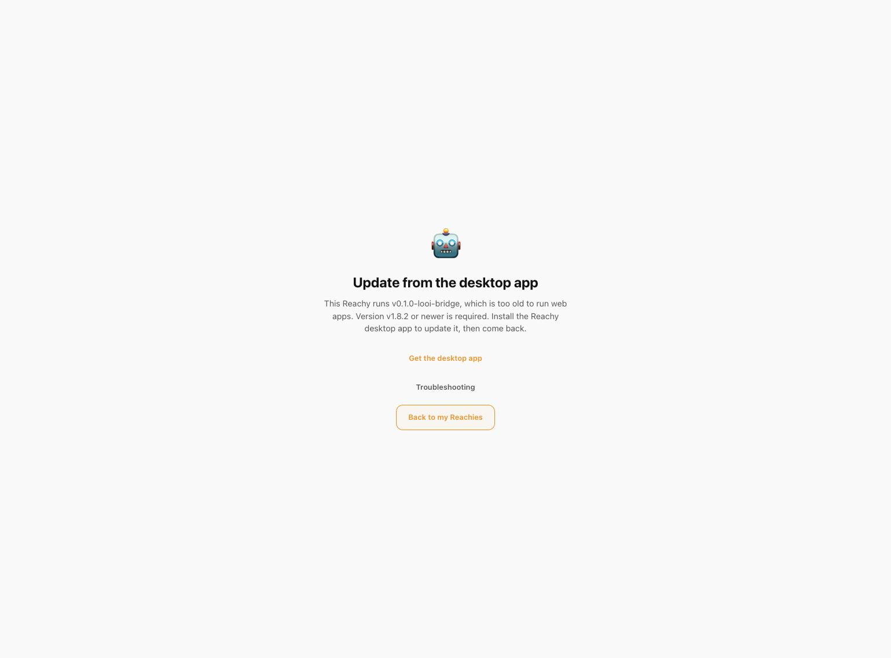
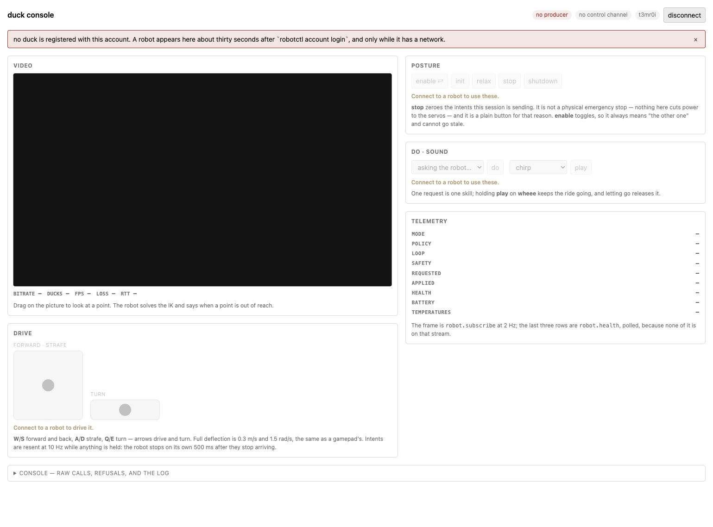

# Reachy- und MicroDuck-App-Abnahme für My LOOI

**Stand:** 26. Oktober 2026. Diese Abnahme prüft gepinnte Original-SDKs und
App-Protokolle gegen den LOOI-Demo-Companion, den öffentlichen App-Katalog und
den installierten iPhone-Build. Ein physischer LOOI war nicht angeschlossen.

## Ergebnis

Reachys SDK-Bewegungspfad und eine unveränderte offizielle Python-App funktionieren
im Demo-Backend. Nach der ersten begrenzten Installationsprobe wurde auch der
vollständige App-Store-Install samt Abhängigkeiten und anschließendem echten
App-Runner-Lifecycle erfolgreich geprüft. MicroDucks Basis-RPCs funktionieren, die unveränderte
MicroDuck Console kann wegen fehlender RPCs und abweichender Roboteraktionen
jedoch noch nicht vollständig arbeiten. Die Central-Familienkollision wurde in
der nativen Laufzeit behoben und durch lokale Tests abgedeckt. Die echte
iPhone-App registriert sich erfolgreich bei Pollen Central. Die originale
Telepresence-App entdeckt LOOI und baut eine WebRTC-Sitzung auf, blockiert ihre
weitere Nutzung aber an der Daemon-Versionsprüfung. Echte Kamera-, Audio- und
RTP-Medien stehen noch aus.

| Bereich | Ergebnis | Aussage |
|---|---|---|
| Reachy Python-SDK | **PASS im Demo-Backend** | Originaler SDK-Verbindungs-, Zustands-, Bewegungs-, RecordedMove- und Stop-Pfad wurde ausgeführt. |
| Reachy Clock-App | **PASS einschließlich vollständiger Installation** | Der echte Store-Runner installierte das unveränderte Paket samt Abhängigkeiten. Zwei anschließende Läufe starteten, sendeten ein adaptiertes Kommando und stoppten sauber; der erste Lauf verfehlte das 30-Sekunden-Fenster. |
| Reachy Kamera/Audio/WebRTC | **OFFEN** | Die Clock-App fordert diese Funktionen nicht an; ihr Lauf nutzte `no_media`. |
| MicroDuck RPC-Grundpfad | **PASS im Demo-Backend** | Originaler Python-RPC-Client, Zustand, Vorwärtsfahrt, Blick, Nicken und STOP funktionieren. |
| MicroDuck Console | **FAIL für vollständiges Verhalten** | Mehrere von der Original-Console verwendete Methoden fehlen oder haben auf LOOI keine passende Semantik. |
| Central-Familienwechsel | **PASS in lokaler Abnahme** | Eine HF-Bearer-Identität nutzt nur einen Central-Peer; die Laufzeit wechselt die aktive Familie nach geordnetem STOP. |
| Öffentlicher Apps-Katalog | **PASS beim Prüflauf** | 197 Einträge wurden live ohne Katalogwarnungen geladen. |
| iPhone-Build | **PASS als installierter Mock-Build** | Signierter Release-Build mit den Korrekturen wurde auf dem iPhone installiert; die App zeigte `Mock robot · Connected`. |
| Live Central-Registrierung | **PASS auf dem iPhone** | Der installierte Release-Build zeigt `Reachy Mini · Hugging Face Central · Connected`; der geschützte HF-Zugang wurde vom Dienst akzeptiert. |
| Reachy Hosted-App / WebRTC | **VERBINDUNG PASS, APP-NUTZUNG BLOCKIERT** | Offizielles Telepresence-OAuth, Discovery von LOOI, WebRTC und Status-RPC funktionieren. Der Host verlangt Daemon ≥1.8.2; unser Adapter meldet 0.1.0-looi-bridge. |
| MicroDuck Hosted-App / Discovery | **NICHT ABGENOMMEN** | OAuth funktioniert, aber die echte Console sieht LOOI weiter ohne `meta.kind: "microduck"` und meldet `no producer`. Der erfolgreiche Familienwechsel ist auf dem Gerät nicht belegt. |
| Physische LOOI-Bewegung | **NICHT GEPRÜFT** | Es war kein physischer Roboter angeschlossen. |

## Reachy

Getestet wurde das offizielle Python-SDK `1.13.0.dev0` aus
[`pollen-robotics/reachy_mini`](https://github.com/pollen-robotics/reachy_mini/tree/9fb2bfcbdf4c9800b0649acb8f0c18027673943f),
Commit `9fb2bfcbdf4c9800b0649acb8f0c18027673943f`, mit Python `3.12.13`.
Gegen den echten lokalen Companion im Demo-Modus liefen `ReachyMiniApp.wrapped_run()`,
Startstatus und Zustandsabfragen, `wake_up`, `goto_target`, `set_target`, ein
`RecordedMove` über `play_move`, `goto_sleep` und das Schließen des SDK-Kontexts.

Der reale SDK-Wire-Vertrag serialisiert ausgelassene optionale Werte wie
`body_yaw` als JSON `null`. Der Adapter verwarf dadurch vorher den ganzen
`set_target`-Aufruf. Nullwerte für optionale Posefelder gelten jetzt als
ausgelassen; ungültige Zahlen und Matrizen bleiben abgelehnt. Eine Regression
belegt, dass `set_target` den simulierten Zustand tatsächlich fortschreibt.

Zusätzlich lief die unveränderte offizielle
[`reachy_mini_clock`-App](https://huggingface.co/spaces/pollen-robotics/reachy_mini_clock)
aus Space-Revision `e8b4a4ea44116d881b940b5ea210fe5e69e162e4`, Version `0.1.0`.
Der Live-Katalog löste dieselbe Revision als Python-App auf. Der echte
`createAppRunner` hydrierte den installierten Eintrag, startete den originalen
Entry-Point `reachy_mini_clock.main:ReachyMiniClock`, empfing dessen
Bewegungskommando und stoppte den Prozess erfolgreich. Während dieses Laufs war
der Demo-Status `adapted`; eine gemessene Roboterpose gab es nicht (`null`).

Diese erste App-Probe belegte den Runner-Lifecycle, nicht den vollständigen
Store-Installationsweg: Das App-Paket wurde ohne erneute Abhängigkeitsauflösung
in der vorhandenen isolierten SDK-Umgebung installiert, und der Runner bekam
für diese Probe seine Install-Registry. Eine Test-Bootstrap-Regel band den
App-Webserver an Loopback; der Upstream-App-Quelltext blieb unverändert. Der
separate vollständige `createAppRunner.install()`-Versuch scheiterte zunächst
mit `ENOSPC` beim Wheel `gstreamer_gtk==1.28.8`.

Mit wieder ausreichend freiem Speicher bestand anschließend der vollständige
Installationspfad ohne `--no-deps` und ohne vorbefüllte Registry. Der Resolver
wählte Python `3.14.5`, `reachy-mini 1.13.0`, Clock `0.1.0` und `pytz 2025.2`.
Ein neuer Runner hydrierte genau diese Installation und führte den unveränderten
Entry-Point aus. Zwei aufeinanderfolgende Läufe erhielten ein `adapted`-
Bewegungsergebnis und stoppten sauber. Ein vorheriger Lauf überschritt das
30-Sekunden-Fenster ohne Kommando; dessen Ursache blieb offen. Details und
Reproduktion stehen in der [vollständigen Store-Abnahme](reachy-store-full-install-acceptance-2026-10-26.md).

Die Clock-App verwendet keine Kamera-, Audio- oder WebRTC-APIs. Ihr erfolgreicher
Lauf verwendete ausdrücklich `no_media` und sagt nichts über Apps aus, die diese
Streams anfordern.

## MicroDuck

Getestet wurde
[`pollen-robotics/microduck`](https://github.com/pollen-robotics/microduck/tree/942e58e3aa6dbb28e7037203fff11866122c7567)
bei Commit `942e58e3aa6dbb28e7037203fff11866122c7567` (IPC API 44). Die
Quellstände der unveränderten `spaces/shared/control.py`-RPC-Implementierung
und der Methodennamen aus `mediad/webclient/index.html` wurden gegen Git-Blob-
Hashes dieses Commits geprüft.

Der offizielle Python-RPC-Client verband sich mit `/microduck`, erhielt
API-Version 44 und den erwarteten Zustandsvertrag. Vorwärtsfahrt, `robot.look`,
`robot.do({skill: "nod"})` und `robot.stop` funktionierten gegen den Demo-
Companion. `robot.subscribe({hz: 2})` lieferte in 3,05 Sekunden sechs
Zustandsnachrichten, also beobachtete 2,0 Hz; zuvor wurde die Rate nicht korrekt
begrenzt. Die korrigierte Subscription respektiert nun die gewünschte Rate.

Die unveränderte Console benötigt zusätzlich diese noch nicht unterstützten
Aufrufe:

| Original-Aufruf | Beobachtung | Folge |
|---|---|---|
| `system.info`, `media.video`, `robot.policies`, `robot.mode`, `robot.health`, `robot.sound` | JSON-RPC `-32601` | Info, Videometadaten, Skills, Modus, Gesundheit und Sound-Funktion fehlen. |
| `robot.init`, `robot.relax`, `robot.shutdown` | JSON-RPC `-32001` | Console-Posture-Aktionen können nicht ausgeführt werden. |
| `robot.enable({on:true,toggle:true})` | `accepted:false` | MicroDuck-Policy-Aktivierung hat kein bestätigtes LOOI-Gegenstück. |
| `robot.move({vx:0,vy:0.1,vyaw:0})` | `accepted:false` | LOOI unterstützt keine Seitwärtsfahrt. |

Da die Console den Fehler von `robot.policies` unterdrückt, bleibt ihr
Skills-Menü bei „asking the robot…“; Nicken ist zwar über `robot.do` verfügbar,
aber über dieses Menü nicht auswählbar. Statuszeilen für Gesundheit und Modus
bleiben leer. Audio-/Posture-Aktionen schließen nicht ab. Die Vorwärtsfahrt und
Blicksteuerung funktionierten im Demo-Backend. Die Probe testete RPC-Methoden
und den Original-Client, nicht die vollständige gerenderte Console in einer
angemeldeten Hosted-App-WebRTC-Sitzung.

Für die volle Console fehlen damit passende Antwortverträge für die
Informations- und Statusmethoden sowie sichere LOOI-Semantik für Sound,
Aktivierung und Haltungsaktionen. Lateralbewegung müsste als Fähigkeit
zurückgemeldet oder durch eine passende Oberfläche vermieden werden; sie darf
nicht als ausgeführt gelten.

## Pollen Central und Familienwechsel

Der geprüfte Central-Serverstand ist Commit
`01e6d0e428bfe1a9c64a7acc50c8342c5abb1d11` aus
[`reachy_mini_central_signalling`](https://github.com/pollen-robotics/reachy_mini_central_signalling/tree/01e6d0e428bfe1a9c64a7acc50c8342c5abb1d11).
Central ordnet einen Bearer-Token einem Peer zu. Eine zweite SSE-Verbindung für
denselben Peer ersetzt dessen aktuelle Queue; eine weitere Producer-Registrierung
überschreibt die Metadaten des einen Producer-Eintrags. Gleichzeitig filtert
die MicroDuck Console per `meta.kind === "microduck"`, während Reachys Picker
die Familienart nicht herausfiltert. Zwei parallele LOOI-Producer mit demselben
HF-Token waren daher keine korrekte Architektur.

Die native Laufzeit registriert jetzt nur eine aktive Familie. Vor einem
Familienwechsel schließt sie die bisherige Sitzung vollständig, wartet auf das
Ende des alten SSE-Streams und registriert erst danach den neuen Producer. Beim
Start aus dem Apps-Katalog wird die Familie der App vorbereitet und die
Verbindung abgewartet, bevor der Hosted-Link geöffnet wird; STOP bricht einen
noch laufenden Start ab. Ältere gespeicherte Konfigurationen mit beiden
Familien werden auf eine aktive Familie normalisiert.

Die Central-Korrektur wurde durch einen lokalen, quellbasierten Fixture und
Native-Central-/Runtime-Lifecycle-Tests geprüft. Zusätzlich wurde ein minimal
berechtigter HF-Token nach ausdrücklicher Freigabe ausschließlich über die
Oberfläche in LOOI gespeichert. Der echte iPhone-Build zeigte anschließend
`Reachy Mini · Hugging Face Central · Connected`. Der Dienst akzeptiert damit
die Anmeldung und Producer-Registrierung. Die weitere Consumer-Abnahme ist
im folgenden Abschnitt dokumentiert. Der zuvor erstellte, nie gespeicherte Token wurde nach
Freigabe widerrufen; Tokenwerte sind kein Bestandteil der Testartefakte.

## Tatsächliche Hosted-App-Sitzungen

Die offiziellen Apps [Telepresence](https://huggingface.co/spaces/pollen-robotics/telepresence)
und [MicroDuck Console](https://huggingface.co/spaces/pollen-robotics/microduck-console)
wurden im internen Mac-Browser mit demselben HF-Konto angemeldet. Beide
OAuth-Freigaben umfassten ausschließlich das öffentliche Profil
(`openid profile`). Das iPhone blieb der native Producer; der Browser bekam
keinen Zugriff auf den in LOOI gespeicherten Producer-Token.

Telepresence zeigte einen verfügbaren Roboter **LOOI**. Ein erster Versuch
endete mit `app-suspended`; das Geräteprotokoll belegt unmittelbar danach
`background-entered` und `runtime-paused`. Nach erneuter Öffnung von My LOOI
blieb die nächste Sitzung bestehen. Der Original-Host zeigte **Link quality
10 ms**, lud die eingebettete App und erhielt die Daemon-Version über den
Steuerkanal. Das belegt echte Central-Signalisierung, WebRTC-Aushandlung und
einen Status-RPC gegen das iPhone, nicht nur einen lokalen Fixture.
Der [gesicherte UI-Status](evidence/robot-app-acceptance-2026-10-26/reachy-webrtc-status.txt)
enthält die 10-ms-Anzeige und die geladene eingebettete App; die OAuth-
Rückgabeparameter wurden vor dem Speichern entfernt.

Der Host blockierte anschließend mit „Update from the desktop app“, weil
unser Adapter `0.1.0-looi-bridge` meldet. Die
[Mindestversion des Hosts](https://github.com/pollen-robotics/reachy_mini/blob/82842fb9713bdec6fae95210dda699a2da72ff7e/ts/host/src/lib/daemonRelease.ts)
ist `1.8.2`, die erstmals den WebRTC-Updatebefehl `start_update` unterstützt.
Die [Versionssperre](https://github.com/pollen-robotics/reachy_mini/blob/82842fb9713bdec6fae95210dda699a2da72ff7e/ts/host/src/components/DaemonUpdateGate.tsx)
ist damit eine weitere reale Schnittstelle. Unser Adapter lehnt `start_update`
ab; die Versionsnummer wurde nicht künstlich erhöht. Für unveränderte
Host-Apps muss dieser Update-/Versionsvertrag sinnvoll auf LOOI abgebildet
werden. Die eingebettete Ansicht zeigte `WAITING FOR CAMERA`; Kamera,
Mikrofon und Lautsprecher waren für diese Bridge-Sitzung nicht eingeschaltet.
Es gibt daher keinen Nachweis für Medienframes oder hörbares Audio.

Die MicroDuck Console meldete nach OAuth `signed in`, fand aber beim
Verbindungsversuch keinen MicroDuck-Producer. Ihr sichtbares Rohprotokoll
enthielt weiterhin einen LOOI-Producer mit `name`, `session_liveness` und
`session_active`, **ohne `meta.kind: "microduck"`**. Deshalb greift ihr
Familienfilter und sie meldet `no producer`. Der Nutzer hatte den Wechsel
bestätigt; ein tatsächlich gespeicherter und neu registrierter MicroDuck-
Zustand konnte auf dem iPhone in diesem Lauf nicht verifiziert werden. Das
ist kein Beleg für einen Fehler des bereits lokal getesteten Metadata-
Formatters, aber ein offener Geräte-/Familienwechsel-Test. Es wurde keine
MicroDuck-WebRTC- oder RPC-Sitzung im Browser erreicht.

Die iPhone-Fernansicht war zeitweise durch iOS wegen aktiver Kamera oder
Mikrofonaufnahme nicht verfügbar; später wurde das Telefon parallel verwendet.
Es wurden keine fremden App-Inhalte in die Testartefakte übernommen.

## Katalog und iPhone

Der öffentliche Hugging-Face-Katalog lieferte beim Live-Aufruf 197 Einträge
ohne Warnungen. Darunter waren Python-, Web- und MicroDuck-Apps. Das bestätigt
die Katalogabfrage, nicht die Erreichbarkeit oder Funktionsfähigkeit jedes
einzelnen Hosted-Links.

Ein realer Linktest fand einen Fehler: `sdk-js-demo-app` wurde als
`pollen-robotics-sdk-js-demo-app.hf.space` geöffnet und antwortete mit 404. Die
[offizielle Space-Seite](https://huggingface.co/spaces/pollen-robotics/sdk-js-demo-app)
verweist auf `pollen-robotics-sdk-js-demo-app.static.hf.space`. Der Katalog
berücksichtigt jetzt `sdk: "static"` und bevorzugt einen gültigen offiziellen
Space-Host aus den Metadaten. Der gezielte Regressionstest war vor der
Korrektur rot und danach grün; der portable Katalogtest bestand ebenfalls.
Die korrigierte Adresse lud im Browser tatsächlich die Anmeldeseite der
originalen „SDK JS Demo App“ statt der vorherigen 404-Seite.

Der korrigierte Release-Build wurde signiert und als Update auf einem echten
iPhone installiert. Die App öffnete den Apps-Bereich, lud den Live-Katalog und
zeigte die Central-Verbindungseinstellungen mit Reachy als aktiver Familie
und anschließend die erfolgreiche Live-Registrierung bei Central.
Der sichtbare Roboterstatus war `Mock robot · Connected`; es gab keinen
physischen LOOI. Die native Release-Installation belegt damit den iOS-Build und
die Oberfläche und Central-Registrierung. Die beiden jüngsten Änderungen
(statische Space-URLs und präzisere Release-Diagnosen) wurden im Quellstand
getestet und in dieser Fortsetzung noch nicht neu auf das iPhone installiert.

## Lokale Verifikation und nächste Arbeit

Nach den ursprünglichen Adapter- und Central-Änderungen liefen
`pnpm run robot:bridge:test` und `pnpm exec tsc --noEmit` erfolgreich.
Die gezielten Tests der jüngsten Katalog-/Diagnoseänderungen und der
abschließende vollständige Bridge-Testlauf bestanden. Für die Loopback-
Testserver war die Ausführung außerhalb der Sandbox nötig; der erste Versuch
wurde beim lokalen `listen` mit `EPERM` abgebrochen.
Ein späterer TypeScript-Gesamtlauf meldete Fehler in
`src/behavior/behavior-companion.ts` (`scene`, `draft`, `acceptStartSignal`),
außerhalb der Bridge-Dateien. Der aktuelle Gesamtquellstand ist deshalb noch
nicht als fehlerfreier neuer Release-Build bestätigt. Die Bridge-Suite umfasst unter
anderem Kern, beide Adapter, LOOI-Backend, Medien, WebRTC, App-Katalog,
Companion-Gateway, Runner, Central-Registrierung, geordneten Familienwechsel,
Abbruch und verspätete Speichervorgänge. Die gezielten Upstream-Protokolle sind
unter [`scripts/robot-bridge-upstream-reachy-acceptance.md`](../../scripts/robot-bridge-upstream-reachy-acceptance.md)
und [`scripts/robot-bridge-upstream-microduck-acceptance.md`](../../scripts/robot-bridge-upstream-microduck-acceptance.md)
dokumentiert.

Die damalige nächste Arbeit bezog sich auf das Familien-Auswahlmodell aus
diesem Prüflauf. Die anschließende universelle Architektur und der aktuelle
Abnahmestand stehen im folgenden Abschnitt.

## Weiterentwicklung nach Abnahme

Die oben festgehaltenen Geräte- und Browserergebnisse bleiben historische
Messwerte des damals installierten Builds. Die späteren Änderungen am Quellstand
ändern diese damaligen Beobachtungen nicht. Insbesondere bleibt der damalige
MicroDuck-`no producer`-Befund korrekt für den alten Producer; er verifiziert
weder die neue universelle Metadatenregistrierung noch eine aktuelle App-Sitzung.

Der Central-Laufzeitpfad nutzt jetzt einen universellen Producer pro
gespeicherter Central-Verbindung. Die interne `central.protocols`-Liste bleibt
als Kompatibilitätsfeld erhalten und wird bei aktiver Verbindung auf
`["reachy", "microduck"]` normalisiert. Die App-Oberfläche bietet weder eine
Roboterfamilienauswahl noch einen Familienfilter; Hosted-Apps bereiten dieselbe
Verbindung vor. Bei bereits verbundener universeller Verbindung startet der
App-Aufruf keinen zweiten Producer. Bei einer echten Konfigurationsänderung
schließt die Laufzeit den alten Central-Stream vor der Neuverbindung.

Central registriert LOOI mit `meta.kind: "microduck"`,
`session_liveness: "peer"` und
`meta.supported_protocols: ["reachy", "microduck"]`. Damit erfüllt ein
Producer sowohl die MicroDuck-Discovery-Prüfung als auch die Reachy-Auswahl.
Eine Nachricht wird anhand ihres Wire-Formats an den Reachy- oder
MicroDuck-Adapter geroutet. Eine Central-Sitzung öffnet einen einzigen,
zuverlässigen und geordneten `data`-Kanal mit dem Label `data`; zusätzlich
werden MicroDuck-JSON-RPC-Anfragen aus Central-`peer.rpc`-Ereignissen über
HTTP/SSE an dasselbe Gateway geleitet. Das deckt unter anderem `hello` und
`robot.policies` des MicroDuck Policy Playground ab, auch solange der
WebRTC-Datenkanal noch nicht geöffnet ist.

Beide Adapter erhalten dieselbe sitzungsgebundene `RobotAppMediaServices`
Fassade. Die native Media-Broker-Schicht bleibt alleiniger Gerätebesitzer;
Kamera, Mikrofon und Lautsprecher folgen den gespeicherten, ausdrücklich
erteilten Gerätefreigaben. Kameraabmessungen stammen bei verfügbarem Stream aus
den Einstellungen des aktiven WebRTC-Tracks. Audio-Gain steuert die WebRTC-
Spur und nicht die iPhone-Systemlautstärke. Die MicroDuck-Soundoberfläche
erzeugt offline kurze Effekte für `chirp`, `greet`, `inquire`, `alarm`, `peck`,
`coo` und `wheee`. Ein Core-STOP invalidiert Motion, Peer und App-Sound; ein
spät fertiggestellter Kamera- oder Audio-Start wird freigegeben, bevor ein neuer
Besitzer beginnt.

Der Reachy-Adapter meldet jetzt `version: "1.13.0+looi"` als
Reachy-Wire-Kompatibilitätsversion und zusätzlich separat
`adapter_version: "0.1.0"` sowie `version_origin:
"reachy_wire_compatibility"`. Das behauptet keine Installation des Reachy-
Daemons auf LOOI. Ein `start_update` wird im erwarteten Kommando-/Fehlerformat
abgelehnt und auf My LOOIs App-Update-System verwiesen; es wird kein Upstream-
Update vorgetäuscht. Der MicroDuck-Adapter meldet, dass keine ONNX-Policy läuft;
die Kompatibilitätsantworten erfinden weder Policy-Ausführung noch Beinbewegung.

Die lokalen Universal-, Central-, Runtime-, Adapter-, Medien- und
WebRTC-Fixtures decken diese Verträge auf Simulations- beziehungsweise
Quellprotokollebene ab. Nach der Korrektur der Companion-Audio-Schnittstelle
in `device-connection.ts` bestand der finale Lauf von
`pnpm run robot:bridge:test` außerhalb der Sandbox, weil der Loopback-Testserver
einen lokalen Listener benötigt. `pnpm exec tsc --noEmit --pretty false` und
`git diff --check` bestanden ebenfalls. Ein zweiter nativer Release-Build war
erfolgreich; `codesign --verify --deep --strict` bestätigte die Signatur
außerhalb der Sandbox, da diese die Signaturkette dort nicht validieren konnte.
Anschließend wurde der Build mit `devicectl` als datenbewahrendes Update auf
dem gekoppelten iPhone installiert.

Der anschließende Live-Versuch meldete in der MicroDuck Console „no producer“
und in Reachy Telepresence „no robot online“. Crash-Reports von My LOOI um
14:48:45 und 14:54:50 Ortszeit zeigen `EXC_CRASH`/`SIGABRT` mit
`NSInvalidArgumentException: -[NSNull stdString]` in
`WebRTCModule(RTCPeerConnection) peerConnectionAddICECandidate:resolver:rejecter`.
Der Browser übermittelte einen ICE-Kandidaten mit `sdpMid: null`; der native
Kandidaten-Konverter stürzte dabei ab. Das erklärt, warum My LOOI im Test nicht
aktiv blieb; die frühere Einschätzung, die App sei lediglich nicht im
Vordergrund geblieben, war unvollständig. Die Meldungen belegen keinen Fehler
der universellen Discovery oder Registrierung.

Die ICE-Korrektur lässt `sdpMid`- und `sdpMLineIndex`-Felder weg, wenn sie null
sind, und weist nichtleere Kandidaten zurück, wenn beide Locator fehlen, bevor
der native Konverter aufgerufen wird. `node scripts/robot-bridge-webrtc.test.mjs`
reproduzierte den Fehler vor der Änderung und bestand danach; der Test stellt
auch sicher, dass ungültige Kandidaten den nativen Konverter nicht erreichen.
Der finale Lauf von `pnpm run robot:bridge:test` bestand außerhalb der Sandbox,
ebenso `pnpm exec tsc --noEmit --pretty false`. Ein neuer nativer Release-Build
war erfolgreich, bestand `codesign --verify --deep --strict` und wurde mit
`devicectl` auf dem gekoppelten iPhone installiert.

Die erneute Live-Prüfung der Original-Apps steht noch aus; sie wurden noch nicht
in einer stabilen My-LOOI-Vordergrundsitzung getestet. Das Browser-Tool ist in
den Work-Einstellungen weiterhin nicht verfügbar. Discovery der Original-Apps,
Entfernung der Familienauswahl und Kamera-/Mikrofon-/Lautsprecher- sowie
RTP-Nutzung wurden mit diesem finalen Build noch nicht geprüft. Die
fehlgeschlagene MicroDuck-Browsersitzung wurde mit Nutzerfreigabe getrennt.

Das nächste Live-Gate ist die Discovery beider Original-Apps mit genau einem
Producer auf dem installierten Build, danach die echte
Kamera-/Mikrofon-/Lautsprecher- und RTP-Nutzung. Bewegungs-, Sensor- und
Sicherheitsverhalten muss mit einem physischen LOOI geprüft werden.

## Live-Prüfstand mit Action-Mapping-Release

**Aktualisiert:** 26. Oktober 2026. Dieser Abschnitt beschreibt den späteren
Live-Lauf und ergänzt die oben dokumentierten historischen Versuche, ohne deren
damalige Befunde umzuschreiben.

Getestet wurde My LOOI `2.1.151` (Build `41`) auf dem privaten iPhone mit der
unveränderten [MicroDuck Console](https://huggingface.co/spaces/pollen-robotics/microduck-console)
und Reachy Telepresence. Die Console meldete Build `8909b1a/dc788eef` vom
21. September 2026. Ihr Handshake fragte `api_version: 33` an; LOOI antwortete
mit `api_version: 44`. Die Console zeigte den Versionshinweis, ließ die Sitzung
und RPC-Aufrufe aber weiterlaufen. Die Anfrage und Antwort sind im
[Console-Beleg](../../output/robot-original-apps-live-2026-10-26/microduck-control-proof.txt)
festgehalten.

Pollen Central lieferte genau einen Producer für LOOI mit
`meta.kind: "microduck"` und `supported_protocols: ["reachy", "microduck"]`.
Der MicroDuck-WebRTC-Datenkanal war geöffnet; die gemessene RTT lag zwischen
12 und 21 ms. `robot.policies` lieferte 16 Skill-Namen einschließlich des in
My LOOI gespeicherten Alias `looitest`.

### MicroDuck-Alias über die Original-Oberfläche

In der unveränderten Console wurde `looitest` im Skills-Menü gewählt und `do`
gedrückt. Der originale Aufruf `robot.do({skill: "looitest"})` erhielt
`accepted: true` und `applied: {kind: "gesture", name: "nod"}`. Das My-LOOI-
Diagnoseprotokoll verzeichnete anschließend das Ereignis `head-gesture: nod`.
Damit ist der Alias-Weg über die Original-MicroDuck-Oberfläche und bis zum
LOOI-App-Befehl **PASS**. Es war kein physischer LOOI angeschlossen; das
Protokoll belegt deshalb keinen tatsächlichen Roboterkopf-Move.

Zwei direkt aufeinanderfolgende Alias-Aufrufe zeigten das erwartete
Queue-Verhalten: Aufruf `349` wurde als `superseded_or_expired` abgelehnt,
während Aufruf `352` akzeptiert und auf `nod` abgebildet wurde.

### Kamera und Audio

Die zwei `robot.sound({tag: "chirp"})`-Aufrufe wurden mit
`accepted: false` abgelehnt: `Robot app speaker is not enabled for this
session`. Es gibt somit keinen Nachweis für abgespielten oder gehörten Ton.
Das WebRTC-Angebot enthielt nur `m=application`; in der Console war kein
Audio- oder Video-Track angehängt. Das Videoelement meldete `0 × 0`,
`readyState: 0`, `paused: true`, keine dekodierten Frames und keine Tracks.
Der [Video-DOM-Beleg](../../output/robot-original-apps-live-2026-10-26/microduck-video-proof.json)
bestätigt, dass in dieser Sitzung keine Kameraframes dekodiert wurden. Audio-
RTP in beide Richtungen und physisch hörbare Ausgabe wurden nicht geprüft.

### Reachy und App-Lebenszyklus

Reachy Telepresence war angemeldet und entdeckte denselben LOOI-Producer.
Während die MicroDuck-Sitzung aktiv war, blieb die Reachy-Verbindungsaktion
deaktiviert; es entstand keine Reachy-WebRTC-Medien-Sitzung. Die zusätzliche
offizielle SDK-Demo blieb bei ihrer Anmeldeseite. Ein Reachy-Alias- oder
Reachy-Medientest fand daher nicht statt. Telepresence stellt Kopf-/Körper-
Joysticksteuerung bereit, aber keinen sichtbaren benannten Aktionsaufruf.
Außerdem unterstützt der aktuelle Reachy-Adapter `task.req.move_name`, führt
`play_recorded_move` aus dem modernen JS-SDK aber derzeit als nicht unterstützt;
die beiden Wire-Formate sind nicht gleichzusetzen. Siehe die
[Reachy-SDK-Referenz](https://github.com/pollen-robotics/reachy_mini/blob/main/docs/source/SDK/javascript-sdk.md)
und `src/robot-bridge/reachy-adapter.ts`.

Die MicroDuck-Sitzung endete mit `app-suspended`. Das native Diagnoseprotokoll
verzeichnete am 26. Oktober um `21:33:50.392Z` den Zustand `inactive` mit
`ownsDriving: true` und `centralSessionPending: true`; um `21:33:52.613Z` war
die App wieder `active`. Später wechselte sie erneut in den Hintergrund.
Bei der Prozessprüfung wurde kein neuer Crash-Report für diesen Lauf gefunden;
die früheren Crash-Reports um 14:48 und 14:54 bleiben dokumentiert und werden
dadurch nicht widerlegt. Die redigierten Sitzungsdaten stehen im
[nativen Sitzungsbeleg](../../output/robot-original-apps-live-2026-10-26/native-session-proof.json).

| Live-Prüfung | Ergebnis |
|---|---|
| Central-Discovery und MicroDuck-Datenkanal | **PASS** — ein LOOI-Producer, Kanal offen, RTT 12–21 ms |
| Originales MicroDuck-Skills-Menü mit `looitest → nod` | **PASS** — RPC angenommen und LOOI-App-Diagnose protokolliert den Nod-Befehl |
| Physische LOOI-Bewegung | **NICHT GEPRÜFT** — kein physischer Roboter angeschlossen |
| MicroDuck-Sound | **ABGELEHNT** — der App-Lautsprecher war für die Sitzung nicht freigegeben |
| MicroDuck-Kamera und bidirektionales Audio | **OFFEN** — keine Media-Tracks oder dekodierten Frames in dieser Sitzung |
| Reachy-Discovery | **PASS** — dieselbe LOOI-Registrierung wurde gefunden |
| Reachy-Sitzung, Alias und Medien | **OFFEN** — Sitzung war wegen der aktiven MicroDuck-Verbindung nicht gestartet |

Für die nächste Medienabnahme muss My LOOI mit gespeicherten Kamera-, Mikrofon-
und Lautsprecherfreigaben im Vordergrund bleiben. Erst Track-/RTP-Zähler und
dekodierte Frames belegen Medienübertragung; tatsächlich hörbare Ausgabe muss
zusätzlich von einer Person bestätigt werden.

## Reachy Telepresence: Medien-Liveprüfung

**Aktualisiert:** 26. Oktober 2026. Dieser Nachtrag ergänzt den vorherigen
Reachy-Abschnitt; dessen damaliger Status „Sitzung offen“ bezog sich auf den
früheren Lauf, in dem MicroDuck die Verbindung hielt.

Im späteren Lauf entdeckte die unveränderte Reachy Telepresence denselben
LOOI-Producer. Der erste Verbindungsversuch endete mit `app-suspended`. Nach
Rückkehr zur Roboterauswahl wurde erneut verbunden; der WebRTC-Link meldete
14 ms RTT.

### Kamera

Das Videoelement in der eingebetteten Telepresence-Seite meldete
`videoWidth: 1280`, `videoHeight: 720`, `readyState: 4` und `paused: false`.
`currentTime` stieg während der Beobachtung von `35.444639` auf `50.85855`.
Damit lief die Videowiedergabe tatsächlich weiter: **Kamera-Videoelement PASS**.
Der iframe-Sandbox-Kontext lieferte keinen zugänglichen Framezähler; auch seine
Abfrage der Trackliste ergab keine Tracks. Diese beiden fehlenden DOM-Werte
heben den beobachteten Zeitfortschritt des aktiven 1280×720-Videoelements nicht
auf, ersetzen aber keinen RTP-Statistikbeleg. Die zwei direkt gemessenen
DOM-Stichproben sind im [Reachy-Medienbeleg](../../output/robot-original-apps-live-2026-10-26/reachy-media-proof.json)
gespeichert.

### Lautsprecher und Mikrofon

Der Schalter wechselte sichtbar von `Sound off` zu `Sound on`. Das belegt den
lokalen UI-Zustand, noch keinen dekodierten Robot-Audiostream oder hörbaren Ton.
Eine Audio-RTP- beziehungsweise Decode-Messung und eine Hörbestätigung stehen
noch aus. Der CDP-Versuch, `Media.enable` zu aktivieren, wurde vom verwendeten
Tool nicht unterstützt; dadurch kamen aus diesem Weg keine RTP-Zähler hinzu.

Der Schalter `Mic off` blieb nach dem Tippen auf `Mic off`. In der sichtbaren
Konsole erschien dabei kein neuer Mic-Fehler; vorhanden waren nur ältere
Meldungen des vorherigen `app-suspended`-Starts. Mikrofon-Übertragung ist daher
nicht nachgewiesen.

Der aktuelle Telepresence-Quelltext erklärt den Unterschied zwischen UI und
Mikrofonpfad: Das Reachy-JS-SDK nimmt das lokale Mikrofon nicht selbst auf und
fügt zunächst nur einen stillen Platzhalter als WebRTC-Audiosender ein. Beim
ersten `Mic on`-Tippen muss die App `getUserMedia()` aufrufen und den echten
Mikrofon-Track mit `RTCRtpSender.replaceTrack()` auf diesen Sender legen;
spätere Taps schalten den echten Track um. Das verlangt einen passenden
Bidirectional-Audio-Sender und eine im Tap-Kontext erlaubte Aufnahme. Ein
fehlender Audio-Sender, fehlende Mikrofonfreigabe beziehungsweise kein
Eingabegerät oder ein Fehler beim Tracktausch kann den Zustand auf `Mic off`
belassen. Der beobachtete Zustand allein identifiziert nicht, welcher Fall hier
vorlag. Die SDK-Dokumentation bestätigt außerdem, dass `setMicMuted()` allein
den SDK-Platzhalter schaltet und nicht die App-Aufnahme ersetzt.
[Telepresence-Audiopfad und Fehlerfälle](https://huggingface.co/spaces/pollen-robotics/telepresence/blob/main/README.md),
[Änderung für `getUserMedia` und `replaceTrack`](https://huggingface.co/spaces/pollen-robotics/telepresence/commit/38c43f7c6d0da31ccae4b350bf42e64222d5935c),
[Reachy-JS-SDK-Audio-API](https://github.com/pollen-robotics/reachy_mini/blob/main/docs/source/SDK/javascript-sdk.md).

| Live-Prüfung | Ergebnis |
|---|---|
| Reachy-Discovery und erneute Sitzung | **PASS** — nach Rückkehr zur Roboterauswahl wieder verbunden, RTT 14 ms |
| Kamerastream im Original-Videoelement | **PASS** — 1280×720, `readyState: 4`, nicht pausiert, `currentTime` lief weiter |
| `Sound on`-Schalter | **UI PASS** — lokaler Zustand wechselte; Audioempfang/-wiedergabe nicht bestätigt |
| Lokales Mikrofon zur Roboterseite | **OFFEN** — `Mic off` blieb bestehen; Ursache nicht aus der sichtbaren Konsole bestimmbar |
| Audio-RTP und hörbarer Ton | **OFFEN** — kein RTP-/Decode-Beleg oder Hörtest in diesem Nachtrag |

Nach dem erfolgreichen Medienlauf meldete die Seite beim fünften automatischen
Reconnect `Lost connection... No data-channel traffic for 8153ms`; die UI kehrte
zur Roboterauswahl zurück. Dieser Abbruch wird als Beobachtung festgehalten; eine
Ursache ist damit nicht belegt. Weitere manuelle Mic- und Hörprüfungen für beide
Audiorichtungen warten auf die ausstehende Rückmeldung. Bis dahin ist nur das
laufende Videoelement als bestätigter Medienpfad dokumentiert.

## Nativer Lifecycle-Kontext zu den Hosted-App-Läufen

Die nativen Diagnosen geben zeitliche Einordnung, belegen aber keine Ursache
für einen Verbindungsabbruch. Um `21:42:52.492Z` meldete My LOOI bei
`appState: active` einen `configuration-change`, während `ownsDriving: true`
und `centralSessionPending: true` waren. Ein weiterer Konfigurationswechsel
folgte um `21:42:55.775Z`; danach standen beide Werte auf `false`. Um
`21:43:35.663Z` wurde externer Medienbesitz protokolliert.

Um `21:47:36.407Z` startete die Laufzeit mit `appState: inactive` und wechselte
35 ms später auf `active`. Um `21:47:37.210Z` wurde erneut ein externer
Medienbesitz erkannt; der native Log ordnet ihn einer nicht vom Test gestarteten
Session zu. Danach protokollierte die Laufzeit zwischen `21:47:43.906Z` und
`21:49:07.672Z` insgesamt 18-mal `robot-app-central-session-failed`. Um
`21:49:55.021Z` folgte ein weiterer Medienbesitz. Das ist kein durchgehender
stabiler Hosted-App-Lauf und kein Hörnachweis. Die redigierte Ereignisfolge
ohne Owner-UUIDs steht im [Lifecycle-Beleg](../../output/robot-original-apps-live-2026-10-26/native-media-lifecycle-proof.json).

## MicroDuck Console: aktueller Medien-Live-Lauf

In einer späteren, separaten Sitzung war die unveränderte MicroDuck Console
wieder verbunden: Producer sichtbar, Datenkanal `control open` und
Bedienelemente aktiviert. Die unveränderte Oberfläche wählte `looitest` und
sendete `robot.do({skill: "looitest"})`. Die Antwort auf RPC-ID `34` war
`accepted: true`, `applied: {kind: "gesture", name: "nod"}`.

Zwei unveränderte `robot.sound({tag: "chirp"})`-Aufrufe (IDs `35` und `38`)
wurden mit `accepted: true` quittiert und meldeten den App-Audio-Scope. Die
native Playback-Fassade meldete die Wiedergabe als abgeschlossen. Es gab keine
Hörbestätigung und keinen physischen LOOI; damit ist weder hörbarer Ton noch
physische Bewegung belegt. Der [Control-Beleg](../../output/robot-original-apps-live-2026-10-26/microduck-media-enabled-control-proof.txt)
enthält die Original-RPCs und Antworten.

Die Console protokollierte Track-Events für Audio und Video sowie ungefähr
29 kbit/s, 23–25 fps, 0 % Paketverlust und 15 ms RTT. Ein RPC meldete
Kamerametadaten von 1280×720. Das `<video>`-Element blieb dennoch bei 0×0,
`readyState: 0`, `paused: true`, `currentTime: 0`, `autoplay: true`,
`muted: true` und `errorCode: null`; es zeigte kein laufendes Bild. Die Angabe
1280×720 stammt aus Kamerametadaten, nicht aus dekodierten DOM-Frames. Die
`src`-Attributabfrage ergab `null`; das ist für eine per `srcObject`
angeschlossene WebRTC-Quelle allein nicht aussagekräftig. Der
[Medienbeleg](../../output/robot-original-apps-live-2026-10-26/microduck-media-enabled-video-proof.json)
trennt DOM-Zustand und Console-Statistik.

### Historische Quellcode-Hypothese für Build `8909b1a`

Dieser Befund bezieht sich auf den damals live geprüften, unveränderten
MicroDuck-Console-Build `8909b1a` und die davor implementierte LOOI-Senderform.
Er beschreibt keinen nachfolgenden Release-Build und ist kein Nachweis, dass
das Video inzwischen live funktioniert.

Der im beobachteten Build ausgewiesene Commit `8909b1a` ist
`8909b1ad8da9525dc53b2ce99ebdb704eae41047`. Dessen unveränderte
[Console-Datei](https://github.com/pollen-robotics/microduck/blob/8909b1ad8da9525dc53b2ce99ebdb704eae41047/mediad/webclient/index.html#L1161-L1163)
setzt im `pc.ontrack`-Handler für jedes Track-Event direkt
`video.srcObject = event.streams[0]`; ein Fallback auf
`new MediaStream([event.track])` fehlt.

LOOIs [Reachy-WebRTC-Sender](../../src/robot-bridge/webrtc-peer.ts) hängt das
Kameratrack mit `addTransceiver(camera, {direction: "sendonly"})` ohne
Streamzuordnung an. Das Mikrofon wird dagegen mit `addTrack(microphone, stream)`
zugeordnet. Falls das entfernte Video-Track-Event deshalb eine leere
`event.streams`-Liste hat, weist die Console dem Videoelement für dieses Event
keinen Stream zu. Die beobachtete Reihenfolge Audio-Track, dann Video-Track
passt dazu, dass erst ein Audio-Stream gesetzt und anschließend beim
streamlosen Video-Track überschrieben wird. Das ist eine konkrete, durch beide
Quellpfade gestützte Hypothese für die ankommenden Pakete bei gleichzeitig
leerem Videoelement. Die WebRTC-Spezifikation beschreibt `RTCTrackEvent.streams`
als Liste der zugeordneten Remote-Streams; ohne solche Zuordnung ist sie leer.
Die Liste `event.streams` oder das ausgehandelte `a=msid` wurde in der Live-Seite
nicht erfasst; die Hypothese ist daher noch nicht als Ursache bestätigt.
[WebRTC-Spezifikation: Remote-Stream-Zuordnung und Track-Event](https://www.w3.org/TR/webrtc/#dom-rtctrackevent).

| MicroDuck-Live-Prüfung | Ergebnis |
|---|---|
| Originale Console und `control`-Kanal | **PASS** — verbunden, Steuerelemente aktiviert |
| Alias `looitest → nod` | **PASS** — RPC angenommen und als Nod-Aktion quittiert; keine physische Bewegung geprüft |
| `chirp`-Soundaufruf | **RPC PASS** — zweimal angenommen und Playback-Fassade abgeschlossen; kein Hörnachweis |
| Kamera-RTP/Console-Statistik | **PASS** — Track-Events, 23–25 fps, 0 % Verlust, RTT 15 ms |
| Kamerametadaten | **PASS** — RPC meldete 1280×720; keine Aussage über Dekodierung |
| Video im Original-HTML-Element | **NICHT PASS** — 0×0, `readyState: 0`, pausiert, kein Fortschritt |
| Audio-RTP und hörbare Ausgabe | **OFFEN** — Soundannahme ist kein RTP- oder Hörnachweis |
| Vermutete Ursache des schwarzen Videos | **OFFEN** — fehlende Streamzuordnung passt zu Handler, Sender und Messung; `event.streams` nicht direkt erfasst |

## Korrektur: Streamzuordnung im LOOI-WebRTC-Sender

Nach dem oben dokumentierten Original-App-Lauf wurde die Streamzuordnung im
LOOI-Sender ergänzt. Send-only Kamera-Tracks und Mikrofon-Tracks ohne
Speaker-Empfang erhalten jetzt `streams: [lease.stream]` beim
`addTransceiver()`-Aufruf. Der Mikrofon-plus-Speaker-Pfad verwendet weiter
`addTrack(track, lease.stream)`. Siehe
[LOOI-WebRTC-Sender](../../src/robot-bridge/webrtc-peer.ts#L272-L281).

Das passt zur installierten `react-native-webrtc@124.0.7`-Implementierung:
`RTCPeerConnection.addTransceiver()` übernimmt `init.streams`, wandelt die
Stream-IDs in `streamIds` um und reicht diese an den nativen WebRTC-Aufruf
weiter (`node_modules/react-native-webrtc/src/RTCPeerConnection.ts`, Zeilen
429–434). Die Zuordnung ist damit durch die verwendete RN-WebRTC-API gedeckt.

Ein Regressionsmodell spielt die Track-Reihenfolge des Original-Console-Handlers
nach: Audio mit Streamzuordnung, danach Video. Ohne Streamzuordnung des zweiten
Events wird das zuerst gesetzte `srcObject` überschrieben; mit der neuen
Kamera-Zuordnung bleibt derselbe Stream gesetzt. Das Modell war vor der Änderung
rot und ist jetzt grün. `pnpm run robot:bridge:test` und
`pnpm exec tsc --noEmit --pretty false` sind ebenfalls PASS. Die vollständigen
Logs liegen in `/private/tmp/looi-stream-association-suite.log` und
`/private/tmp/looi-stream-association-types.log`.

Das bestätigt den LOOI-Sendervertrag und das Regressionsmodell, aber noch keine
Wiedergabe in einer neuen Live-Sitzung. Die Reachy- und SDK-Tabs wurden
geschlossen und die MicroDuck-Testsitzung getrennt; der MicroDuck-Tab bleibt
geöffnet. iPhone und DeviceHub sind an einen anderen Chat übergeben. Die
Console-Steuerelemente sind daher aktuell deaktiviert. Der Screenshot
[microduck-after-test.png](../../output/robot-original-apps-live-2026-10-26/microduck-after-test.png)
zeigt absichtlich den Zustand nach dem Disconnect und ist kein Live-Beleg. Die
vor dem Disconnect aufgezeichneten `looitest → nod`- und `chirp`-Antworten
bleiben gültige RPC-Belege; ein Hörtest wurde zurückgestellt.

Der native Release-Build mit dieser Änderung ist erfolgreich abgeschlossen
(Exitcode 0); auch `codesign --verify --deep --strict` war erfolgreich
(Exitcode 0). Das [Build-Manifest](../../output/robot-original-apps-live-2026-10-26/stream-association-fix-build.json)
führt Build und Signatur als bestanden, `installed: false` und den Live-Video-
Retest nach der Geräteübergabe als ausstehend. Das iPhone bleibt an den anderen
Chat übergeben; es gab keine weiteren Geräteaufrufe. Eine Installation und ein
erneuter Live-Test des MicroDuck-Videos sind nicht belegt.
