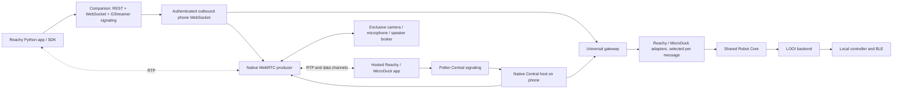

# Robot compatibility bridge

My LOOI has a robot-neutral execution core, Reachy Mini and MicroDuck protocol
adapters, a LOOI backend, native camera/audio ownership, and a WebRTC producer.
A native Central host connects hosted apps directly to the phone through one
universal producer. An optional local companion provides the Python SDK
endpoints, local GStreamer signaling, package installation and execution, and
a browser view of the same app catalog. Reachy Python packages run on that
companion; camera, microphone, speaker and BLE control stay on the phone.
Hosted web apps run at their original Space.

Open **Apps** from the main face or the shared navigation to browse apps,
install a Python app, and start or stop it. Connection settings are grouped
inside Apps. The screen is also accessible from onboarding before the normal
voice assistant is configured; the original `/robot-apps` route redirects there.
The native screen reads the public catalog directly through the shared
`src/robot-bridge/app-catalog.ts` client, so browsing needs no paired companion.
Installed apps and their start/stop controls appear in My apps. iOS web
apps use the in-app browser. The Apps area opens at Discover and switches directly between Discover, My apps
and With AI. The setup gear groups App connection, Camera & audio and Action
mapping. The full-width Apps shell leaves the existing shell of other routes unchanged. Technical server and companion fields sit
under App connection → Advanced settings. Catalog entries show their content
and actions without generic compatibility
badges or limitation notices. The companion retains the same discovery client
for installation validation and its local catalog portal.
This implements protocol compatibility; complete upstream apps still need
individual acceptance on an iPhone and LOOI.

## Apps as AI skills

**Apps → With AI** lets LOOI choose a catalog app for the current request.
The same searchable catalog includes both origins; the user does not select a
robot family. Four fixed voice tools provide search, description, start and
stop. Catalog titles, tags and descriptions remain untrusted plain text, and
never become tool definitions or executable instructions. Realtime and PCM
Realtime use the same dispatcher. Budget voice supports discovery and stop;
starting requires the existing continuous STOP supervision in Realtime.

On first use, a Python app is installed automatically on the configured,
connected companion. `POST /api/apps/ensure-start` reserves one composite job
for resolution, installation and launch. HTTP 202 means admitted, not running.
The native runtime observes installation, launch, running and termination.
Stopping leaves the installed environment and its pinned revision in place.
Later use reuses that revision; a newer catalog SHA is reported separately and
does not silently replace a working installation. Hosted web apps instead
prepare the shared Central producer and open their original Space interface.
Browser handoff alone does not prove an app action or task has completed.

Catalog discovery follows the public Hub pagination links and caches the complete
result for one minute. New public, correctly tagged Spaces become selectable on
the next fresh lookup without an app release. The Refresh action bypasses the
cache. This is pull-based discovery, not a push subscription or proof that every
new app uses an implemented robot operation.

**My apps → Uninstall** removes an idle app's content-addressed installation
folder and persistent registry entry after a native confirmation. Other starts
and installs cannot race removal. The management endpoint accepts only a Space
ID, never a directory. The public catalog entry remains selectable and the next
use can install it again. AI tools do not include deletion.

The runtime lives at the root of the app, independently of the settings page.
Each Python launch receives a private request ID before HTTP admission. A
targeted STOP cancels only that operation; a server-side tombstone prevents a
delayed start request from creating a new job after STOP. Cancellation and
polling keep the original companion URL and credentials even if settings
change. An unconfirmed stop retains that identity for reconciliation or retry.
Local STOP, sleep, background and connection changes revoke pending starts.
They never uninstall an app or replay a cancelled request.

The enabled preference uses the separate SecureStore key
`looi-robot-app-skills-v1`. It is enabled for a fresh configuration; unreadable
preferences fail closed. The menu shows the actual current operation, a stop
control and links to discovery and companion setup. See the
[implementation and validation record](research/robot-app-skills-2026-10-26.md).

## Runtime layout



`src/robot-bridge/types.ts` defines the public contract. `core.ts` owns exclusive
app sessions, per-channel ordering and replacement, deadlines, cancellation and
out-of-band STOP. The backend is injected; tests run without a physical robot.
The same production adapters and core are used by the phone and companion demo.

The native runtime is installed by the root layout but stays disabled until
configured. Without configuration it neither opens a network connection nor
stops existing robot activity. Credentials are kept in SecureStore. Background,
sleep, disconnect and local STOP invalidate the external app session. A fresh
session is required after returning; old commands are never replayed.
Completed app commands count as robot activity; heartbeat/state traffic alone
does not keep an otherwise idle robot awake.

Central registration uses Expo's native streaming fetch transport and creates
one universal producer per Central configuration. Its metadata identifies LOOI
as `kind: "microduck"` and advertises
`supported_protocols: ["reachy", "microduck"]`. This metadata is shaped to
match the original MicroDuck discovery predicate and Reachy's name-based
selection.
The stored legacy `protocols` list is normalized to both entries and does not
select a wire adapter. Each Central app session gets one reliable, ordered
`data` channel; the gateway identifies Reachy envelopes versus MicroDuck
JSON-RPC on every message and routes them to the matching adapter. Central's
`peer.rpc` SSE event also carries MicroDuck JSON-RPC requests and responses,
including Policy Playground control calls, over the same session even before
the data channel opens. This path and the data channel share one core session
and STOP owner. STOP cancels an app launch that is still preparing. A
Central-only configuration keeps the companion URL and pairing token empty.
When both connections are configured, the companion retains Python/local-SDK
duties and does not register a duplicate Central producer or receive the native
HF token.

## Supported contract

| Interface | Implemented | Limits |
| --- | --- | --- |
| Shared core | target pose, bounded drive, named gesture, light, capability/state inspection, sessions and STOP | Unknown measurements remain null; one controlling app at a time |
| Reachy | Python `/ws/sdk` startup and periodic state envelopes; target/goto; original UUID task progress; virtual motor lifecycle; bounded JSON recorded-move upload/playback/cancel; recording | No Reachy joint kinematics, gravity compensation or physical antennas; gzip uploads and named HF dataset resolution are not implemented |
| MicroDuck | JSON-RPC hello, state and supported robot methods; Central `peer.rpc`; named LOOI gestures and offline app sounds | No ONNX policy execution/install, limb control, firmware/configuration services or calibrated velocity |
| LOOI backend | Three head positions, existing head gestures, light, bounded directional movement through the local safety controller | No measured pose/velocity, lateral drive, verified velocity control or odometry |
| Media | One session-scoped media service for both adapters; explicit phone camera/microphone/speaker consent, live camera metadata, remote speaker audio, track gain and seven offline synthesized MicroDuck sounds | No calibrated Reachy camera intrinsics or array-microphone direction of arrival; gain is not the phone's hardware volume |
| WebRTC | Producer offer/answer/ICE, one reliable ordered `data` channel for universal Central sessions, MicroDuck `peer.rpc` over Central SSE, RTP media, local GStreamer signaling and Central rendezvous | TURN may be needed across networks; physical RTP interoperability remains to be verified |
| App catalog | Real public Hugging Face tags, search, source/hosted links, pinned Python package installation and separate start/stop; family is internal discovery metadata, not a user selection | A tag is discovery metadata; app behavior depends on the protocol surface it uses |
| Hosted web apps | One authenticated Pollen Central producer advertised to both app protocols, plus the native media/control peer | Requires an HF account/token and robot visibility to the app's user; live hosted-app acceptance is tracked in the [2026-10-26 app acceptance](research/robot-app-acceptance-2026-10-26.md) |

## Shared app action mappings

**Apps → Action mapping** configures one LOOI action profile for both upstream
protocols. The catalog contains supported expressions, three head positions,
bounded forward/back/turn pulses and light on/off. The page has localized
labels, lets the user add, edit or remove aliases, save or reset the profile,
and preview a saved mapping. Preview uses a temporary robot session and requires
LOOI to be awake and connected; it does not enable an app connection.

An alias maps a source name directly to one canonical LOOI action. For example,
`dance → happy_bob` and `walk → move_forward` let the unchanged MicroDuck
`robot.do` and Reachy `task.req.move_name` inputs invoke the same LOOI action.
Resolution happens in the shared core before command validation and lane
admission, so mapped movement uses the drive lane, sequence checks and STOP
handling. Generated movement is a fixed 300 ms pulse. Raw SI drive requests
keep their existing strict validation; setting an alias does not loosen those
requests. Mapped actions report the resolved command and `adapted` result.
Resolved named gestures receive a 3 s execution lease so an ordinary longer
LOOI controller gesture can finish. Reachy named-action tasks use the same
3 s task lease; streamed frame commands retain their separate 750 ms lease.
Replacing a running named action across command lanes revokes its prior lease.
The timing regression test confirms that replacing a running wheel action with
a head action invokes STOP before the head action starts.

The profile is validated and stored separately from connection credentials in
SecureStore under `looi-robot-app-actions-v1`, so editing it needs no network or
app connection. Source names preserve exact case, internal spaces and
punctuation. The mapping page trims pasted outer whitespace; the persisted
profile accepts a trimmed printable source of 1–200 Unicode code points and
rejects C0/C1 controls. The input supports up to 400 UTF-16 code units to allow
200 supplementary-plane characters; shared validation caps it at 200 code
points. At most 64 mappings are accepted. Duplicate sources,
canonical-source overrides, malformed data or unknown targets are rejected.
Sources are literal lookup keys, never code, URLs or file paths. The gateway
advertises built-in actions and configured aliases only when the backend
capabilities can execute them. This shared catalog adapts these named-action
entry points; it does not imply that every upstream app operation has a LOOI
equivalent.

On load, corrupt JSON or an unsupported saved schema falls back to the empty
canonical profile; the reason is recorded only in diagnostics. SecureStore I/O
errors propagate instead of silently clearing the profile. Preview checks for
pending or accepted Companion/Central app sessions both before and after
activation awaits, so a session starting during preview cannot acquire control
concurrently.

Reachy reports the pinned `1.13.0+looi` **wire-compatibility** version and
`version_origin: "reachy_wire_compatibility"`; `adapter_version: "0.1.0"`
identifies LOOI's own implementation separately. This does not claim that the
Reachy daemon is installed on LOOI. The upstream `start_update` request returns
the expected command/error refusal shape and directs updates to My LOOI's app
update system; the bridge does not fake an upstream daemon update.

The protocols are pinned to Reachy Mini commit
`9fb2bfcbdf4c9800b0649acb8f0c18027673943f` and MicroDuck commit
`942e58e3aa6dbb28e7037203fff11866122c7567` (IPC 44).
The MicroDuck `hello` compatibility response identifies LOOI as its backend;
the API number describes the dialect, not full MicroDuck hardware support.

Virtual Reachy poses and MicroDuck schema placeholders are labelled as virtual.
They allow clients to parse the original wire shape, but are not physical sensor
readings. Core `observed.measuredPose` and `observed.measuredVelocity` stay null.
New Reachy app sessions start with the virtual motor gate enabled, matching the
stock SDK's `wake_up()` trajectory flow. Explicit motor disable still blocks
later poses until re-enabled; this gate never represents physical torque control.
MicroDuck state does not report a fabricated `walk`/`stand` policy or imply that
an ONNX motion policy or leg controller is running on LOOI.

## App media services and ownership

`src/robot-bridge/app-media-services.ts` defines the session-scoped
`RobotAppMediaServices` seam. `src/robot-bridge/runtime.ts` creates it when a
native Central session opens its gateway and injects it into both adapters.
`createRobotGateway` may also omit this service; Node-side protocol fixtures
can inject test services without importing phone-native modules. The service
facade only calls the media broker for its own session owner and saved device
consent. The native broker is the sole owner that acquires camera, microphone
and communication audio tracks.

Camera metadata is read from the active WebRTC video track settings when they
are available, and reports unavailable metadata otherwise; it is not a Reachy
camera calibration profile. Reachy volume routes and MicroDuck `media.video`
and audio-gain RPCs use the same session service. Gain values control the
WebRTC track, not system volume. The MicroDuck `robot.sound` surface accepts
only the seven built-in tags `chirp`, `greet`, `inquire`, `alarm`, `peck`,
`coo` and `wheee`; these are short offline synthesized clips, not arbitrary
remote files.

The ownership invariants are one active core session, explicit consent for
each requested phone device, and STOP invalidation across motion, WebRTC and
app sound. Core generation changes cancel pending sound work; the media broker
aborts pending capture and disposes late tracks before allowing another owner.
The session facade also closes a late native player factory result before any
replacement sound starts. Normal LOOI voice/camera owners are restored only
after the external media owner releases the broker.

## Approximation policy

Strict sessions reject requests that require unavailable precision or axes.
With `allowApproximation: true`, head pitch maps to up/center/down; unsupported
pose axes can be held in the virtual model without actuating hardware. Drive
signs map to fixed directional commands for a bounded duration. Requested SI
magnitudes are not treated as achieved speed. A combined forward/yaw request
can be serialized into two short moves and is reported as adapted, never as
simultaneous native drive. Lateral drive is refused.
Physical head writes are spaced by at least 120 ms after the preceding write
settles. Repeated targets for the same quantized position are coalesced within
240 ms; later targets refresh it without claiming a measured position.

Results distinguish `applied`, `adapted`, `unsupported`, `cancelled` and
`rejected`, with limitations. An applied controller command is still not a
measured robot pose. A 500 ms MicroDuck input lease is not renewed by the relay.
The phone publishes monotonic clock samples; the relay stamps each packet's
expiry in that same clock. Transport delay consumes the lease without requiring
wall-clock synchronization. Expired packets are rejected before adapter dispatch.
An admitted Reachy trajectory has a bounded playback lifetime and short leases
for each generated frame; its original packet lifetime is an admission check.

STOP invalidates leases synchronously, then performs native cleanup outside the
execution queues. Drive guards are checked around connection/sensor waits,
before and after initial BLE writes and at most every 25 ms during bounded
movement. An older cancellation must not stop a successor's motion generation.
An in-flight BLE packet cannot be recalled; cancellation reasserts STOP after
it settles when it still owns the controller.

## Try the companion without hardware

From the repository root, with the frozen workspace dependencies installed:

```bash
corepack pnpm run robot:bridge --demo --approximate
```

This exposes a simulation on loopback port 8000:

- `ws://127.0.0.1:8000/ws/sdk`: Reachy command/state/task envelopes.
- `ws://127.0.0.1:8000/microduck`: MicroDuck JSON-RPC.
- `http://127.0.0.1:8000/api/daemon/status`: compatibility daemon status.
- `http://127.0.0.1:8000/api/robot-bridge/state`: capabilities, virtual targets
  and actual available measurements.
- `http://127.0.0.1:8000/health`: companion availability.

For example, a MicroDuck client can send:

```json
{"jsonrpc":"2.0","id":1,"method":"robot.move","params":{"vx":0.1,"vy":0,"vyaw":0}}
```

Existing Reachy scripts can point their SDK at localhost, with
`connection_mode="localhost_only"`. Use `media_backend="no_media"` for this
hardware-free command demo. The adapter
accepts the SDK's original `TaskRequest` for `goto_target`, including UUID and
terminal progress. This path is tested at the original wire-envelope level;
installation and execution of complete upstream app packages is not certified.

## Connect a development phone

For hosted web apps, open **Apps → App connection → Hugging Face Central**, enable
Central, enter your HF token and robot name, and save. All hosted apps use the
same universal producer. Leave the companion address and pairing-token fields
empty. Camera, microphone and speaker are enabled explicitly in
**Apps → Camera & audio**. Use **Apps → Discover apps → Open app** to enter the Space's normal
HF login and robot picker inside the iOS app.

For Python apps running on a computer, connect the optional companion:

Start the companion without `--demo`. For a phone on a trusted development LAN:

```bash
ROBOT_BRIDGE_HOST=0.0.0.0 corepack pnpm run robot:bridge --approximate
```

`ROBOT_BRIDGE_HOST`, `ROBOT_BRIDGE_PORT` and `ROBOT_BRIDGE_TOKEN` configure the listener. The token
must be 32–128 hexadecimal characters; otherwise the gateway creates a random
token and prints it once to its local terminal. Keep that token private. The
phone initiates `/device`; it does not open an inbound listener. Local SDK and
GStreamer endpoints accept loopback clients. Management endpoints also accept
the paired phone's bearer token, so it can browse and control companion apps.

1. In **Apps → App connection → Advanced settings**, enter
   `ws://<companion-LAN-address>:8000/device` and the
   pairing token printed by the companion.
2. Enable motion approximation if the app needs Reachy poses or MicroDuck
   velocity commands mapped onto LOOI's available movements.
3. Explicitly enable camera, microphone and/or speaker. All three default off.
   Choose front or rear camera. OS permission prompts appear when an app first
   acquires the relevant device, not while merely browsing the catalog.
4. Save/connect. The page shows transport, device permissions, current media
   owner and audio route. **STOP** disconnects the external session and stops
   its media/motion; **Reconnect** starts a fresh connection.

For connections outside a trusted development LAN, terminate TLS and use
`wss://`. Pairing credentials travel in the WebSocket subprotocol, not query
strings. Management requests use an authorization header. Native configuration
and tokens are stored in SecureStore. No vendor token is bundled with the app.

In a native development build, call the exported configuration API:

```ts
import { configureRobotBridge } from './src/robot-bridge/runtime';

await configureRobotBridge({
  url: 'wss://your-companion-host/device',
  token: pairingToken,
  allowApproximation: true,
  media: { camera: true, microphone: true, speaker: true, cameraFacing: 'environment' },
});

// Disable and remove the stored credential:
await configureRobotBridge(null);
```

Each app socket gets a distinct session. The relay does not buffer commands across device
disconnects. Heartbeat loss closes the connection after three seconds, while
individual movement leases expire earlier. To avoid two motion owners, the
runtime uses the existing driving-control hold to suppress ambient, behavior and
social-attention motion while an external app owns the session.

## Camera, audio and unchanged local Python apps

The CLI binds the original local GStreamer signaling service on
`ws://127.0.0.1:8443`; `ROBOT_BRIDGE_SIGNALING_PORT` overrides it and
`--no-signaling` disables it. Stock Reachy WebRTC discovery looks for a producer
named `reachymini`. The companion preserves that protocol name while identifying
LOOI in its display metadata. Its command WebSocket and media connection share
one local app session, rather than competing for robot ownership.

With a paired foreground phone, media opt-in and this signaling port available,
existing Reachy scripts can use `media_backend="webrtc"`. The included app
runner selects that backend only when the app leaves its backend unspecified;
an app's explicit hardware/backend choice is preserved. Camera frames and
duplex audio travel over WebRTC. Local media acquire/release and SDK speaker/
microphone volume routes are relayed to the phone. Volume values control WebRTC
track gain from 0–100 and expose that origin; they do not change system volume.

Before capture starts, the broker synchronously closes LOOI's own voice entry
gate and drains its voice, wakeword, TTS and social-camera owners. BLE control
stays available to the external app. There is one media owner, including while
native capture is still pending. A late `getUserMedia` result after cancellation
is stopped before ownership is returned. Disconnect, background, sleep or STOP
closes the peer and releases tracks. Normal LOOI media resumes only when the
app is foreground and awake. A stale callback cannot resume capture.

Python apps need a companion Python version compatible with their package,
`venv`, `pip` and `git`. Apps using the Reachy WebRTC media backend additionally
need the upstream Python/GStreamer bindings and codecs available in their
environment; the Node gateway does not install these operating-system libraries.
Use the [upstream media installation instructions](https://github.com/pollen-robotics/reachy_mini/tree/9fb2bfcbdf4c9800b0649acb8f0c18027673943f/docs)
for the companion platform. Applications can have their own model, API-key,
audio-device or native-library requirements. A per-app venv is dependency
isolation, not an operating-system sandbox.

## App catalog and Pollen Central

The same catalog is available on the companion at
`http://127.0.0.1:8000/apps`. It queries the public HF tags
`reachy_mini_python_app`, `reachy_mini_js_app` and `microduck`, with bounded
requests and cached fallback. It never silently
installs an app. Python installation pins the returned repository commit,
creates an app venv under `~/.looi/robot-bridge/apps/`, and validates the original
`reachy_mini_apps` package entry point. Installation runs third-party package
code; starting the installed app is a separate action. One app process runs at
a time. Its state and bounded logs are available through `/api/apps/status` and
`/api/apps/jobs/<job-id>`. Stop terminates the app process group.

Hosted apps open the canonical `*.hf.space` app URL returned by HF metadata.
Missing or invalid host metadata falls back to the Hub page, whose nested
OAuth/WebRTC behavior has not been verified. The official Reachy host shell
handles the user's OAuth and robot picker. This is distinct from mobile
embedding with `connectToHost()` and short-lived user credentials: LOOI does
not inject its Central producer token into a third-party page. A Space that
hard-codes a different signaling service still needs its supported deployment
configuration; a URL alone does not reroute it to LOOI.

To offer LOOI to hosted apps, open **Apps → App connection**, enable Central,
enter the trusted Central HTTPS URL, HF token and robot display name, then
save/reconnect. The same producer serves both wire protocols; there is no
app-family selection or filter. The default service is
`https://pollen-robotics-reachy-mini-central.hf.space`. Native registration uses
Expo's streaming fetch for authenticated `/events` SSE and `/send` requests
with leases/heartbeats, universal producer metadata and session/SDP/ICE
exchange. Its token remains in native SecureStore and is sent to the configured
Central HTTPS endpoint. The `kind: "microduck"` field and Reachy-facing `LOOI`
name match both original discovery paths; the live acceptance report notes
that the new metadata has not yet been retested through the current phone build.

The Node companion also retains its standalone `HF_TOKEN` registration mode
for deployments using that relay. Explicit native Central configuration turns
off the paired relay's producer so the same phone is represented by only one
producer. Legacy programmatic configurations without a `central` field leave
the companion's own environment configuration intact.

By default ICE uses the upstream public Google STUN server. Deployments needing
TURN can provide `ROBOT_BRIDGE_ICE_SERVERS` as a JSON array of validated
`urls`, `username` and `credential` objects on the companion for its local SDK
sessions. The native host also accepts injected `iceServers` when embedded by
another runtime. TURN credentials
are forwarded only over the paired device connection; they are not returned by
the catalog/status routes. The local Central fixture verifies universal peer
registration, both discovery metadata predicates, ordered data-channel behavior
and Policy Playground RPC; authenticated cloud acceptance is tracked in
the [upstream app acceptance](research/robot-app-acceptance-2026-10-26.md).

## Verification and acceptance

```bash
corepack pnpm run robot:bridge:unit
corepack pnpm run robot:bridge:test
corepack pnpm exec tsc --noEmit
```

Tests cover invalid matrices/values, mutation after admission, coalescing,
sequence/deadline rejection, failed STOP, pending-connect and sensor-wait
cancellation, delayed first BLE writes, active-drive replacement, successor
protection, virtual telemetry, task progress, playback cancellation, strict JSON-RPC,
device lifetime and a real local WebSocket round trip through the companion.
Media tests cover ownership conflicts, permission denial, late capture cleanup,
speaker routing and software gain. WebRTC tests cover stock signaling,
offer/answer/ICE, data labels, consent, teardown and stale sessions. Lifecycle
tests cover transfer away from normal LOOI media without suspending BLE, plus
navigation races and foreground-only restoration. Catalog/runner tests use
fake package processes; they never execute downloaded third-party apps.
The native Central fixture exercises one universal producer, SDP/ICE, the
single ordered app data channel, MicroDuck Policy Playground RPC, and original
Reachy and MicroDuck messages through the real host, WebRTC peer, gateway and
robot core with a simulated backend. It checks STOP on session end and rejects
stale data-channel replay. STOP also revokes an accepted Central session while
its native peer is still being created, before it acquires a core gateway.
Additional tests cover Central-only configuration, companion credential
isolation, foreground generations, and SSE timeout cleanup
before reconnecting. Authentication failures produce a controlled recovery
message without including the bearer token.

Physical iPhone/LOOI operation is still subject to the acceptance described in
[the iOS guide](ios.md). The 2026-10-26 app acceptance confirms the signed iPhone
build and public catalog, a Reachy SDK and Clock app run against the demo
companion, and MicroDuck's working RPC subset. The full Clock Store install and
two subsequent start/command/stop runs also passed. Authenticated Telepresence
discovered LOOI and negotiated a real WebRTC session with a displayed 10 ms
link; its host then blocked on the adapter's daemon version/update contract.
That was the installed build's result at the time; the source now advertises a
Reachy-compatible wire version separately from its LOOI adapter version, as
described above. The recorded MicroDuck OAuth attempt predates the universal producer and saw a
producer without MicroDuck metadata. That old live result does not test the
current universal registration or app-selection flow. These historical results
and the MicroDuck methods exercised in that test are summarized
in [the app acceptance report](research/robot-app-acceptance-2026-10-26.md).

After the companion audio seam fix in `device-connection.ts`, the final
`pnpm run robot:bridge:test` passed outside the sandbox because its loopback
test server needs a local listener. `pnpm exec tsc --noEmit --pretty false` and
`git diff --check` passed as well. A second native Release build succeeded;
`codesign --verify --deep --strict` passed outside the sandbox (the sandbox
could not validate the signing chain), and `devicectl` installed the build on
the paired iPhone as a data-preserving update.

The subsequent live attempt reported no producer in MicroDuck Console and no
robot online in Reachy Telepresence. My LOOI crash reports at 14:48:45 and
14:54:50 local time show `EXC_CRASH`/`SIGABRT` with
`NSInvalidArgumentException: -[NSNull stdString]` in
`WebRTCModule(RTCPeerConnection) peerConnectionAddICECandidate:resolver:rejecter`.
The browser sent an ICE candidate with `sdpMid: null`; the native candidate
converter crashed while handling it. This explains why My LOOI did not remain
active during that attempt; the earlier foreground-only assessment was
incomplete. It does not establish a failure in universal discovery or
registration. The ICE fix omits null `sdpMid` and `sdpMLineIndex` fields and
rejects nonempty candidates when both locators are absent, before native
conversion. `node scripts/robot-bridge-webrtc.test.mjs` reproduced the failure
before the fix and passed after it; the test also confirms that invalid
candidates never reach the native converter. The full
`pnpm run robot:bridge:test` passed outside the sandbox, as did
`pnpm exec tsc --noEmit --pretty false`. A new native Release build succeeded,
passed `codesign --verify --deep --strict`, and was installed on the paired
iPhone with `devicectl`.

Live re-verification of the original apps is still pending. They have not yet
been tested in a stable foreground My LOOI session, and the browser tool is
unavailable in Work settings. The family-selector removal, original-app
discovery, and camera, microphone, speaker, and RTP use have not been verified
with this final build. The unsuccessful MicroDuck browser session was
disconnected with user approval.
The catalog returned 197 live entries without warnings. iPhone verification
used the Mock backend; no physical LOOI motors were available. Native camera
and audio ownership logic and WebRTC negotiation have local tests, but camera/
microphone/speaker routing and RTP exchange with the original hosted apps still
need a real media session. The complete Reachy dependency install was repeated
successfully once enough free space was available; see the
[full Store acceptance](research/reachy-store-full-install-acceptance-2026-10-26.md).

Reachy antennas, six-axis head kinematics, measured state, calibrated camera
geometry and MicroDuck leg/ONNX policy execution have no automatic LOOI
equivalent. These remain unsupported or explicitly approximated. An app that
needs them cannot run unchanged merely because its control or media protocol
connects. See the pinned [Reachy research](research/reachy-mini-kompatibilitaet.md)
and [MicroDuck research](research/microduck-gemeinsame-roboterschicht.md).

The action profile has separate focused tests in
`scripts/robot-bridge-action-profile.test.mjs` and
`scripts/robot-bridge-action-runtime.test.mjs`. The runtime test exercises both
original app request envelopes through the production gateway, core and LOOI
backend with a mocked controller seam; it does not claim a physical motor or
hosted-app test. It includes an 850 ms controller gesture through both
protocols, mapped drive-to-head replacement and STOP fencing, plus preview
guards and profile recovery. The action-mapping UI was exercised in an iPhone
simulator; its screenshots and exact scope are recorded in
the dated [action mapping report](research/robot-app-actions-2026-10-26.md).
Release 2.1.151 (build 41) was installed on the private iPhone, but DeviceHub
showed the lock screen afterward and the app was not opened for on-device UI
acceptance. See that report for the simulator reset evidence and verified scope.
